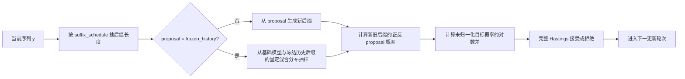

# 推理扩展算法：基础、原理与实现

本文档集中说明仓库中全部推理算法及其执行实现。第 2.1 节给出统一入口 `python -m inference_scaling` 的执行规则，
以及 MH 与 IS 的完整数据流；后续各节分别展开目标分布、有限预算算法、关键代码、统计性质和成本来源。批处理、
KV 复用、vLLM 和计算量统计统一列在第 11 节。[设置说明](../SETTINGS.md)逐项说明 `settings/inference.json` 的字段。
[算法质量报告](../reports/GSM8K_3090_ALIGNED_RESULTS.md)与
[执行成本报告](../reports/RTX3090_ROLLOUT_INFRA.md)分别汇总准确率与执行开销。

## 1. 统一记号与实现边界

给定 token 化提示 $`x`$，记基础模型的完整生成分布为

```math
p(y\mid x)=\prod_{t=1}^{|y|}p(y_t\mid x,y_{\lt t}).
```

在已经生成前缀 $`g`$ 时，下一段候选记为 $`z`$，候选后的补全记为 $`u`$。奖励写作
$`r(g,z,u)`$，奖励温度写作 $`\tau\gt 0`$。仓库中最常用的显式奖励目标是

```math
\pi_r(y\mid x)
=\frac{p(y\mid x)\exp\{r(y)/\tau\}}
       {\sum_{y'}p(y'\mid x)\exp\{r(y')/\tau\}}.

```

<p align="right">式 (1)</p>

另一类目标是幂分布

```math
\pi_\alpha(y\mid x)
=\frac{p(y\mid x)^\alpha}{\sum_{y'}p(y'\mid x)^\alpha},
\qquad \alpha\gt 0.

```

<p align="right">式 (2)</p>

本文使用三类性质：

- **目标分布保持不变**：若当前状态服从指定目标，执行一次 MH 更新或一次保留完整序列的条件 IS 步后仍服从该目标；
  有限更新轮次仍有链的收敛误差。
- **估计量无偏**：未截断的普通 IS 对条件奖励权重给出无偏估计；有限候选数下的归一化重采样仍是近似。
- **执行等价**：批处理与连续批处理只改变物理执行顺序，随机请求与统计量保持固定。

下文中，MH 指 Metropolis--Hastings，IS 指重要性采样（Importance Sampling），SIR 指
采样—重要性加权—重采样（Sampling-Importance-Resampling），SMC 指序贯蒙特卡洛
（Sequential Monte Carlo），GRPO 指组相对策略优化（Group Relative Policy Optimization），ESS 指
有效样本量（effective sample size）。边缘分布指只保留一部分随机变量、对其余随机变量的概率求和后得到的
分布；细致平衡指任意两个状态之间按目标概率加权后的正向与反向转移概率相等，因此一次更新保持目标分布不变。

为与代码和设置字段对应，文档保留少量英文标识。rollout 指从当前候选继续生成到终止位置的补全；proposal
指产生候选的提议分布；`history` 指冻结历史 proposal 在链开始前生成并冻结的样本。转移核指“给定当前状态时，
下一状态的条件分布”。代码字段名继续写在反引号内，说明文字使用上述中文含义。设置键写作点分路径，
例如 `ar.algorithms.is.block_size` 表示 `settings/inference.json` 中 `ar` → `algorithms` → `is` → `block_size` 字段。

重要性修正要求 $`p(y)\gt 0\Rightarrow q(y)\gt 0`$。把部分概率直接截为零的 top-k/top-p 可能破坏该条件，统一入口
因此要求 `mh`、`mh_power` 与 `is` 使用 `ar.sampling.top_p = 1` 和 `ar.sampling.top_k = null`；权重截断以偏差换取
有限权重范围。

### 1.1 模型无关算法层与生成适配层

AR-LLM 与 dLLM 的生成状态不同：前者追加 token 后缀，后者更新掩码块或完整反向轨迹。算法层仅依赖
候选、目标值和 proposal 概率，不直接调用具体模型。实现边界如下。

| 共享对象 | 算法层操作 | AR-LLM 适配 | dLLM 适配 |
| --- | --- | --- | --- |
| `normalize_log_weights`、`categorical_index_from_uniform` | 归一化候选权重并按显式均匀数重采样 | 保留完整序列的条件 IS | 逐块 IS |
| `decide_metropolis_hastings` | 根据未归一化目标概率与正反 proposal 概率执行接受或拒绝 | 随机后缀 proposal | 分块轨迹或整段 proposal |

对任意逐步生成模型，MH 适配层为当前状态 $`y`$ 和 proposal $`y'`$ 提供四个标量：
$`\log\widetilde\pi(y)`$、$`\log\widetilde\pi(y')`$、$`\log q(y'\mid y)`$ 与
$`\log q(y\mid y')`$。共享核计算

```math
\log A=\min\left\{0,
\log\widetilde\pi(y')-\log\widetilde\pi(y)
+\log q(y\mid y')-\log q(y'\mid y)
\right\},
```

再以 $`\log U\leq\log A`$ 接受 proposal，其中 $`U`$ 为 $`[0,1)`$ 上的均匀随机数。后缀切点、扩散
生成块和批处理属于 proposal 的执行方式，不改变该接受核。

<a id="token-penalty"></a>
### 1.2 词表惩罚

`ar.model.token_penalty` 在任何策略读取 logit 之前把固定 token 集 $`S`$ 的 logit 减去 $`\lambda`$（`strength`）：

```math
\tilde p(v\mid c)=\frac{p(v\mid c)\,e^{-\lambda\mathbf 1[v\in S]}}{1-(1-e^{-\lambda})\,p(S\mid c)}.
```

$`\tilde p`$ 取代 $`p`$ 成为模型：温度作用于惩罚后的 logit，采样、参考概率、评分与读取模型概率的奖励都来自它，
式 (1)、式 (2) 与上述性质对 $`\tilde p`$ 原样成立；它仍是全支撑分布，重要性修正条件不受影响。整条序列上，
$`\tilde p(y)`$ 等于 $`p(y)e^{-\lambda N_S(y)}`$ 再除以各步分母之积，$`N_S`$ 为 $`S`$ 中 token 的出现次数。
Qwen3.8-27B 默认对 wait、hmm、alternatively、actually、however、but、maybe、perhaps 启用惩罚，取 $`\lambda=1`$；
设为 `null` 可关闭。惩罚覆盖 thinking 与正文输出，该模型上的质量与速度收益尚未验证。TIP（arXiv:2501.18585）用同类 logit 惩罚抑制思路切换；arXiv:2606.00206 在量化模型上对 50 个同类
标记在 $`\lambda\in[0.5,4]`$ 上扫描，思维链缩短 12%–23%，准确率持平或提高。该文只取前有空格的形式；这里另取行首的
首字母大写形式（段首的 “Wait”），不取无空格的小写形式，因为它多是其他词的片段。vLLM 用 `logit_bias` 施加惩罚，
它在温度之前生效；原生评分与 `fused_logprobs` 读未惩罚的 logit，所以评分转交精确后端，同步引擎的 beam search
报错。$`\lambda`$ 应在 `selection.skip` 跳过的留出题上选择，并在相同 FLOP 下与幂指数 $`\alpha`$ 比较。

<a id="alg-overview"></a>
## 2. 方法总览

统一入口用 `--algorithm` 选择七种算法，用 `--model` 选择模型族。两族共用目标分布与公共核，生成适配不同。

| 算法 | 采样或估计对象 | 有限预算下的性质 | AR-LLM 实现 | dLLM 实现 |
| --- | --- | --- | --- | --- |
| `sample` | 基础模型分布 $`p`$ | 基线分布 | 按 `ar.sampling` 抽样一次 | 按 `dllm.sampling` 分块解码一次 |
| `greedy` | 逐位置最大概率项 | 确定性基线 | 原生贪心解码 | 温度 0 的分块解码 |
| `beam` | 累计对数概率最高的前缀 | 确定性搜索 | token 级 beam search | 按轨迹概率保留的分块 beam |
| `best_of_n` | 式 (3) | 随 $`N`$ 增大趋向奖励最大化 | 独立样本后按奖励选择（verifier 投票时即多数投票） | 同左 |
| `mh` | 式 (1) | 目标分布保持不变；每次 proposal 需要一次奖励 | 后缀 MH（第 5 节），可选冻结历史 proposal（第 8 节） | 整段独立 proposal MH，可选冻结历史轨迹混合 |
| `mh_power` | 式 (2) | 目标分布保持不变；有限更新存在收敛误差 | 后缀 MH（第 4 节） | 反向轨迹幂 MH |
| `is` | 式 (1) | AR：首步为整序列 SIR，此后每步保持目标不变；dLLM：保留序列时同 AR，否则候选取完整画布时 $`K,M\to\infty`$ 趋近目标 | 固定配置、保留完整序列的条件 IS（第 6 节） | 逐块 IS（第 7 节），可选完整画布候选与保留序列 |
| GRPO / VRPO | 参数化策略的训练近似 | 受模型族、优化轮次与采样预算影响 | `python -m training` 的 `grpo` 阶段 | `vrpo_preferences` 与 `vrpo` 阶段 |

`--reward` 只作用于 `best_of_n`、`mh` 和 `is`，可选 `verifier`、`self_certainty`、`consilience`（第 9 节），
dLLM 只支持 `verifier`（也是它的默认奖励）。默认运行 `--algorithm is --model ar --reward consilience --dataset gsm8k`；
AR 的 `is` 默认固定使用 M=4、K=1、B=1024（`ar.algorithms.is`）。第 6.1 节的可枚举候选
logit adjustment 只作理论参考，未接入统一入口。源码路径均位于 [`src/inference_scaling`](../../src/inference_scaling/)。

<a id="alg-execution"></a>
### 2.1 统一入口的执行规则

```bash
python -m inference_scaling --algorithm is --model ar --reward consilience --dataset gsm8k --output results
```

命令行只选择算法、模型族、奖励和数据集；其余参数全部位于 `settings/inference.json`，缺失、未知或类型不符的
字段在加载模型前报错。每个（题目，重复）按以下顺序执行：

1. **提示与长度**：数据集按 `datasets.<name>.selection` 固定抽题，并用 `prompt_template` 生成提示；AR 再套用
   chat template（`ar.prompt`）。生成上限取 `ar.max_new_tokens` 与模型剩余上下文（含统一的
   `ar.engine.context_window`）的较小值；dLLM 使用 `dllm.max_new_tokens`，取不超过它的
   `dllm.sampling.block_length` 最大整数倍。
2. **采样范围**（AR）：`ar.output.sampling_scope = "thinking"` 时，`mh`、`mh_power` 与 `is` 只对思考段采样，
   最终内容随后由基础模型生成。`verifier` 与全序列 Consilience 需要完整输出，`mh` 与 `is` 因而回退到
   `full` 并记录原因 `reward_uses_full_sequence`。
3. **奖励阶段**：按 `--reward` 构造逐序列奖励。verifier 投票用于 `is` 或 `mh` 时，先从基础模型独立生成
   `rewards.verifier.pool_size` 条样本并冻结为投票池；池的随机种子与算法无关，同一重复下各算法共用同一池。
4. **搜索阶段**：运行所选算法，得到一条完整输出。
5. **收尾与评测**：思考范围下补生成最终内容。数据集评分器只评测答案文本（完整思考段之后的内容；
   `ar.output.thinking_mode = "enabled"` 时，未结束的思考没有最终答案），给出 `answer`、`parseable` 与 `correct`。
6. **记录**：结果目录为 `<output>/<dataset>/<model>/<algorithm>[-<reward>]/<指纹前 16 位>`，包含 `manifest.json`、
   每个（题目，重复）一行的 `records.jsonl` 与 `summary.json`（准确率、Wilson 区间、`run.draws` 大于 1 时的 pass@k、
   计算量与失败统计）。指纹覆盖命令行选择、所读设置、模型与数据身份和源码哈希；同一指纹再次运行只补齐缺失记录。
   `run.draws` 不进入指纹，因此可以在原目录追加重复次数。

随机数由 `run.seed` 按重复序号、算法和题目逐层派生。`ar.engine.continuous_batching.workers` 大于 1 时，多个题目
并发并共享[连续批处理](#infra-prefix-kv)后端。逐题成本要求所有生成与评分调用均有请求级计数；
任一调用无法归属时，该题成本为 `null`，汇总改用运行级计数器。

<a id="alg-qwen-default-mh"></a>
#### 2.1.1 后缀 MH

同一条链支持幂目标式 (2)（`mh_power`）和奖励目标式 (1)（`mh`），目标统一为
$`\log\widetilde\pi(y)=\alpha\log p(y\mid x)+r(y)/\tau`$：幂目标没有奖励项，奖励目标取 $`\alpha=1`$。后缀长度分布由 `suffix_schedule` 指定；`mh` 可用
`proposal = "frozen_history"` 改用冻结历史混合 proposal。



固定当前阶段的长度上限 $`T`$ 后，一次更新执行：

1. 从与当前序列无关、对 $`1,\ldots,T`$ 全支持的 $`\rho(\ell)`$ 抽取后缀长度 $`\ell`$，令切点
   $`c=T-\ell`$；输出已在切点之前停止时，重生成的后缀为空，这次更新不改变状态，直接跳过，不生成也不调用奖励；
2. `mh_power` 从温度 proposal 抽取新后缀；`mh` 从基础模型抽取，选择冻结历史 proposal 时改从基础模型与冻结
   历史后缀组成的固定混合分布抽取（第 8 节）；新后缀在停止处或总长度达到 $`T`$ 时结束；
3. 对旧后缀和新后缀计算同一个 proposal 的概率。历史分量命中时仍需计算完整混合分布概率；单独使用
   历史记录的频率不满足 MH 接受率的要求；
4. 计算幂目标或奖励目标的未归一化对数概率差，调用共享 MH 核；
5. 用请求局部的均匀随机数接受或拒绝，随后进入下一次更新；
6. 幂目标在当前阶段完成 `steps_per_block` 次更新后扩展到下一阶段：未停止的输出续写到新的上限，已停止的输出
   保持不变，直到上限 $`L`$。奖励只对完整输出有定义，奖励目标因此只有上限 $`L`$ 一个阶段，更新次数与分阶段时
   相同（阶段数乘 `steps_per_block`）。设置 `iterations` 时两者都先生成一条完整输出，再在上限 $`L`$ 上执行给定次数的更新。

单链单次更新的逻辑工作量如下。

| proposal 路径 | 新后缀生成 | 概率计算 | 奖励调用 |
| --- | --- | --- | --- |
| 基础模型或温度 proposal | 1 条至多 $`\ell`$ 个 token 的后缀 | 生成时保存新后缀概率；旧状态概率缓存 | 奖励目标对新完整序列调用一次；幂目标无需奖励 |
| 冻结历史命中 | 0 条新后缀生成 | 读历史序列生成时保存的基础概率，计算新旧完整混合概率 | 奖励目标对新完整序列调用一次 |

`multiscale` 只改变各个后缀长度的固定混合比例；冻结历史只改变给定前缀下的 proposal。每个分量都在
Hastings 比中使用完整正反概率，因此两项可以组合。直观上，短后缀降低生成成本，完整后缀的正概率提供
全局移动；增加更新轮次会继续减小有限链误差，但实际速度取决于 proposal 与目标的重叠程度。

两种目标与冻结历史 proposal 共用 [`run_mh_chain`](../../src/inference_scaling/arllm/algorithms/mh.py)，基础分布 $`p`$ 与
proposal 作为参数传入；统一入口的调用位于 [`app/ar.py`](../../src/inference_scaling/app/ar.py)。

<a id="alg-qwen-default-is"></a>
#### 2.1.2 条件 IS

`is` 从基础模型生成候选和补全，并保留一条完整序列（第 6 节）。每步使用 `ar.algorithms.is` 中固定的
候选数 $`M`$、补全数 $`K`$ 与块长 $`B`$，块长在输出上限处截短。


假设本步的 $`M`$ 个候选均未终止，一步的逻辑工作量为：

| 步骤 | 完整输出（候选及其第一条补全） | 另行生成的补全 | 奖励评分 |
| --- | ---: | ---: | ---: |
| 第一步 | $`M`$ | $`M(K-1)`$ | $`MK`$ |
| 后续每步 | $`M-1`$ | $`M(K-1)`$ | $`MK-1`$ |

补全在生成时已返回基础模型概率，不需要重评分。`verifier` 只读取答案文本；`self_certainty` 与 `consilience`
读取的逐 token 统计量由生成一并算出（未开启融合概率的 vLLM 上的 `self_certainty` 除外，见[第 9 节](#alg-token-statistics)），也不需要评分前向。候选与补全按异构请求展平为批次；连续批处理把逻辑请求合并为较少的批量模型调用，
主要降低墙钟时间，请求随机种子与候选选择随机数保持不变，填充可能使实际参与前向计算的 token 位置数略有增加。

主要入口为
[`ConditionalISAdapter.step`](../../src/inference_scaling/arllm/algorithms/conditional_is.py)和
[`run_conditional_is`](../../src/inference_scaling/arllm/algorithms/conditional_is.py)。批量与流式执行共用
[`evaluate_candidates`](../../src/inference_scaling/arllm/algorithms/candidates.py) 构造固定候选树；CLI 与服务共用采样循环。
完整 token 仅用于当前状态和本轮候选，结束的步骤保存长度、权重、奖励、选择索引与计数。
候选生成及补全请求的前向 token 位置全部累计，任一请求未计量时总量标记为未知。

### 2.2 核心符号、设置字段与成本影响

具体数值由 `settings/inference.json` 给出；下表说明参数的算法含义与计算成本，`<name>` 指数据集或奖励名。

| 符号 | 设置键 | 作用 | 增大后的主要影响 |
| --- | --- | --- | --- |
| $`L`$ | `ar.max_new_tokens` / `dllm.max_new_tokens` | 各模型族的最大生成长度，AR 受模型上下文限制 | 增加生成、评分和 KV 成本 |
| $`B`$ | `ar.algorithms.mh_power.block_size`、`ar.algorithms.mh.block_size`、`ar.algorithms.is.block_size`；dLLM `beam`、`mh_power`、`is` 的 `decision_block_size` | 每个阶段提交的生成块长度 | 选择步骤减少，每次候选或后缀更长 |
| $`n`$ | `ar.algorithms.mh_power.steps_per_block` / `iterations`（`mh` 同名）；`dllm.algorithms.mh_power.updates_per_stage`、`dllm.algorithms.mh.updates` | MH 更新数 | 减小有限链误差，增加 proposal 与奖励调用 |
| $`\alpha`$ | `ar.algorithms.mh_power.alpha`、`dllm.algorithms.mh_power.alpha` | 幂目标指数 | 更偏向高基础概率序列，可能降低接受率 |
| $`\tau`$ | `rewards.<name>.temperature` | 奖励相对基础概率的尺度 | 减弱奖励差异对权重和接受率的影响 |
| $`M`$ | `ar.algorithms.is.candidate_count`、`dllm.algorithms.is.candidate_count` | 每步基础模型候选数 | 改善候选覆盖，增加候选和 rollout 成本 |
| $`K`$ | `ar.algorithms.is.rollout_count`、`dllm.algorithms.is.rollout_count` | 每个候选的 rollout 数 | 减少条件权重噪声，增加补全成本 |
| $`N`$ | `ar.algorithms.best_of_n.samples`、`dllm.algorithms.best_of_n.samples` | Best-of-$`N`$ 的独立样本数 | 更接近奖励最大化，生成成本线性增加 |
| $`\lambda`$ | `ar.algorithms.mh.frozen_history.mixture`、`dllm.algorithms.mh.frozen_history.mixture` | 冻结历史分量的比例 | 提高历史命中率，仍需完整混合概率 |
| — | `rewards.verifier.pool_size` | verifier 投票的冻结样本池大小 | 一致比例更稳定，奖励阶段生成成本增加 |
| — | `ar.algorithms.mh_power.proposal_temperature` | 幂目标 MH 的 proposal 温度 | 改变接受率与多样性 |
| — | `ar.sampling.temperature` | 基础分布的温度 | 改变多样性、接受率和目标本身 |
| — | `ar.engine.continuous_batching.max_batch_size` / `max_batch_tokens`、`ar.engine.transformers.max_score_batch_size` | 生成与评分批量 | 提高 GPU 利用率，也可能增加填充与峰值显存 |

后缀长度分布与冻结历史样本数分别见第 4 节和第 8 节；运行目录的 `manifest.json` 保存本次运行的完整设置。

<a id="alg-sources"></a>
### 2.3 方法来源

| 方法族 | 主要文献 | 本仓库中的关系 |
| --- | --- | --- |
| beam search | [Freitag and Al-Onaizan (2017)](https://aclanthology.org/W17-3207/) | 作为确定性搜索基线 |
| 自一致性（self-consistency） | [Wang et al. (2023)](https://openreview.net/pdf?id=1PL1NIMMrw) | verifier 的投票来源：Best-of-$`N`$ 的多数投票，以及与冻结样本池的一致比例 |
| Consilience 置信度轨迹 | [Kong et al. (2026)](https://arxiv.org/abs/2608.09898)；[代码](https://github.com/LechengKong/consilience) | 由同一模型的 top-$`K`$ token 概率构造固定逐序列奖励，不使用外部 verifier |
| Metropolis--Hastings | [Hastings (1970)](https://doi.org/10.1093/biomet/57.1.97) | 用于幂分布和显式奖励目标的后缀转移 |
| 重要性采样与全支持混合分布 | [Hesterberg (1995)](https://doi.org/10.1080/00401706.1995.10484303) | 用于条件奖励权重和覆盖完整支持集的冻结历史 proposal |
| 迭代 SIR（iterated SIR） | [Samsonov et al. (2022)](https://papers.neurips.cc/paper_files/paper/2022/file/21c86d5b10cdc28664ccdadf0a29065a-Paper-Conference.pdf) | 条件 IS 每步保持目标不变的有限池论证 |
| 可枚举候选 logit adjustment | [Just-In-Time Reinforcement Learning，Li et al. (2026)](https://arxiv.org/abs/2601.18510) | 原文在有限动作集合上加入估计优势；第 6.1 节将其改写为序列奖励下的条件权重接口 |
| GRPO | [Shao et al. (2024)](https://arxiv.org/abs/2402.03300) | 使用同一基础模型训练的参数更新基线 |
| 连续批处理与 KV 分块 | [Orca，Yu et al. (2022)](https://www.usenix.org/conference/osdi22/presentation/yu)、[PagedAttention，Kwon et al. (2023)](https://doi.org/10.1145/3600006.3613165) | 跨题调度、共同前缀预填充和 vLLM APC |

<a id="alg-baselines"></a>
## 3. 生成与训练基线

### 3.1 sample、greedy、beam 与 Best-of-$`N`$

`sample` 按 `ar.sampling` 的温度从基础模型抽样；`greedy` 逐 token 取最大概率项；`beam` 保留累计对数概率最高的
`ar.algorithms.beam.num_beams` 个前缀。dLLM 的 `greedy` 以温度 0 分块解码；`beam` 在每个决策块边界按
`dllm.exact_sampling` 下的轨迹对数概率保留 `width` 个假设，每个假设再抽 `branching_factor` 个后续块。

Best-of-$`N`$ 先独立生成 $`y_1,\ldots,y_N\sim p`$，再按奖励选择一个序列：

```math
\widehat y=\arg\max_{1\le i\le N}\widehat r(y_i).

```

<p align="right">式 (3)</p>

式 (3) 随 $`N`$ 增大趋向奖励最大化。verifier 投票时，每个候选的奖励是 $`N`$ 个候选中与它答案相同的比例，式 (3)
因而选出得票最多的答案（多数投票）；无法解析的答案得 0。最高奖励出现平票时，按固定种子在并列候选中均匀选取。`self_certainty` 与 `consilience`
读取生成时算出的逐 token 统计量，不增加前向计算（未开启融合概率的 vLLM 上的 `self_certainty` 除外）。

### 3.2 GRPO 与 VRPO 对照

GRPO 对照使用同一基础模型和 GSM8K 训练集，奖励为数据集判定的正确性，即第 9 节 verifier 的 oracle：按参考答案
判定数值正确性。若忽略参数化限制，一个带 KL 正则的理想策略
优化问题具有式 (1) 的形式；实际 GRPO 只通过有限 rollout、组内相对优势和有限梯度更新去近似该目标。训练
FLOPs 与训练后采样 FLOPs 分别统计；单次推理成本指训练完成后的生成成本。

训练得到固定策略 $`p_{\theta_{\mathrm{GRPO}}}`$ 的 LoRA 适配器。把它填入 `ar.model.adapter` 后，分别以
`--algorithm sample`（温度 1 随机采样）和 `--algorithm greedy`（逐 token 取最大概率项）评测。dLLM 的 VRPO 对照由
`vrpo_preferences` 阶段按正确性构造偏好对、`vrpo` 阶段训练适配器，填入 `dllm.model.adapter` 后同样评测。

训练入口为 `python -m training`，按 `settings/training.json` 的 `stages` 依次运行。GRPO 位于
[`training/grpo.py`](../../training/grpo.py)，VRPO 位于 [`training/vrpo.py`](../../training/vrpo.py) 与
[`dllm/training/`](../../src/inference_scaling/dllm/training/)。

<a id="alg-power-mh"></a>
## 4. 幂分布后缀 MH

生成长度上限为 $`L`$。当前状态是一条完整输出 $`y=(y_1,\ldots,y_n)`$：在 EOS 处停止时 $`n\le L`$ 且末 token
为 EOS，否则 $`n=L`$。一次更新先按固定分布 $`\rho(\ell)`$ 选择 $`\ell\in\{1,\ldots,L\}`$，令切点
$`c=L-\ell`$。若 $`c\ge n`$，切点之后没有 token，这次更新是恒等转移，实现直接跳过。否则保留 $`y_{1:c}`$，
再从 proposal $`q_c(\cdot\mid x,y_{1:c})`$ 生成新后缀 $`v`$，直到停止或总长度达到 $`L`$。约定 $`c=0`$ 时
保留前缀为空。接受概率为

```math
A(y\to y')=
\min\left\{1,
\exp\left[
\alpha\bigl(\log p(v\mid x,y_{1:c})-\log p(y_{c+1:n}\mid x,y_{1:c})\bigr)
+\log q_c(y_{c+1:n}\mid x,y_{1:c})-\log q_c(v\mid x,y_{1:c})
\right]\right\}.

```

<p align="right">式 (4)</p>

对固定 $`\ell`$，候选前缀相同；新后缀非空，$`y'`$ 在同一切点也能移回 $`y`$，正向和反向转移都含同一因子
$`\rho(\ell)`$，该因子在 Hastings 比中抵消，因此式 (4) 是该切点对应的完整接受率；长度不超过 $`c`$ 的状态在该
切点下不动。记其转移核为 $`K_\ell`$，则

```math
K_\rho=\sum_{\ell=1}^{L}\rho(\ell)K_\ell,
\qquad
\pi_\alpha K_\rho
=\sum_{\ell=1}^{L}\rho(\ell)\pi_\alpha K_\ell
=\pi_\alpha.
```

所以任何与当前序列无关的固定 $`\rho`$ 都保持同一目标分布。实现要求每个 $`\rho(\ell)\gt 0`$，从而既能
执行局部更新，也保留整段重生成。温度 proposal 的逐前缀归一化常数进入 $`q_c`$ 的正反概率。`mh_power` 的 proposal
温度为 `ar.algorithms.mh_power.proposal_temperature` 乘以 `ar.sampling.temperature`，目标中的 $`p`$ 是
`ar.sampling.temperature` 下的基础分布。

实现提供三种分布：`uniform` 对所有长度等概率；`inverse_length` 取
$`\rho(\ell)\propto 1/\ell`$；`multiscale` 将 10% 概率均匀分给全部长度，其余 90% 均匀分给
$`1,2,4,\ldots,L`$ 中的不同长度。后两者减少平均 proposal token 数；`multiscale` 同时提高 2 的幂长度和
完整后缀的采样频率。分布由 `ar.algorithms.mh_power.suffix_schedule`（奖励目标为 `ar.algorithms.mh.suffix_schedule`）
选择，`settings/inference.json` 中两者当前都取 `uniform`。

实现按 `block_size` 逐步扩展到 $`L`$，并在每个长度执行 `steps_per_block` 次后缀更新。设置
`ar.algorithms.mh_power.iterations` 时，先生成完整长度的初始序列，再在该长度上执行给定次数的后缀更新；两种初始化和
预算安排在有限计算量下可产生不同结果，应分别记录。最终长度上的有限更新结果仍含 MCMC 误差。由于切点
$`c=0`$ 能以正概率重生成整段，且未截断 softmax proposal 在有限词表、长度不超过 $`L`$ 的完整输出上处处为正，转移矩阵任意两行
都有正重叠。写

```math
\delta(K)=1-\min_{y,y'}\sum_v\min\{K(y,v),K(y',v)\}\lt 1,
```

则最终长度的核满足

```math
\left\|\mu K^n-\pi_\alpha\right\|_{\mathrm{TV}}
\le \delta(K)^n.

```

<p align="right">式 (5)</p>

式 (5) 的直观含义是：两条从不同序列出发的链，每轮都有一部分共同的下一状态概率；整段 proposal 保证
这部分重叠不为零。每增加一次更新，尚未消除的最坏情形差异至多再乘一个 $`\delta(K)`$。真实 LLM 状态空间
过大，$`\delta(K)`$ 无法在当前实验中直接计算；要得到式 (5) 中的具体几何收敛系数，需要显式转移矩阵 $`K`$。
运行记录给出实际执行的更新轮次（`trace.updates`）、跳过的恒等更新数（`trace.skipped_updates`）、接受率、平均 proposal 长度和接受后实际改变的 token 数。

代码中的接受率由模型无关的共享核计算；AR 适配层只提供式 (4) 的四个概率项：

```python
decision = decide_metropolis_hastings(
    current_target_log_density=alpha * old_base_logprob,
    proposed_target_log_density=alpha * new_base_logprob,
    forward_proposal_log_probability=new_proposal_logprob,
    reverse_proposal_log_probability=old_proposal_logprob,
    uniform=uniform,
)
accepted = decision.accepted
```

proposal 与目标使用同一 EOS，思考段范围内再加上思考段结束标记；停止 token 的概率计入 $`p`$ 与 $`q_c`$。
切点、proposal 与接受判定的随机数都按链与更新序号派生，跳过一次更新不改变其余更新的随机数。

<a id="mh-suffix-replay"></a>
### 4.1 后缀重放

从切点 $`c`$ 生成的新后缀，其首个 token 与当前状态的 $`y_{c+1}`$ 处在同一上下文。`suffix_replay` 打开时，两种 MH
把当前后缀连同生成时记录的 proposal 概率、基础概率和累积概率区间作为草稿交给后端。后端用本请求自己的均匀数
$`u_t`$ 逐位检查：$`u_t`$ 落在草稿 token 的区间内，恰是逆累积分布采样会抽中该 token 的情形，于是直接保留而不调用
模型；第一次落在区间外时，从该位置起在同一均匀数流中照常生成。proposal 因此与关闭时逐 token 相同，接受判定与链
轨迹都不变，只是与当前后缀相同的开头部分不再前向计算，完整复现当前后缀的恒等移动不调用模型。每步保留的 token
数记在 `trace.replayed_tokens`，后端计数器 `replayed_tokens` 汇总免去的生成 token。重放需要请求级均匀数流，
只有 Transformers 后端支持；冻结历史 proposal 只对基础分量重放。

<a id="mh-early-rejection"></a>
### 4.2 精确提前拒绝

记 proposal 温度为 $`1/\beta`$。当 $`1\le\beta\le\alpha`$（即 `proposal_temperature` 在 $`[1/\alpha,1]`$ 内）时，每个
proposal token 对式 (4) 对数接受比的贡献

```math
w_t=\alpha\log p(v_t)-\log q(v_t)=(\alpha-\beta)\log p(v_t)+\log\sum_u p(u)^\beta\le 0,
```

$`\beta=\alpha`$ 时它等于 $`\log\sum_u p(u)^\alpha`$，与所取 token 无关。于是 $`\log A=\min\{0,\sum_{v}w_t-\sum_{y_{c+1:n}}w_t\}`$，
新后缀的部分和只降不升。在这一温度范围内，实现总用截到 0 的 $`\min(0,w_t)`$ 计算接受比，截断只去掉舍入误差。
`early_rejection` 打开时先抽接受用的 $`U`$，把当前后缀的权重和与 $`\log U`$ 随请求交给后端；后端按生成顺序累加，
部分和减去当前后缀的和一旦小于 $`\log U`$ 就停止并返回 `rejected`。部分和单调不增、累加顺序与判定时相同，所以被停下
的 proposal 生成完也会被拒绝，链与关闭时逐步相同，只是不再生成停止点之后的 token。与后缀重放叠加时，重放阶段的部分和
不低于当前后缀的和，提前拒绝只在第一次偏离之后起作用。`trace.early_rejected` 记录提前停止的次数，这些步的 proposal
长度与 `log_acceptance` 取停止时的值。

dLLM 的 `mh_power` 以反向扩散轨迹概率的幂 $`p(\mathrm{trace}\mid x)^\alpha`$ 为目标：最终 token 序列的边缘概率一般不可计算，
而 `dllm.exact_sampling` 的随机重掩码轨迹概率可以精确计算。切点落在原生扩散块边界，阶段按
`dllm.algorithms.mh_power.decision_block_size` 延长；每个阶段执行 `updates_per_stage` 次更新。proposal 逐个原生块
生成，每块的画布只到该块为止，基础概率与 proposal 概率取自同一次前向的 logits（温度分别为基础温度与其 $`1/\alpha`$），
因此不需要再次评分，且某块记录的正反概率在以后任何切点下都仍然有效。实现位于 [`search.py`](../../src/inference_scaling/dllm/algorithms/search.py)。

<a id="alg-reward-mh"></a>
## 5. 奖励目标后缀 MH

对式 (1)，相同后缀 proposal 的接受率为

```math
A_r(y\to y')=\min\left\{1,
\exp\left[
\log\frac{p(y'_{c+1:n'}\mid x,y_{1:c})}{p(y_{c+1:n}\mid x,y_{1:c})}
+\frac{r(y')-r(y)}{\tau}
+\log\frac{q_c(y_{c+1:n}\mid x,y_{1:c})}{q_c(y'_{c+1:n'}\mid x,y_{1:c})}
\right]\right\}.

```

<p align="right">式 (6)</p>

当 $`q_c=p(\cdot\mid x,y_{1:c})`$ 时，基础模型与 proposal 项抵消，只剩
$`\min\{1,e^{(r(y')-r(y))/\tau}\}`$。`mh` 默认使用这一基础模型 proposal；代码仍保留展开后的四项，因而同样
支持任意可精确评分、具有完整支持集的 proposal，例如第 8 节的冻结历史混合分布。在固定最大长度、有限词表、
有限奖励、全支持 proposal 且 $`\rho(L)\gt 0`$ 时，整段重生成使任意两个出发状态具有共同可达的下一状态，因而得到
与式 (5) 相同的几何收敛直观解释。

dLLM 的整段奖励 MH 从基础模型独立生成 `dllm.algorithms.mh.updates` 个完整 proposal。基础轨迹概率在目标与
proposal 中抵消，因此共享核只接收 $`r(y)/\tau`$ 与 $`r(y')/\tau`$，无需额外计算轨迹 likelihood；proposal 与当前
状态无关，初始样本和后续 proposal 可在一次批处理中生成。dLLM 的幂目标轨迹 MH 不发生该抵消，适配层将旧、新
轨迹的基础概率及 proposal 概率交给同一接受核。

奖励在实现中是完整生成序列的函数。数值正确性、外部 verifier 等只能在完整 proposal 后得到时，每次 MH 更新都要
完成整段后缀并调用一次奖励。多尺度后缀分布缩短平均 proposal 长度，[冻结历史混合 proposal](#alg-replay-mh)
以并行评分替代部分后缀生成。

<a id="ensemble-mh"></a>
### 5.1 完整候选池的后缀更新

该路径保留多个前缀参与后续探索。先从基础策略生成 $`M`$ 条完整序列；每轮为每条序列选一个切点，保留其前缀并
重新生成后缀，随后依次接受或拒绝更新；完成指定轮数后，按奖励权重抽取最终序列。候选池的构造采用
[ensemble MCMC 的扩展状态思路](https://arxiv.org/abs/1101.0387)，后缀生成与接受修正由本仓库实现。

令 $`w_i=\exp\{r(y_i)/\tau\}`$、$`W=\sum_i w_i`$、$`Z=\mathbb E_p[w(Y)]`$。整个候选池的目标为

```math
\Pi(y_1,\ldots,y_M\mid x)
=\left[\prod_{i=1}^M p(y_i\mid x)\right]\frac{W}{MZ}.
```

在候选 $`i`$ 的实际长度范围内抽切点 $`s\sim h(\cdot\mid y_i)`$，其中 $`0\leq s\lt |y_i|`$。
新后缀从 $`p(\cdot\mid x,y_{i,1:s})`$ 生成至 EOS、思考结束标记或同一长度上限，得到 $`y_i'`$。
接受概率为

```math
A_i=\min\left\{1,
\frac{W-w_i+w_i'}{W}
\frac{h(s\mid y_i')}{h(s\mid y_i)}\right\}.
```

基础模型的后缀概率与正反 proposal 概率抵消，候选池总权重比保留下来。正反切点都取同一位置 $`s`$；序列长度改变
时切点概率也会改变，例如均匀切点的修正为 $`|y_i|/|y_i'|`$。每个切点对应的转移满足细致平衡，混合所有切点后仍
保持 $`\Pi`$。候选按固定序号接受，前面已接受的更新会进入后续候选的 $`W`$。

最后以 $`w_i/W`$ 选择索引 $`i`$。把联合概率乘以该选择概率，并对其他候选求和，得到

```math
\sum_{i=1}^M\sum_{y_{-i}}\Pi(y_1,\ldots,y_M\mid x)\frac{w_i}{W}
\mathbf 1[y_i=y]=\frac{p(y\mid x)w(y)}{Z}.
```

因此平稳时最终输出服从式 (1)。每个池内候选的边缘分布则为
$`\pi_r/M+(1-1/M)p`$，保留了基模探索成分。独立基模样本组成的初始池尚未服从 $`\Pi`$，有限轮数仍有误差。
固定有限长度、有限词表及有限奖励下，整段重生成有正概率，接受概率为正；逐个更新所有槽位可以到达任意有效候选池，
也有原地保持的正概率，故随更新轮数增加收敛到唯一的 $`\Pi`$。这些性质保证目标与可达性，同预算误差与质量仍由实验评价。

四种切点策略共用 [`suffix_length_probabilities`](../../src/inference_scaling/arllm/algorithms/mh.py)：

| `suffix_schedule` | 在长度 $`L`$ 内分配后缀长度概率 | 探索倾向 |
| --- | --- | --- |
| `uniform` | 所有长度等概率 | 较多中长后缀更新 |
| `inverse_length` | 与后缀长度的倒数成比例 | 较多局部更新 |
| `multiscale` | 10% 均匀，90% 分给不同的 2 的幂长度及完整长度 | 局部更新与整段更新混合 |
| `log_uniform` | 10% 均匀，90% 在 $`[1,2),[2,4),\ldots`$ 的非空整数区间等分，再在区间内均匀抽样 | 覆盖多个探索尺度 |

在 `settings/inference.json` 中设置 `ar.algorithms.mh.ensemble_size = 4`、`iterations = 1`、
`suffix_schedule = "log_uniform"`、`proposal = "base"`、`suffix_replay = false`，运行
`python -m inference_scaling --algorithm mh --model ar --reward consilience`，即初始 4 条完整序列加一轮后缀更新。
`iterations = 2` 对应三阶段。默认 `ensemble_size = 1` 保持原单链算法；IS 的默认设置也保持不变。

[`run_ensemble_mh`](../../src/inference_scaling/arllm/algorithms/ensemble_mh.py) 默认逐轮批量生成候选，复用基础生成返回的
奖励统计量，随后按序提交接受决策。每轮结束仅保留当前候选池的统计量，历史记录只保存长度、奖励、切点和接受结果。
生成后按最大分数选择属于不同的输出规则；本实现使用加权抽样以保持上述目标。批次组成可能改变设备浮点计算与
采样轨迹，执行对照需同时核对实际 token、前向计算量和输出。

<a id="ensemble-pipeline"></a>
#### 5.1.1 跨轮执行与接受决定

`ar.algorithms.mh.execution = "pipeline"` 保持上述候选池更新，把已经确定的下一轮请求提前提交。
例如，槽位 0 的后缀更新已经可以接受，槽位 3 仍在生成上一轮后缀，槽位 0 即可开始下一轮生成。
所有请求仍使用原轮次、槽位对应的随机种子；每个候选自身的完整奖励得到后才参与接受判断。
同一槽位的生成依赖按顺序执行，整个池至多有 $`M`$ 条生成请求在途；并发上限与探索预算保持不变。

一次更新中，记其他槽位在**原逻辑顺序**下的权重总和为 $`A`$，正反切点概率比为 $`h`$。接受率为

```math
a(A)=\min\left\{1,h\frac{A+w_i'}{A+w_i}\right\}.
```

尚未确定的其他槽位只提供权重范围：完整新旧奖励都已得到时，使用两者的最小值和最大值；新奖励未知时使用
$`[0,+\infty]`$。已确定的槽位提供精确权重。各范围相加给出 $`A`$ 的上下界。
比例 $`(A+w_i')/(A+w_i)`$ 关于 $`A`$ 单调，因此代入两个端点即可得到接受率范围 $`[a_-,a_+]`$。
沿用原接受随机数 $`u`$：$`u\leq a_-`$ 时接受，$`u\gt a_+`$ 时拒绝，其余情况继续等待。
一旦该槽位的新状态确定，就从该状态生成下一轮规定的后缀。

每次提前判断对所有尚未完成的权重都给出同一结果；按已完成决定逐次归纳，其源状态、切点、proposal 和接受结果
与原有序更新一致。固定更新轮数、相同逐请求随机流和确定的模型概率下，最终候选池及选择也一致，因此保留原算法的
有限轮输出分布与平稳目标。实现为浮点比较保留余量，接近边界时等待完整权重，结束时按完整逻辑上下文
复核接受决定。原生模型的 batch 数值差异仍按上一节说明单独处理；按墙钟截止返回会改变这个等价前提。

收益来自不同槽位、不同轮次的生成重叠；proposal 数、完整奖励和模型评分次数保持不变。
当各槽位接近同时完成，或接受率范围无法排除不确定性时，可重叠的工作较少；有限并发下还需计入请求竞争，
因此具体时延需要实测。当前支持独立初始化和普通基础后缀 proposal；分层与排除原轨迹的路径继续使用 `batch`。
非流式后端自动使用原批处理，trace 的 `execution` 记录实际方式。

执行逻辑位于 [`ensemble_schedule.py`](../../src/inference_scaling/arllm/algorithms/ensemble_schedule.py)，
继续调用统一的后缀分布、MH 接受核及生成会话。
[`StatisticRecorder`](../../src/inference_scaling/arllm/backends/statistics.py) 以当前池、未决完整候选及已提交请求所需的
前缀统计作为保留集合，包括尚未产生首 token 的请求；旧记录超过该集合所需大小时压缩缓存。
算法的历史轮次只保存标量摘要，关闭会话后保留最终选中序列的统计。
执行成本对照见[昇腾实验报告](../reports/ASCEND_IS_INFRA.md#ensemble-pipeline-results)。

<a id="ensemble-initial-strata"></a>
### 5.2 完整候选池的分层初始化

独立采样可能把多个候选分配到相近的序列区域。`mh.initialization = "stratified"` 仅改变上一节的首轮候选池：
把基础分布对应的累计概率区间分成 $`M`$ 等份，各取一条完整序列，并随机排列到候选槽位。后续后缀 proposal、
接受率与最终加权选择保持不变。序列累计概率的解码思路与
[Quasi-random Multi-Sample Inference](https://arxiv.org/abs/2411.06251)相关；此处使用每个区间内独立随机采样，
分析的是初始化方差和后续候选池 MH，而非该论文的准随机点集。

**逐 token 实现。** 按 token ID 固定排列词表。候选的初始区间为
$`[a,b)=[j/M,(j+1)/M)`$。当前前缀下，token $`v`$ 的累计概率区间记作 $`[F_{v-1},F_v)`$。
每步从 $`[a,b)`$ 独立抽均匀数，选择包含该数的 token，再更新

```math
[a,b)\leftarrow
\left[
\frac{\max(a,F_{v-1})-F_{v-1}}{F_v-F_{v-1}},
\frac{\min(b,F_v)-F_{v-1}}{F_v-F_{v-1}}
\right).
```

这是已选前缀下剩余累计概率的条件区间，因而等价于从最初指定的序列区间采样。区间变为 $`[0,1)`$ 后，余下
token 直接用原生采样器生成。每步重新抽数，避免反复展开同一个有限精度随机数；各请求独立推进，无需同时入队或
增加候选间的同步。EOS、思考结束标记与长度上限沿用原有规则。

**方差与目标。** 设 $`Y=G(U)`$ 是上述序列解码，$`U\sim\mathrm{Unif}[0,1)`$；令 $`J=\lfloor MU\rfloor`$。
每层独立抽样、随机排列后，每个槽位的边缘分布仍为 $`p`$，候选之间不独立。对任意具有有限方差的序列函数 $`f`$，
利用条件方差分解可得

```math
\mathrm{Var}\!\left[\frac1M\sum_{i=1}^M f(Y_i)\right]
=\frac{1}{M^2}\sum_{j=0}^{M-1}\mathrm{Var}(f(Y)\mid J=j)
=\frac{\mathrm{Var}_p(f)-\mathrm{Var}(\mathbb E[f(Y)\mid J])}{M}
\leq\frac{\mathrm{Var}_p(f)}{M}.
```

对任意预先固定的序列集合 $`A`$，各层独立，且各层条件概率的平均值为 $`p(A)`$。由几何平均不大于算术平均，

```math
\Pr(Y_1\notin A,\ldots,Y_M\notin A)
=\prod_{j=0}^{M-1}\bigl(1-\Pr_p(Y\in A\mid J=j)\bigr)
\leq\bigl(1-p(A)\bigr)^M.
```

因此首轮覆盖该集合的概率不低于独立采样。分别取每个单序列集合再求和，还得到不同序列数的期望不降低；
固定语义分类下，访问类别数的期望同样不降低。这是候选覆盖保证，不决定最终加权选择的正确率。

取 $`f=w=\exp(r/\tau)`$，首轮归一化常数估计 $`\widehat Z=M^{-1}\sum_i w(Y_i)`$ 的方差不增。
记仅在初始池中按权重抽样的输出分布为 $`q`$，则

```math
\|q-\pi_r\|_{\mathrm{TV}}
\leq\frac{\mathbb E|\widehat Z-Z|}{2Z}
\leq\frac{\sqrt{\mathrm{Var}(\widehat Z)}}{2Z}.
```

第一步不等式来自：经验加权质量 $`M^{-1}\sum_i w(Y_i)\mathbf1[Y_i=y]`$ 的期望是 $`p(y)w(y)`$；
将其分别除以 $`\widehat Z`$ 和 $`Z`$，对所有 $`y`$ 的绝对差求和后取期望。
分层改善这个方差型上界，但不推出实际 TV 误差逐例更小或最终输出的正确率提高。
后续仍使用 5.1 节的独立后缀更新，任意初始池都收敛到同一 $`\Pi`$；无需修改接受率。
相关候选仅用于初始化，不能直接替换条件 IS 中的独立 proposal 并沿用其原有正确性论证。

**配置与实现。** 默认 `initialization = "iid"`；分层要求 `ensemble_size > 1`、完整支持集和 vLLM Ascend 后端。
其他后端显式拒绝该选项。累计概率采用 CPU 双精度、固定 token 顺序，无词表排序；只保存每条候选的区间、随机状态和
标量计数。设备到 CPU 的概率传输仅发生在区间尚未解除时，会增加采样开销，也可能因覆盖长序列区域而增加最长等待。

- [`InitialStrata`](../../src/inference_scaling/shared/sampling/stratified.py)：区间更新、续接种子别名和独立候选池的状态隔离。
- [`SamplingConstraintsWorker`](../../src/inference_scaling/arllm/backends/vllm_sampling.py)：替换已注册请求的采样 token；保留原生处理后概率载荷，随后按实际 token 提取 logprob。
- [`stratified_initialization`](../../src/inference_scaling/arllm/backends/vllm_backend.py)：覆盖首轮生成及思考段续接，正常或异常退出均清理状态；后缀更新恢复原生采样。

`trace.initialization_statistics` 记录参与候选数、受限 token 数、结束时未解除的区间数和累计概率舍入误差。
自然结束时区间可以尚未解除，其状态仍会清理。有限分布审计与单卡/双卡检查见
[初始化比较](../reports/ASCEND_IS_INFRA.md#stratified-initialization)。

<a id="ensemble-persistent-strata"></a>
### 5.3 后续更新保留分层

仅在首轮分层时，后续更新可能让多个候选再次集中到相近的序列区域。设置 `mh.stratified_updates = true` 后，
每个槽位在全部轮次中保留原先的区间，继续使用 5.1 节的候选池更新与最终加权抽样。默认关闭，且要求
`initialization = "stratified"`。它改变候选池的联合分布，最终输出的平稳目标仍为式 (1)。

**候选池目标。** 记 $`p_j(y\mid x)=\Pr_p(Y=y\mid J=j,x)`$。各区间等宽，因此
$`M^{-1}\sum_j p_j(y\mid x)=p(y\mid x)`$。将每层对应的槽位记为 $`y_j`$，新的候选池目标为

```math
\Pi_{\mathrm{str}}(y_0,\ldots,y_{M-1}\mid x)
=\left[\prod_{j=0}^{M-1}p_j(y_j\mid x)\right]\frac{\sum_j w(y_j)}{MZ}.
```

沿用 5.1 节的求和：最后按 $`w(y_j)/\sum_i w(y_i)`$ 选择槽位，输出概率等于
$`\sum_j p_j(y\mid x)w(y)/(MZ)=p(y\mid x)w(y)/Z`$。因此不需要重新定义奖励或改变温度。

**允许的切点。** 每条序列只额外保留一个位置 $`d_j`$：生成到该位置时，5.2 节的条件区间首次变为
$`[0,1)`$。此后的前缀已完全属于该层，剩余条件分布就是基础模型的普通后缀分布。允许的切点集合为
$`D_j(y)=\{0\}\cup\{d_j,\ldots,|y|-1\}`$；若序列结束时仍未解除区间约束，则取 $`D_j(y)=\{0\}`$。
原切点概率 $`h`$ 在该集合上重新归一化：

```math
h_j(s\mid y)=
\frac{h(s\mid y)\mathbf1[s\in D_j(y)]}
{\sum_{u\in D_j(y)}h(u\mid y)}.
```

- $`s=0`$：在槽位原来的区间内重新生成整条序列，即从 $`p_j`$ 抽样。
- $`s\geq d_j`$：保留前缀，使用普通基础模型补全；保留原来的 $`d_j`$。
- 一轮的全部 proposal 并行生成，随后按独立抽取的随机槽位顺序逐个决定是否接受。

接受率仍为 5.1 节的总权重比，只需使用新的正反切点概率：

```math
A_j=\min\left\{1,
\frac{W-w(y_j)+w(y_j')}{W}
\frac{h_j(s\mid y_j')}{h_j(s\mid y_j)}\right\}.
```

整条更新的 proposal 为 $`p_j`$；局部更新的 proposal 等于 $`p_j`$ 在保留前缀下的条件分布。
两种情况下，正反后缀概率都与候选池目标中的对应项抵消，故复用 5.1 节的细致平衡论证。
正反概率各自包含允许切点的归一化常数；省略该修正会改变目标。有限长度、有限奖励下，整条更新具有正概率，
可以在各层有效序列之间转移并原地保持，因此收敛到唯一的 $`\Pi_{\mathrm{str}}`$，最终输出收敛到式 (1)。

**实现与适用范围。** [`run_ensemble_mh`](../../src/inference_scaling/arllm/algorithms/ensemble_mh.py) 共用生成、奖励、
接受与统计缓存逻辑；只为需要整条重生成的槽位注册区间。vLLM Ascend 在已有的状态清理调用中返回解除位置，
核对参与采样的各 TP rank 一致；无额外模型评分或逐 token 历史存储。思考段被截短到解除位置之前时，该序列只允许整条更新。
`trace.interval_statistics` 与逐步记录保存解除位置、整条更新槽位和正反切点概率。

分层依据是基础概率区间，与语义类别并不等同；同一高概率序列也可能横跨多个区间。保持各层有候选有助于减少候选聚集，
但 5.2 节独立分层的方差界不能直接用于经过 MH 更新的池。有限预算的 TV 与不同序列数改善来自
[精确枚举比较](../reports/ASCEND_IS_INFRA.md#persistent-strata)，存在反例；真实模型上的准确率和耗时仍需分别评价。

<a id="ensemble-nonself"></a>
### 5.4 排除原轨迹的后缀更新

短后缀或高概率路径容易生成与当前序列完全相同的 proposal。这类更新消耗生成预算，却没有改变候选。
`ar.algorithms.mh.nonself_updates = true` 将 5.1 节的 proposal 条件化为“序列发生变化”，仍使用同一候选池目标。
它与首轮分层兼容，与持续分层互斥；后者需要另算各层条件概率。默认关闭，当前采样适配由 vLLM Ascend 提供。

令 $`a(y)`$ 表示原 proposal 改变当前序列的概率：

```math
a(y)=\sum_{s=0}^{|y|-1}h(s\mid y)
\left[1-p(y_{s+1:}\mid x,y_{1:s})\right].
```

先按上式各项归一化后的概率抽切点，再从该前缀的基础条件分布生成不同于原后缀的序列。对 $`y'\ne y`$，
切点与序列的联合 proposal 为

```math
q(s,y'\mid y)=\frac{h(s\mid y)p(y'_{s+1:}\mid x,y_{1:s})}{a(y)}.
```

因此只需在 5.1 节的接受比中补上正反归一化常数：

```math
A_i=\min\left\{1,
\frac{W-w(y_i)+w(y_i')}{W}
\frac{h(s\mid y_i')}{h(s\mid y_i)}
\frac{a(y_i)}{a(y_i')}\right\}.
```

基础后缀概率仍然抵消；细致平衡与最终加权选择的论证直接复用 5.1 节。若 $`a(y)=0`$，该候选没有其他可达序列，
本次更新跳过。有限轮数仍是目标分布的近似。排除自返 proposal 后，非周期性需单独检查：两状态且总接受的例子会交替访问，
不能仅凭目标不变就声称逐轮收敛。LLM 的有限长度完整支持空间包含至少三个序列时，全局切点允许任意不同序列间转移。
任意两个候选池之间，每个槽位都能经过一条与其起点、终点不同的中间序列；两轮转移概率因此处处为正，
得到不可约、非周期的有限状态链及目标分布收敛。

**直接抽取第一次分歧。** 当前序列已经记录了 $`p_t=p(y_t\mid x,y_{\lt t})`$，无需重新评分。
给定切点 $`s`$，第一次不同 token 的位置 $`d\in\{s+1,\ldots,|y|\}`$ 满足

```math
\Pr(d\mid s,y,\mathrm{changed})=
\frac{\left(\prod_{t=s+1}^{d-1}p_t\right)(1-p_d)}
{1-\prod_{t=s+1}^{|y|}p_t}.
```

复制到 $`d-1`$，在 $`d`$ 处按基础 token 分布排除旧 token 后重新归一化采样，其后照常生成。
这与条件后缀 proposal 等价，免去复制段的逐 token 解码；设备仍可能为未命中缓存的前缀执行预填充。
模型不变、没有辅助模型。首 token 的采样被约束，但返回的 logprob 和 Consilience 统计仍属于基础策略，
修正由上面的接受比承担。

```python
plan = plan_nonself(current_logprobs, cut_probabilities, rng)
if plan is not None:
    request = GenerationRequest(
        prompt + current_tokens[:plan.divergence], total_length - plan.divergence,
        sampling, seed, "suffix-update")
    with backend.first_token_exclusion([(seed, current_tokens[plan.divergence])]):
        sample = backend.sample_batch([request])[0]
# 组合复制前缀与 sample.token_ids，再执行上述候选池接受步骤。
```

共享计算在 [`sampling/nonself.py`](../../src/inference_scaling/shared/sampling/nonself.py)，候选池更新复用
[`run_ensemble_mh`](../../src/inference_scaling/arllm/algorithms/ensemble_mh.py)。与分层采样共用 worker 注册、
续写 seed 绑定和异常清理；不同题目可同时使用两类约束。同一请求的首 token 约束只生效一次。只保留当前池的 token
概率，记录中保存切点、分歧位置、免解码 token 数及正反 $`a`$，不保存完整历史 token。

**收益范围。** 固定其他候选时，每个槽位的非对角转移概率不小于原更新：对应正反流量分别除以
$`a(y)\leq1`$ 和 $`a(y')\leq1`$，二者的最小值也不会减小。这减少无变化更新，但不能推出有序整轮的所有有限步 TV
都更小，也不保证相同墙钟成本或更多不同序列。固定期望 token 预算的分布误差和真机成本分别见
[后缀更新比较](../reports/ASCEND_IS_INFRA.md#nonself-suffix)。

<a id="alg-conditional-is"></a>
## 6. 条件 IS

在已生成前缀 $`g`$ 之后，式 (1) 对下一个生成块 $`z`$ 的条件分布可写为

```math
\pi_r(z\mid x,g)\propto p(z\mid x,g)h(g,z),
\qquad
h(g,z)=\mathbb E_{u\sim p(\cdot\mid x,g,z)}
\left[e^{r(g,z,u)/\tau}\right].

```

<p align="right">式 (7)</p>

AR 的条件 IS 始终保留一条完整序列 $`y`$，每一步在它的下一个块边界处切开：

1. 设切点之前的前缀为 $`g`$；第一步时 $`y`$ 与 $`g`$ 都为空。0 号候选是 $`y`$ 在 $`g`$ 之后的下一块，$`y`$ 的
   剩余部分算作它的一条补全；
2. 其余候选各从一条完整输出切出：$`z_m\sim p(\cdot\mid x,g)`$ 是它的前 $`B`$ 个 token，剩余部分就是第一条
   on-policy 补全 $`u_{m1}\sim p(\cdot\mid x,g,z_m)`$；每个候选（含 0 号）再生成 $`K-1`$ 条补全；所有补全都生成到
   EOS 或长度上限；
3. 计算式 (8)：

```math
\widehat h_m=\frac1K\sum_{k=1}^K e^{r(g,z_m,u_{mk})/\tau};

```

<p align="right">式 (8)</p>

4. 以 $`\widehat h_m/\sum_j\widehat h_j`$ 的概率选择候选，再在它的补全中按 $`e^{r(g,z_m,u_{mk})/\tau}`$
   选一条，保留 $`y=(g,z_m,u_{mk})`$，进入下一个块边界。保留补全的奖励直接复用，不再评分。

$`M,K,B`$ 分别取自 `ar.algorithms.is` 的 `candidate_count`、`rollout_count` 与 `block_size`。
默认 `exploration_schedule="fixed"` 在一次运行中保持这三个量固定；还可选择
[单轮完整候选池](#is-single-pool)或[两阶段探索](#is-two-stage)。

`ar.algorithms.is.block_first` 打开时，第 2 步先只生成各候选的 $`B`$ 个 token，第一条补全改为续写请求：沿用候选的种子，
均匀数流从第 $`B`$ 个位置接着取，与其余 $`K-1`$ 条补全同批生成。在均匀数流按位置索引的后端上，续写逐 token 等于原先
那条完整输出的剩余部分，所以候选、权重与选择都不变；关键路径从“完整输出、再补全”两段缩短为“块、再补全”，
配合前缀 KV 存储时续写不重复预填充 $`g+z_m`$。vLLM 的续写改用派生种子，分布相同、样本不同。

第 3、4 步合起来，就是在全部 $`MK`$ 条完整后缀中按 $`e^{r/\tau}`$ 选一条，所以第一步是 $`MK`$ 条共享首块的
完整序列上的整序列 SIR。之后每一步把当前后缀放在候选树的固定位置，其余节点按提议分布重新生成，再按权重
选择叶子，即 conditional SMC 的单步转移。记候选树为 $`T=(z_m,u_{mk})_{m,k}`$，叶子 $`i=(m,k)`$ 的权重为
$`w_i=e^{r(g,z_m,u_{mk})/\tau}`$，定义候选树与选中叶子的联合分布

```math
\overline\pi(T,I=i)\propto\lambda(T)\,w_i,
\qquad
\lambda(T)=\prod_{m=1}^{M}p(z_m\mid x,g)\prod_{k=1}^{K}p(u_{mk}\mid x,g,z_m).

```

<p align="right">式 (8a)</p>

各叶子在 $`\lambda`$ 下边缘同分布，因此 $`\overline\pi(I=i)`$ 对所有叶子相同；给定 $`I=i`$ 与该叶子，其余节点的
条件分布正是“其余候选及其补全、所选候选的其余补全均按提议分布独立生成”。由候选编号与补全编号的对称性，
把当前后缀固定放在 0 号候选的第一条补全处，不改变选中结果的分布。给定整棵树，$`I`$ 的条件概率正比于
$`w_i`$，这一步是 Gibbs 更新，保持式 (8a) 不变；对其余节点求和，选中叶子的边缘分布正比于
$`p(z,u\mid x,g)e^{r(g,z,u)/\tau}`$，即式 (1) 给定前缀 $`g`$ 的条件分布。由此：

- 从目标分布出发，一轮扫描后仍是目标分布；`test_conditional_is.py` 在可枚举模型上核对这一点；
- 第一步之后，每一步都不增大输出分布到目标的 KL 散度，且每一步结束时都有一条可直接输出的完整序列。

这要求奖励只依赖被评分的序列，因为保留补全的奖励会被后续步骤复用。第 9 节的三种奖励都满足这一条件；
verifier 投票的样本池在算法运行前冻结，不随当前候选变化。

$`K`$ 在这里既估计块的价值，也提供候选答案：增大 $`K`$ 只是增加同一块下的完整后缀，因此宜取 1 或 2，
把预算用在 $`M`$ 上。它相对整序列 SIR 是否更省，取决于前缀计算是否复用：后续步骤的新后缀共享已固定的
前缀，复用前缀 KV 时每条新后缀只需生成切点之后的 token；每个请求都重新计算整个前缀时，一条新后缀的
前向成本与一条新的完整序列相同。块长不小于输出上限时，只做一次整序列 SIR。

关键实现先按候选的平均权重选择候选，再在所选候选内按权重保留一条补全：

```python
candidate_log_weights = [
    logmeanexp(rollout.log_weight for rollout in candidate.rollouts)
    for candidate in candidates
]
m = rng.choice(len(candidates), p=softmax(candidate_log_weights))
rollouts = candidates[m].rollouts
k = rng.choice(len(rollouts), p=softmax([rollout.log_weight for rollout in rollouts]))
kept = prefix + candidates[m].token_ids + rollouts[k].token_ids
```

AR 条件 IS 位于 [`conditional_is.py`](../../src/inference_scaling/arllm/algorithms/conditional_is.py)，候选与所有
补全都按异构请求展平为批次；执行细节见[重复前缀 KV 复用](#infra-prefix-kv)。dLLM 的条件 IS 是分块版本：
选择候选后只提交该块，见第 7 节。

<a id="is-single-pool"></a>
### 单轮完整候选池

`ar.algorithms.is.exploration_schedule="single_pool"` 只生成首轮完整候选池，从中选出一条完整序列后结束探索。
首轮仍使用配置的 M/K/B：先生成 M 个候选块，每个块有 K 条完整补全；已终止的块只有一条。
默认等待所有请求完成后再选择，保留原采样策略、完整序列奖励和前缀计算复用。节省的计算来自省略后续探索；
首轮最长请求可另用[末条补全筛选](#is-last-rollout-filter)处理。

该模式采用 Metropolized 索引更新。设第 $`m`$ 组实际有 $`K_m`$ 条补全，展平后的叶子权重为

```math
w_{mk}=\frac{\exp(r(z_m,u_{mk})/\tau)}{K_m}.
```

更新的起点 $`i`$ 固定为第 0 组第 0 条补全，由生成前的编号确定。先在其余叶子中按权重提出 $`j`$，再以

```math
\min\!\left(1,\frac{\sum_{\ell\ne i}w_\ell}{\sum_{\ell\ne j}w_\ell}\right)
```

接受；拒绝则保留 $`i`$。只有一个叶子时直接返回它。实现将提议和接受合并为一次分类抽样，其非对角转移概率为

```math
P(i,j)=\frac{w_j}{\max\!\left(\sum_{\ell\ne i}w_\ell,\sum_{\ell\ne j}w_\ell\right)},\qquad j\ne i.
```

对角概率补足到 1。分母关于 $`i,j`$ 对称，因此 $`w_iP(i,j)=w_jP(j,i)`$，更新保持按 $`w`$ 归一化的索引分布。
把它替换到上节的候选树联合分布中，仍保持完整序列的目标边缘分布；$`K_m`$ 的分母保留了提前终止组与普通组的相对权重。
从基模型生成的初始树出发，只执行一次更新得到的分布仍有有限样本误差。减少后续探索可能增大该误差，
Metropolized 更新也没有对普通 SIR 的有限预算 TV 误差优势保证。

选择规则位于公共采样层 [`select_metropolized`](../../src/inference_scaling/shared/sampling/conditional_is.py)，
不依赖模型类型或推理引擎。AR 入口在一次选择后提交完整序列，直接复用它的补全和奖励：

```python
m, k = select_metropolized(candidates, seeds, "conditional_is", 0)
candidate = candidates[m]
completion = candidate.rollouts[k]
generated = candidate.token_ids + completion.token_ids
```

此模式下 B 决定同组补全的分叉位置；关闭末条筛选且 K=1 时，候选是 M 条独立完整序列，B 不改变其理想采样分布。
启用 `block_first` 时，后端续写种子的处理仍可能使不同 B 产生不同样本。
`sampling_plan` 记录首轮请求的 B/M/K，运行只有一个探索步骤。CLI 与服务共享该选项，基准入口使用
`--exploration-schedule single_pool`。同块补全复用、数量完成配额和超发与此模式互斥；
[权重完成配额](#is-weighted-completion-quota)使用独立的停止与选择规则。

<a id="is-block-selection"></a>
### 按候选块进行 Metropolized 选择

`ar.algorithms.is.metropolized_blocks = true` 在完整候选池上先选择下一块，再选择补全。
同一块下的多条补全，以及不同候选位置生成的相同 token 块，合并为一个选择组。其作用是增加更新下一块内容的概率；
当前候选池的生成请求、完整奖励和已有 rollout 的复用方式不变。

沿用上一节的叶子权重 $`a_i=\exp(r_i/\tau)/K_m`$。设 $`G_g`$ 是 token 块相同的叶子集合，
$`A_g=\sum_{i\in G_g}a_i`$，$`A=\sum_g A_g`$。以原第 0 组第 0 条补全所在的块 $`g`$ 为起点，使用

```math
P(g,h)=\frac{A_h}{\max(A-A_g,A-A_h)},\qquad h\ne g,
\qquad P(g,g)=1-\sum_{h\ne g}P(g,h).
```

选定块 $`h`$ 后，以 $`a_j/A_h`$ 的概率选择其中的叶子 $`j`$。只有一个不同的块时，直接按叶子权重选择补全。
原 $`K_m`$ 分母始终保留，合并相同块后不重新平均，也不删除重复出现的样本质量。

对于不同块中的叶子 $`i,j`$，完整选择的概率流为

```math
a_i P(i,j)=\frac{a_i a_j}{\max(A-A_{g(i)},A-A_{g(j)})}.
```

右侧关于 $`i,j`$ 对称；同块内的概率流为 $`P(g,g)a_i a_j/A_g`$，同样对称。因此选择保持原叶子权重分布。
代入式 (8a) 的条件树构造，仍保持完整序列目标；逐块固定前缀、保留已选补全和两阶段末轮继续使用原流程。

由于 $`A_{g(i)}\ge a_i`$，跨不同块的每个转移概率均不低于上一节的叶子 Metropolized 选择。
同块内的转移概率可能下降，所以该性质不推出有限轮数 TV 误差或同预算准确率的普遍优势。
K=1 且候选块各不相同时，两种选择相同；K>1 时，即使各候选位置的块都不同，同组补全的合并仍会改变选择。

实现复用 [`select_metropolized`](../../src/inference_scaling/shared/sampling/conditional_is.py)：

```python
m, k = select_metropolized(candidates, seeds, "conditional_is", step,
                           group_blocks=True)
```

此选项默认关闭，适用于 `fixed`、`two_stage` 和 `single_pool` 的完整池，不与提前选择、末条筛选、配额、超发或兄弟复用组合。
它不减少当前池的最长请求等待；后续选中的前缀、末轮预算和正文长度可能改变，因此整题耗时差异需与实际生成量一起比较。
有限模型的同预算误差与 Ascend 执行成本见[实验结果](../reports/ASCEND_IS_INFRA.md#block-metropolized)。

<a id="is-weighted-completion-quota"></a>
### 按已完成权重结束候选池

`ar.algorithms.is.weighted_completion_quota=true` 用已完成补全的权重占比决定结束时刻。
它适用于 `single_pool`，默认关闭，使用完整原生根请求，与 `block_first`、末条筛选、数量配额、同块复用及超发互斥。
M、K、B 和生成前确定的种子保持原值，实际完成数量随当前轨迹变化。
奖励对象须提供缓存前缀评分接口 `cached_prefix`；当前内在置信度奖励提供该接口。

沿用每组原定补全数 $`K_m`$；在 B 内终止的组取 1。记已完成叶子集合为 $`C`$，其完整奖励为 $`r_{mk}`$。
对未完成叶子，只读取当前已生成前缀的缓存统计，按同一奖励公式计算暂时分数 $`h_{mk}`$。
尚未释放的子请求使用其已知候选块。至少两个候选组有完整叶子后（M=1 时为一个），计算

```math
\widehat f=
\frac{\displaystyle\sum_{(m,k)\in C}\frac{\exp(r_{mk}/\tau)}{K_m}}
{\displaystyle\sum_{(m,k)\in C}\frac{\exp(r_{mk}/\tau)}{K_m}
+\displaystyle\sum_{(m,k)\notin C}\frac{\exp(h_{mk}/\tau)}{K_m}}.
```

达到 $`\widehat f\ge 1-1/M`$ 时，取消剩余请求。任一所需前缀统计缺失时继续等待，全部完成后按普通 SIR 选择；调度仅读取生成缓存，
完整奖励沿用原有评分流程。所有输出均来自已完成叶子，结束条件仍为 EOS、思考边界或原长度上限。

保留叶子按 $`\exp(r_{mk}/\tau)/K_m`$ 进行普通 SIR 选择，分母保留原定补全数。
编号 `(0, 0)` 的叶子也可能尚未完成，因此此模式使用普通 SIR，随后直接复用所选完整序列和奖励。
实现复用 [`evaluate_candidates`](../../src/inference_scaling/arllm/algorithms/candidates.py) 的分支释放、评分、取消和权重处理。
CLI 与服务共用配置；基准入口增加 `--weighted-completion-quota --exploration-schedule single_pool`。

该规则引入与完成时间及前缀分数相关的选择偏差。前缀统计只是完整奖励的估计，阈值用于控制等待程度，
而非给出目标分布的误差保证。完整生成对照可测量实际被排除的权重：令 $`w_{mk}=\exp(r_{mk}/\tau)/K_m`$，
对同一完整候选池，全部叶子 SIR 与保留叶子 SIR 在叶子编号上的 TV 距离精确等于

```math
1-\frac{\sum_{(m,k)\in C}w_{mk}}{\sum_{m,k}w_{mk}}.
```

映射到输出序列后的 TV 距离至多为该值；到理想目标的误差还包含有限候选误差。
实际取消后的运行只观测保留叶子的完整奖励，完整生成对照用于单独审计这一取舍。

<a id="is-selection-ready"></a>
### 所选补全完成后结束候选池

`ar.algorithms.is.selection_ready=true` 沿用上节的完整奖励、缓存前缀分数和原定 $`K_m`$，
使用生成前固定的随机数决定选择。它适用于流式 `single_pool` 和 `two_stage`，默认关闭，与权重配额、末条筛选、
先块生成、同块复用、数量配额及超发互斥。

在 `single_pool` 中，K=1 时仍直接生成 M 条完整根请求。K>1 时，先并行运行 M 条根请求，等首条根请求结束，再将共同分叉位置设为
$`\max(B,\ell_{\mathrm{first}})`$，其中 $`\ell_{\mathrm{first}}`$ 为该请求的实际生成长度，B 为配置的下限。
其余根请求达到此位置后，各释放 K−1 条独立补全；原根请求继续生成第零条补全。在分叉位置以内结束的组只有一条叶子。
结束条件包括 EOS、思考边界和原长度上限。该安排复用更长前缀，减少重复补全；K=1、完整等待及权重完成配额的分叉策略不变。
`sampling_plan` 记录本轮确定的分叉位置，服务的 `block_size` 仍记录配置下限。

在 `two_stage` 中，首轮保持预设 M/K/B，原根请求在 B 处释放 K−1 条子请求，随后继续生成。
每个候选组独立抽取并固定 $`U_m\sim\mathrm{Uniform}(0,1)`$。已完成叶子使用真实权重
$`w_{mk}=\exp(r_{mk}/\tau)`$；未完成叶子使用缓存前缀分数 $`h_{mk}(t)`$，并取以下估计：

```math
\widetilde w_{mk}(t)=
\begin{cases}
w_{mk}, & (m,k)\text{ 已完成},\\
\max\{\exp(h_{mk}(t)/\tau),\max_{(i,j)\text{ 已完成}}w_{ij}\}, & \text{其余情况}.
\end{cases}
```

按原定组内补全数平均，然后除以各组的固定随机数，得到

```math
J_t=\arg\max_m\frac{K_m^{-1}\sum_{k=1}^{K_m}\widetilde w_{mk}(t)}{U_m}.
```

所有非终止根请求至少产生 B 个 token、至少两组收齐原定补全，且 $`J_t`$ 组全部完成时，
在该组内按真实 $`w_{mk}`$ 比例选择一条完整补全，固定其首块并取消其余请求。
在 B 内结束的组仍取 $`K_m=1`$。前缀统计缺失时继续等待；全部完成后按完整组权重使用同一优先级规则。
最大已完成权重只是未完成权重的经验估计，没有上界保证。

下一轮仍复用[两阶段预算公式](#is-two-stage)：未选组的已完成叶子提供完整长度和奖励，
其余叶子只提供停止时已经生成的长度和前缀分数，保持原定 $`K_m`$ 分母。
各前缀随后释放，状态只保存下一池的新候选数量；不保存历史 token。首轮 B 保持用户预设值。

完整、独立、固定数量候选的“权重除以均匀随机数”选择称为 Uniform Race。
其边际 TV 误差不高于普通 SIR；本算法 K=1 的完整首池符合该比较条件。
K>1 的共享前缀树、提前取消及依赖首轮观测的后续预算需要另外分析，完整池的结论不提供当前提前结束流程的误差保证。
见 [Uniform Race，第4.2节](https://arxiv.org/html/2609.34639v1#S4.SS2)。

`single_pool` 及 `two_stage` 的末轮使用以下固定累计概率抽样。末轮 K=1、B 为剩余生成上限，已有完整后缀及奖励作为 0 号候选。
[末轮长度区间](#is-length-window)仍然生效：已经确认在区间外的候选取零权重，未完成候选才使用前缀估计。
该模式不改变首轮分叉位置或已经固定的前缀。

生成前独立抽取 $`U\sim\mathrm{Uniform}(0,1)`$。候选组与补全按 `(m,k)` 排序；
每次收到生成事件，将已完成叶子的权重设为 $`\exp(r_{mk}/\tau)/K_m`$，
其余叶子使用 $`\exp(h_{mk}/\tau)/K_m`$。将这些权重归一化，得到累计和 $`F_j(t)`$，并计算

```math
J_t=\min\{j:U\lt F_j(t)\}.
```

若 $`J_t`$ 对应的补全已经完整，保留它并取消剩余请求；否则继续生成。
`single_pool` 仍要求至少两个候选组有完整补全（M=1 时为一个）。`two_stage` 的末轮已经有完整的 0 号候选，
各未完成候选具备可用前缀统计后即可开始判断；若固定 U 选中 0 号候选，无须再等待一条新补全结束。
所有事件复用同一个 U，避免反复抽样增加已完成叶子的入选机会。
所需前缀统计缺失时继续等待，全部完成后使用完整权重和原来的 U 选择。
完成条件沿用 EOS、思考边界或原长度上限，所选完整序列随后直接提交。
末轮复用原条件 SIR 的抽样随机数；全部新请求已经完成或被长度区间排除时，使用剩余完整权重选择。
末轮预算为零或首轮已经终止时不增加新探索；初始 M=1 沿用固定块流程，不启用提前选择。

该规则可以在已完成权重比例较小时结束等待：决定本次输出所需的补全已经可用。
若各时刻的权重都等于固定候选池的最终权重，所选叶子始终相同，输出选择恰为该池的普通 SIR；
实际实现使用暂时的前缀分数，J 可能随生成变化，因此存在与分数及完成时间相关的偏差。
完成驱动的分叉还改变同组补全的相关性和有限候选树，不能仅凭根请求的基础模型分布不变，推断最终输出分布不变。
两阶段的首轮和末轮均可能受前缀估计及完成时间影响；末轮允许在首条新补全结束前选择，还会增加保留参考序列的机会。
[两阶段完整探索](#is-two-stage)的目标不变性不适用于提前选择。
误差审计需要联合计算停止时刻和固定 U 的选择结果；单次保留权重比例无法直接给出该规则的 TV 误差。

实现复用 [`evaluate_candidates`](../../src/inference_scaling/arllm/algorithms/candidates.py) 的请求释放、
统计读取和取消流程。它返回已确定的选择索引，适配器直接使用，省去第二次 SIR 抽样；
所有已完成候选的标量统计仍保留在步骤记录中。仅读取已有缓存，额外模型评分调用数为零。
CLI 与服务共用配置，基准入口使用 `--selection-ready --exploration-schedule single_pool`，
或将最后一项设为 `two_stage`。两个模式均复用原执行和计费流程，无额外模型评分。

<a id="is-last-rollout-filter"></a>
### 末条补全的继续概率与权重校正

`ar.algorithms.is.last_rollout_filter=true` 在一轮仅剩最后一条补全时决定是否继续等待。
它适用于 `fixed` 和 `single_pool`；默认关闭，与两阶段、同块多补全复用、完成配额和超发互斥。
固定块模式仍复用上一轮选中的完整序列及奖励，已经提交的前缀保持不变。

设第 $`m`$ 组原定有 $`K_m`$ 条补全，终止块取 $`K_m=1`$，物理叶子数为 $`n=\sum_m K_m`$。
当其余叶子均完成，取本轮后缀的共同 token 位置

```math
\ell=\max\!\left(B,\max_{j\ne i}|z_j,u_j|\right).
```

仅当最后一条 $`i`$ 已超过 $`\ell`$ 时进行筛选；若最长长度并列，则本轮不筛选。
决策读取它前 $`\ell`$ 个 token 的缓存统计，并与其余叶子的完整奖励比较。
Consilience 对这个已观测前缀应用原有统计公式，得到暂时分数 $`h_i`$；它仅用于继续概率，完整奖励仍只由完整思考段计算。
已有固定前缀也包含在分数的输入中。令

```math
v_i=\exp\!\left(\frac{h_i-\max(h_i,\max_{j\ne i}r_j)}{\tau}\right),
\qquad a_i=\frac{1+(n-1)v_i}{n}.
```

其余叶子的保留概率为 1。最后一条以概率 $`a_i`$ 继续，否则取消；因此暂时分数低于其余完整奖励的末条更可能被取消，
且 $`a_i\ge 1/n`$。缺少缓存统计时取 $`a_i=1`$，不发起额外评分。
编号为 `(0, 0)` 的参考叶子始终保留：首轮中它由事先固定的请求编号确定，后续轮中它是被复用的序列。
参考叶子如果最长，其最终权重同样除以 $`a_i`$，不能直接豁免校正。

所有保留叶子使用

```math
\widetilde w_{mk}=\frac{\exp(r(g,z_m,u_{mk})/\tau)}{K_m a_{mk}}.
```

已取消叶子的贡献为零，分母仍是原定 $`K_m`$，不改为剩余补全数。固定块模式按这些权重选择；
单轮模式使用相同权重进行 Metropolized 索引更新。完成通知有延迟、或者参考叶子已经完整复用时，
仍在完整候选池上应用同一逻辑位置的决策，避免执行先后改变筛选规则。提前取消只省去被排除叶子的未执行部分。

**目标分布。** 沿用式 (8a) 的候选树概率 $`\lambda(T)`$。允许终止组与普通组的 $`K_m`$ 不同时，
先均匀选择候选组、再均匀选择组内叶子，其序列边缘仍为基模型分布，所以原联合权重为
$`\lambda(T)\exp(r_i/\tau)/K_{m(i)}`$。设 $`S`$ 是上述随机筛选保留的叶子集合，普通筛选下的概率为 $`P(S\mid T)`$。
引入集合后的联合分布写为

```math
\overline\pi(T,S,I=i)\propto
\lambda(T)P(S\mid T)\mathbf 1\{i\in S\}
\frac{\exp(r_i/\tau)}{K_{m(i)}a_i}.
```

由于 $`\sum_{S:i\in S}P(S\mid T)=a_i`$，对 $`S`$ 求和后恰好恢复原联合分布。
给定参考叶子 $`i`$，集合的条件概率是 $`P(S\mid T)\mathbf 1\{i\in S\}/a_i`$：
参考叶子为末条时强制保留，其余情况下按原概率抽取，正是实现中的规则。
随后按 $`\widetilde w`$ 进行条件抽样，或执行前节已经证明保持这些索引权重的 Metropolized 更新，均保持该联合分布。
筛选使用共同 token 位置、固定的序列奖励与前缀统计，并对组及组内编号对称；据此可把参考叶子放在 `(0, 0)`。
这复用了候选树证明，只增加一次保留集合的条件更新。对固定前缀分别应用即可得到逐块版本，不需要回退前缀。

上述结论要求相同逻辑前缀得到相同分数和统计可用性；实际设备的数值波动仍按本章执行等价性说明处理。
它是目标不变性，不是冷启动的有限预算误差不增。前缀分数低而最终奖励高的长序列可能被排除；
CPU 四状态精确例中，一次更新的 TV 误差可由 0.1438 增至 0.2152。因此该选项属于等待时间与有限预算精度的折中，
性能验证见[昇腾结果](../reports/ASCEND_IS_INFRA.md#last-rollout-filter)。

实现位于 [`evaluate_candidates`](../../src/inference_scaling/arllm/algorithms/candidates.py)；
[`TokenStatisticReward.cached_prefix`](../../src/inference_scaling/arllm/rewards/intrinsic.py) 区分开放思考段与完整奖励，
[`StatisticRecorder.recorded_statistics`](../../src/inference_scaling/arllm/backends/statistics.py) 仅读取已有统计。
批量后端可执行相同筛选，但完整生成后的排除没有取消收益；流式后端才会停止尚未完成的请求。
CLI 与服务共用配置，基准增加 `--last-rollout-filter`。所有取消前已执行的工作仍计入成本；
已评分后再排除的完整叶子也计入 `rollout_evaluations_performed`。

<a id="is-two-stage"></a>
### 两阶段完整探索

`ar.algorithms.is.exploration_schedule="two_stage"` 将首轮之后的多次后缀探索合并为一轮。首轮沿用原 M/K/B，
选中完整序列并固定首块。随后用未选候选组的完整 rollout 长度预测剩余生成工作，用其权重决定是否执行末轮。
长度预测沿用原固定块流程：

```math
q(\ell)=\left\lceil\ell/B\right\rceil,\qquad
S(\ell)=q(\ell)\ell-\frac{Bq(\ell)(q(\ell)-1)}{2},
```

```math
C(\ell)=(M-1)S(\ell)+M(K-1)\bigl(S(\ell)-\ell\bigr).
```

这里 $`\ell`$ 是扣除首块后的剩余长度。S 累加后续每个切点的剩余长度；每轮生成 M−1 条新候选根，
并在全部 M 个块后生成 K−1 条额外补全，得到 C。它是以已观察长度近似后续轨迹的工作预测，
没有计入预填充、奖励评分或设备批次填充，也不构成实际 token/FLOPs 上界。

对未选组逐组平均，终止组取 $`K_m=1`$，其余组取 $`K_m=K`$。工作预测对应的新候选数为

```math
N=\left\lfloor
\frac{\sum_{m\ne m_*}K_m^{-1}\sum_{k=1}^{K_m}C(\ell_{mk})}
     {\sum_{m\ne m_*}K_m^{-1}\sum_{k=1}^{K_m}\ell_{mk}}
\right\rfloor.
```

分母为零时 N=0。流式后端的实验入口和服务入口还将 N 限制在已配置的最大在途请求数以内；
该容量在推理开始前确定，复用后缀不占新请求名额。没有流式调度容量的后端沿用上述预测值。

在未选组内，记 $`a_{mk}=r_{mk}/\tau`$，减去共同最大值后计算 $`v_{mk}=\exp(a_{mk}-\max a)`$。
组内与组间均匀平均，得到一阶、二阶矩及相对离散程度：

```math
\mu=\frac{1}{M-1}\sum_{m\ne m_*}\frac{1}{K_m}\sum_k v_{mk},\qquad
\nu=\frac{1}{M-1}\sum_{m\ne m_*}\frac{1}{K_m}\sum_k v_{mk}^2,
\qquad \rho=1-\frac{\mu^2}{\nu}\in[0,1].
```

权重接近时 $`\rho`$ 小；少数权重占优时 $`\rho`$ 大。它仅用于探索分配，不替代奖励或候选的 IS 权重。
该统计量来自首轮提议，不保证等于所选前缀之后的权重离散程度。
令

```math
n=\min(N,M-1)+\left\lceil\bigl(N-\min(N,M-1)\bigr)\rho\right\rceil.
```

N>0 时，使用独立均匀随机数，以 n/N 的概率执行 N 条新后缀的完整候选池，否则直接保留已有完整序列。
执行末轮时 M=N+1、K=1、B=剩余生成上限，当前完整后缀及奖励作为 0 号候选。N 个新请求完成或到达下述长度上界后，
在区间内的完整序列中按原奖励权重选择；不执行时记录 M=1 的恒等步骤，无新生成请求。每次至多两轮；首轮已经终止时直接输出。
初始 M=1 时沿用固定块流程；少于两个未选组或权重矩无法有效计算时执行完整候选池，避免用单组估计组间差异。
N=0 时也直接保留已有序列。请求数量和长度区间均在提交前确定，与完成先后无关。

给定首轮信息和长度区间，新请求数的期望为 n，与在同一区间下直接生成 n 条新后缀具有相同的条件期望生成 token 数；实际 token 数并不相等。
整轮执行可避免每次都支付小候选池的最长补全等待。若补全耗时独立同分布，分布函数为 F，且单条耗时不受并发改变，
则 n 条请求的预期池耗时为 $`\int_0^\infty[1-F(t)^n]\,dt`$。因为该式关于 n 凹、在 n=0 时为零，

```math
\frac{n}{N}\int_0^\infty[1-F(t)^N]\,dt
\le \int_0^\infty[1-F(t)^n]\,dt.
```

左侧对应随机执行整池，右侧对应每次执行小池。这是相同条件期望 token 数下的理想等待比较；
设备预填充、批次填充和吞吐随并发变化时仍需实测，也不能据此推出相同分布误差。
实际 M/K/B 写入各步 `sampling_plan`，容量上限写入 `final_pool_limit`；固定块模式保持原流程。

<a id="is-length-window"></a>
#### 末轮长度区间

设保留完整序列为 $`y_*`$，已固定首块为 g。抽取独立随机数 $`U\sim\mathrm{Uniform}[0,1)`$，令

```math
H=|y_*|2^U,\qquad H/2\lt|y|\le H.
```

末轮只在这个区间内选择，保留序列始终满足条件。每个新请求的后缀上限设为
$`\min(T-|g|,\lfloor H-|g|\rfloor)`$；T 是原生成上限。遇到 EOS 或思考结束标记时正常完成；
达到较小的新上限仍未结束的请求权重为零，无须补全或计算奖励。已经完整结束但长度不大于 H/2 的序列也取零权重。
新上限等于原剩余上限时，沿用原上限处的完成与奖励规则。长度按 IS 的作用范围计算：thinking 模式计至思考边界，后续正文不进入区间。

这等价于先把所有新请求完整生成，再将区间外权重置零。实际实现提前停止已确定不在区间内的请求，
节省其剩余生成与评分；已执行工作仍计入成本。有效候选继续使用 $`\exp(r/\tau)`$，截停前缀不作为完整候选或奖励输入。
所有新请求均不满足区间时，直接保留已有序列。

给定保留序列，$`\mathbb E[H\mid y_*]=|y_*|/\log 2`$。执行末轮时，N 个新请求的期望生成 token 总数不超过
$`N\min(T-|g|,|y_*|/\log 2-|g|)`$；自然结束只会进一步降低生成量。这个上界约束新增后缀工作，
不包含预填充、评分和批次填充，也不直接给出墙钟加速比例。首轮完整 rollout 的等待不受该区间限制。

区间规则的目标不变性可由一个辅助量的条件密度直接检查：

```math
f(H\mid y)=\frac{\mathbf 1\{|y|\le H\lt2|y|\}}{H\log 2},\qquad
\pi_r(y\mid x,g,H)\propto
\pi_r(y\mid x,g)\mathbf 1\{H/2\lt|y|\le H\}.
```

对固定 y，$`\int_{|y|}^{2|y|}(H\log 2)^{-1}\,dH=1`$，故联合分布
$`\pi_r(y\mid x,g)f(H\mid y)`$ 的 y 边缘分布仍为原条件目标。给定 H 后，密度因子在有效区间内是同一个常数，
原条件 SIR 只需将区间外权重置零即可保持上述条件目标。依次抽取 H、执行这次条件 SIR、丢弃 H，仍保持原目标。
这只证明目标不变性；区间限制单次可到达的长度范围，有限预算误差和收敛速度仍需单独评价。

目标不变性复用式 (8a)。在其联合目标下，对选中组的其他叶子求和后，被选完整序列服从目标分布；
未选组仍按基础模型独立生成，且与被选序列独立。对候选编号作对称处理后，这一结论同样适用于固定保留位置的实现。
N、n 只读取未选组的对称统计量；给定这些组及固定首块，下一轮是恒等转移与上述长度区间转移的混合，混合概率为 1−n/N
与 n/N。二者均保持该前缀下的条件目标，对未选组与随机决策求平均也保持同一目标。
终止组的组内平均等价于将空补全重复 K 次。条件为完整首轮树、逐序列固定奖励，以及上述区间或原 EOS/思考边界上的逻辑停止；
两阶段模式不与同块补全复用、完成配额或超发混用，墙钟截止需另行分析。
上述目标不变性要求关闭 `selection_ready`；开启后首轮和末轮使用[有偏的提前选择](#is-selection-ready)。

从基础模型起步时，首轮结果仍是有限样本近似。减少末轮执行概率或限制长度范围都可能增大有限预算分布误差；
目标不变性与上述等待不等式均不提供相对固定块或完整末池的普遍精度优势。需联合评价生成量、FLOPs、时延与质量。
实现复用 [`run_conditional_is`](../../src/inference_scaling/arllm/algorithms/conditional_is.py) 的原步骤：
`_final_candidate_count` 汇集未选组的长度与权重，`forecast_candidate_count` 计算 N 并用独立随机数决定实际新候选数。
[`evaluate_candidates`](../../src/inference_scaling/arllm/algorithms/candidates.py) 设置末轮长度区间并剔除零权重候选，复用原有请求计费和关闭流程。
两阶段模式默认关闭；长度区间随该模式启用，无单独开关。API 的 `final_pool_limit=None` 只取消容量截限，仍执行权重分配和长度区间；
实验与服务通过共享的 `conditional_is_config` 从后端读取并发容量。

<a id="is-sibling-replay"></a>
### 同块完整补全复用

`ar.algorithms.is.sibling_replay=true` 时，选中块的其他完整补全随机排序后，最多保留 M−1 条。
下一轮把这些补全按固定 B 切为候选块和剩余后缀，直接复用奖励；其余候选根照常生成，每个非终止候选仍补齐 K 条。
只保留当前选中块的补全，未选块和更早的候选池立即释放。K=1 没有额外补全，行为不变。

每复用一条根即可省去该根的生成和评分，随后轮次仍可能因所选长度不同而增减。
这些根经历了上一轮选择，不能当作重新独立抽到的基础模型样本；有限预算结果与关闭复用时不同，
不据此推断分布误差更小。默认关闭。实现见
[`ConditionalISAdapter.step`](../../src/inference_scaling/arllm/algorithms/conditional_is.py) 与
[`StatisticRecorder.retain_statistics`](../../src/inference_scaling/arllm/backends/statistics.py)。

<a id="is-completion-quota"></a>
### 按候选完成比例停止

`ar.algorithms.is.completion_fraction=f<1` 允许舍弃长尾。设候选 m 原定有 K_m 条补全，已完成 n_m 条，
当平均完成比例达到 f 时结束本轮，并取消其余请求。块内已经终止的候选取 K_m=1；
前缀尚未形成的候选按 K_m=K 计，完成数为零。若 B 覆盖全部剩余长度，则所有候选取 K_m=1。
有新生成任务时，还要求至少有一条新补全完成，避免仅凭缓存立即结束。

```math
\frac{1}{M}\sum_{m=1}^{M}\frac{n_m}{K_m}\ge f,
\qquad
\widehat w_m=\frac{1}{K_m}\sum_{k\in\mathrm{completed}(m)}\exp(r_{mk}/\tau).
```

没有完成补全的候选不参与选择。其余候选使用上述权重，候选内仍按完整补全的原奖励权重选择。
分母保持原定 K_m，避免将仅完成一条的候选当成已完成全部补全。
取消会根据样本耗时筛选数据，因此估计有偏，不能沿用完整等待的目标不变性结论。
默认 f=1 且关闭超发，所有原定补全完成后再选择；更小的 f 属于速度与采样质量的折中，准确率需另行评估。

实现见 [`evaluate_candidates`](../../src/inference_scaling/arllm/algorithms/candidates.py)。
取消后保留已生成前缀的概率统计量，供已完成子请求计算奖励；下一轮清理无关记录。
请求级计费可能遗漏取消前尚未交付的计算，因此记录不完整标记；性能对照另读引擎实际执行统计，计入取消和批次补齐。

<a id="is-rollout-race"></a>
### 候选内超发补全

`ar.algorithms.is.rollout_race=true` 在同一候选块后生成额外补全，以较早完成的补全替代长尾。
候选原需 K_m 条、已有 c_m 条完整补全时，保留原定的 K_m−c_m 条请求，再发出至多 K_m−c_m 条备份。
备份提交前已经完成的请求继续减少缺额。默认关闭的整轮配额保持 f=1 时，每个候选收齐 K_m 条即取消该组剩余请求，
无需等待其他候选；复用的补全直接计入完成数。块内终止仍取 K_m=1，不生成重复空补全。

记 A_m 为该候选保留的 K_m 条完整补全，权重和组内选择为

```math
\widehat w_m=\frac{1}{K_m}\sum_{k\in A_m}\exp(r_{mk}/\tau),
\qquad
\Pr(k\mid m,A_m)=\frac{\exp(r_{mk}/\tau)}{\sum_{j\in A_m}\exp(r_{mj}/\tau)}.
```

K=1 时，新候选的原请求与同前缀备份竞争，先收到完整结果的一条参与候选权重计算；已保留的候选无需重新补全。
K>1 时，竞争范围扩展到同一候选的多条补全。M、K、B、完整序列奖励与候选归一化方式保持不变。
`completion_fraction<1` 可在部分候选尚未收齐时结束整轮，此时继续使用上节的缺失叶权重规则。

完成速度参与了 A_m 的选择，因此上述平均值一般有偏，增加 K 也不自动恢复原条件期望。
本选项不具有原条件 IS 的目标不变性保证。收益来自用额外并发工作替代少数长尾等待；
实际 token/FLOPs 可能增加，并发饱和或轨迹长度接近时也可能变慢。默认关闭，使用流式后端。
实现与成本口径见[rollout 调度](ROLLOUT_SCHEDULING.md#可选复用完成配额与超发)及
[`evaluate_candidates`](../../src/inference_scaling/arllm/algorithms/candidates.py)。

<a id="alg-logit-adjustment"></a>
### 6.1 可枚举候选的 logit adjustment

条件 IS 从很大的候选空间抽取 $`M`$ 个候选，再在这 $`M`$ 个候选之间重采样。若下一步所有合法且互斥的候选
组成较小集合 $`\mathcal Z(x,g)`$，可以全部列出并直接归一化。对单 token 候选，基础模型一次前向已经给出
全部 token logits；对固定生成块或结构化动作，需要先计算各候选的基础对数概率，并在该有限集合内
归一化。

记基础候选 logits 为 $`\ell_{\mathrm{base}}(z)`$，使得

```math
p(z\mid x,g)=\mathrm{softmax}
\bigl(\ell_{\mathrm{base}}\bigr)_z,
\qquad z\in\mathcal Z(x,g).
```

<p align="right">式 (8-L1)</p>

对每个候选用式 (8) 得到条件权重估计 $`\widehat h(z)`$，再调整 logits：

```math
\ell_{\mathrm{adj}}(z)
=\ell_{\mathrm{base}}(z)+\log\widehat h(z),
\qquad
\widehat P(z\mid x,g)
=\mathrm{softmax}\bigl(\ell_{\mathrm{adj}}\bigr)_z.
```

<p align="right">式 (8-L2)</p>

展开 Softmax 可见

```math
\widehat P(z\mid x,g)
=\frac{p(z\mid x,g)\widehat h(z)}
       {\sum_{v\in\mathcal Z(x,g)}p(v\mid x,g)\widehat h(v)}.
```

<p align="right">式 (8-L3)</p>

JitRL 原文从相似历史轨迹估计每个有限动作的相对回报，将其乘更新强度后直接加到基础 logits。本节保留
“基础 logits 加一个候选评分”的实现结构，但面向完整序列奖励，把该评分写成 $`\log\widehat h(z)`$。奖励
只能在补全结束后获得时，$`\widehat h`$ 由式 (8) 计算。这里的 rollout 连接是针对本仓库
序列目标的适配；JitRL 原文使用的是历史轨迹检索与回报估计。

式 (8-L2) 是候选可全部枚举时的对数空间实现。若 $`\widehat h=h`$，式 (8-L3) 给出式 (7) 的精确下一候选
条件分布。使用 $`K`$ 条独立的新补全时，在条件权重方差有限且归一化分母不趋近于零的情况下，
$`\widehat h`$ 的典型波动按 $`K^{-1/2}`$ 缩小，输出概率随之稳定。

有限候选算法为：

1. 枚举 $`z\in\mathcal Z(x,g)`$，读取或计算 $`\ell_{\mathrm{base}}(z)`$；
2. 对每个 $`z`$ 生成新的补全，再计算 $`\widehat h(z)`$；
3. 计算式 (8-L2)，从调整后的 Softmax 抽取一个候选；
4. 提交该候选，进入下一生成位置并重复。

完整枚举省去有限 $`M`$ 候选池的覆盖误差，但需要为每个候选估计条件权重。若 $`\mathcal Z`$ 只是从完整
合法集合中截取的 top-k 或检索子集，式 (8-L3) 表示目标在该子集上的条件分布，额外存在集合截断误差。当
$`|\mathcal Z|`$ 很大时，rollout 数约为 $`|\mathcal Z|K`$，可能远高于抽样候选 IS。该方法当前属于理论
参考：CLI、实现和实验结果均未包含这一项。本节只说明它与现有条件权重的关系。原始有限动作
logit 更新见 [Just-In-Time Reinforcement Learning，Li et al. (2026)](https://arxiv.org/abs/2601.18510)。

<a id="alg-dllm-is"></a>
## 7. dLLM 逐块 IS

dLLM 的 `is` 对式 (7) 执行逐块 SIR。每一步按 `dllm.sampling` 提出 $`M`$ 个决策块候选，块长
`dllm.algorithms.is.decision_block_size` 须为原生扩散块长 `dllm.sampling.block_length` 的整数倍；每个候选有 $`K`$ 条
完整补全，用式 (8) 估计 $`h`$，按 $`\widehat h_m/\sum_j\widehat h_j`$ 选择候选，对数权重即 $`r/\tau`$，不需要轨迹概率。
生成在整块 EOS 后停止；最后一块的候选与以整块 EOS 结束的候选已是完整输出，只有一条空补全，选中它即结束。

模型读取整张画布，包括尚未解码的掩码位置，所以同一前缀下，单独请求一个块（画布止于该块）与完整生成（画布到输出
上限）中的该块，分布一般不同。补全与 `sample` 属于后者，式 (7) 的基础模型 $`p`$ 也指后者。
`dllm.algorithms.is.candidate_canvas` 决定候选的来源：

- `"block"`：候选单独请求，补全另行生成 $`K`$ 条，选择后只提交该块并丢弃补全。候选与补全不来自同一策略，
  $`K,M\to\infty`$ 时候选按 $`p_{\rm block}(z\mid g)h(z)`$ 而不是 $`p(z\mid g)h(z)`$ 选出，只有两种画布下块分布相同，
  这一偏差才为零；
- `"full"`：同 AR，从一条到输出上限的完整输出切出候选块，其余部分是它的第一条补全，另生成 $`K-1`$ 条。候选与
  补全来自同一策略，$`K,M\to\infty`$ 时趋近目标；每个候选少生成一条补全，但候选块在整张画布上去噪，每步读取更多位置。

`dllm.algorithms.is.kept_sequence = true`（要求 `candidate_canvas = "full"`）时结构与第 6 节相同：每步在所选候选的
补全中再按 $`e^{r/\tau}`$ 选一条，保留完整序列；下一步的 0 号候选是它的下一块，其余部分算作一条已评分的补全，
奖励直接复用。第 6 节的论证逐字适用，第一步之后每一步保持目标不变。若新候选单独请求，0 号候选与新候选来自
不同策略，论证不再成立，所以不允许与 `"block"` 组合。
[`test_algorithms.py`](../../tests/dllm/test_algorithms.py) 在一个单独请求时块分布反向偏移的可枚举模型上核对：
从目标分布出发，经过其后各步仍是目标分布；从基础分布出发则不是。两个开关默认为 `"block"` 与 `false`。

<a id="alg-replay-mh"></a>
## 8. 冻结历史混合 proposal 的 MH

`ar.algorithms.mh.proposal = "frozen_history"` 时，链开始前先从基础模型独立生成
`frozen_history.samples` 条完整序列，把它们在各切点处的后缀经验分布 $`h_{\mathrm{emp}}`$ 冻结，并与基础模型组成
混合 proposal

```math
q_c(v\mid x,y_{1:c})=(1-\lambda)p(v\mid x,y_{1:c})
+\lambda h_{\mathrm{emp}}(v\mid x,y_{1:c}),
\qquad 0\le\lambda\lt 1,

```

<p align="right">式 (9)</p>

其中 $`\lambda`$ 为 `frozen_history.mixture`。对切点 $`c`$，经验分量只包含前 $`c`$ 个 token 与当前序列一致的历史后缀；
历史序列与链使用同一长度上限和停止规则，因此这些后缀都是合法的完整后缀。没有这样的历史后缀时，proposal
就是基础模型。抽到历史分量时直接读取现成后缀；历史序列带有生成时的逐 token 基础对数概率，共享前缀之后
它们就是 $`p(v)`$，无需评分。无论来源如何，式 (6) 都使用旧后缀与新后缀在式 (9) 的混合分布下的精确概率。
基础分量保证完整支持集，经验库在链开始前冻结，因而该 proposal 仍定义普通 MH 转移核。

```python
new_q = log_q(kept, new_suffix, new_p)   # log[(1 - λ) p(v) + λ h_emp(v)]
old_q = log_q(kept, old_suffix, old_p)
log_acceptance = min(0.0, new_p - old_p + reward_delta / tau + old_q - new_q)
```

冻结历史 proposal 可与式 (4) 的多尺度后缀分布组合。对每个长度 $`\ell`$，式 (9) 定义保持目标分布不变的
Hastings 核 $`K_\ell^{\mathrm{replay}}`$；长度分布 $`\rho(\ell)`$ 在链开始前固定且与当前序列无关，因此

```math
K_{\rho}^{\mathrm{replay}}
=\sum_{\ell=1}^{L}\rho(\ell)K_\ell^{\mathrm{replay}},
\qquad
\pi K_{\rho}^{\mathrm{replay}}=\pi.
```

实现对实际抽到的切点计算新旧后缀在完整混合分布下的概率。切点选择概率在正向和反向提议中相同，仍在
Hastings 比中抵消。历史命中时不调用模型；历史样本的
生成计入搜索阶段的成本，记录中的 `trace.proposal_sources` 给出基础分量与历史分量的抽样次数。

dLLM 的对应实现是回放混合 MH（`dllm.algorithms.mh.proposal = "frozen_history"`）：整段独立 proposal 为基础
轨迹分布与 `frozen_history.samples` 条冻结轨迹经验分布的混合，混合比例为 `frozen_history.mixture`。正反混合概率
需要精确的轨迹概率，因此历史轨迹与基础分量都使用 `dllm.exact_sampling`，目标中的基础分布也随之取该策略；
proposal 与当前状态无关，全部 proposal 在一次批量调用中生成。它与普通独立 MH 是同一个函数
（[`run_diffusion_reward_mh`](../../src/inference_scaling/dllm/algorithms/mh.py)），混合比例为 0 时即只从基础模型提议。

<a id="alg-rewards"></a>
## 9. 奖励信号

`--reward` 选择三种奖励之一，只作用于 `best_of_n`、`mh` 和 `is`；`rewards.<name>.temperature` 是式 (1) 的
$`\tau`$。算法层的奖励是批量函数 `reward(prompt_tokens, sequences)`；它对每个序列计算同一个函数，按输入顺序返回结果，并按题目记忆：重复的完整序列只评分一次。`mh` 与 `is` 所用的奖励都是逐序列的固定函数，不依赖同批其他候选，因此条件 IS
可以复用保留补全的奖励，MH 的接受率只含奖励差。`verifier` 读取答案文本，由
[`app/rewards.py`](../../src/inference_scaling/app/rewards.py) 为两个模型族构造；`self_certainty` 与 `consilience` 读取
模型自身的下一 token 分布，只用于 AR，由 [`app/ar.py`](../../src/inference_scaling/app/ar.py) 构造。

| 奖励 | 定义 | 设置 | 模型族与成本 |
| --- | --- | --- | --- |
| `verifier` | 最终答案对照参考答案（oracle）或与模型自身答案一致的比例（投票） | `rewards.verifier.*` | AR 与 dLLM；按文本计算，不计模型前向；投票样本池在奖励阶段生成并单独计量 |
| `self_certainty` | 评分段上各位置的分布相对均匀分布的 KL 散度的均值 | `rewards.self_certainty.*` | AR；Transformers 或开启融合概率的 vLLM 在生成时算出（见[下文](#alg-token-statistics)） |
| `consilience` | top-$`K`$ 置信度的末段均值减去加权首段均值 | `rewards.consilience.*` | AR；读生成时算出的 top-$`K`$ 置信度 |

### verifier

verifier 按最终答案评分，`rewards.verifier.source` 选择参照：

- `dataset`（默认）：数据集评分器对照题目参考答案（oracle），正确为 1，错误或无法解析为 0；GSM8K 比较最终数值，
  MATH-500 使用 Math-Verify。数据集没有参考答案（`Dataset.oracle` 为假）时改为投票；
- `vote`：不读参考答案，参照模型自身的答案。`best_of_n` 不另生成样本，参照就是这 $`N`$ 个候选：每个候选的奖励为
  同答案候选的比例，取最大者即多数投票（第 3.1 节）。用于 `is` 与 `mh` 时，奖励是与冻结样本池的一致比例：

```math
r_{\mathrm{vote}}(x,y)=\frac1P\sum_{j=1}^{P}
\mathbf 1\{a(y)\ne\varnothing,\ a(y)\equiv a(y^{(j)})\},
```

其中 $`P`$ 为 `rewards.verifier.pool_size`，$`y^{(j)}`$ 是算法运行前从基础模型独立生成并冻结的样本，$`a(y)`$ 为答案文本中的
最终答案，$`\equiv`$ 为数据集的答案规则：GSM8K 比较最终数值；MATH-500 先把答案解析为规范形式，形式相同即等价，
否则用 Math-Verify 判断，结论按形式对缓存。无法解析的答案
得 0。样本池在运行期间固定，奖励因而是逐序列的固定函数；样本池的生成成本记入奖励阶段
（`cost.phases.reward`）。

两种参照共用温度 `rewards.verifier.temperature`（默认 0.1）：oracle 奖励只取 0 或 1，正确与错误序列的权重相差
$`e^{10}\approx 2.2\times10^4`$ 倍，接近只在正确序列中采样；投票奖励以 $`1/P`$ 为步长，$`P=8`$ 时多一票权重乘
$`e^{1.25}\approx 3.5`$，保留对多数的软偏好。verifier 由 [`app/rewards.py`](../../src/inference_scaling/app/rewards.py)
为两个模型族构造，投票位于 [`shared/rewards/vote.py`](../../src/inference_scaling/shared/rewards/vote.py)。训练不读
`rewards.verifier`：GRPO 的奖励与 VRPO 的偏好构造都取数据集判定的正确性。GRPO 把它包装为 TRL 的批量奖励，并记录
奖励调用数、生成 token 数和奖励均值；VRPO 选择得分最高与最低的文本。公开训练集解答只有在
`vrpo.preferences.include_reference_completion = true` 时作为额外候选进入同一评分过程；关闭该字段后，偏好对只由
模型生成与其正确性确定。

<a id="alg-self-certainty"></a>
### Self-Certainty 与置信度

两种模型奖励都读下一 token 分布有多集中，与实际采到哪个 token 无关。`self_certainty` 是原始
[Self-Certainty](https://arxiv.org/abs/2502.18581)：每个位置的分布相对词表上均匀分布 $`U`$ 的 KL 散度，在评分段上
取均值，空段取 0：

```math
s_t(x,y)=D_{\mathrm{KL}}\!\left(U\,\Vert\,p(\cdot\mid x,y_{\lt t})\right)
=-\log V-\frac{1}{V}\sum_{j=1}^{V}\log p\!\left(j\mid x,y_{\lt t}\right),
\qquad
r_{\mathrm{SC}}(x,y)=\frac{1}{L}\sum_{t=1}^{L}s_t(x,y),
```

$`V`$ 为词表大小，$`L`$ 为评分段长度。均值使奖励不随长度增长；原始定义对整条输出取平均，`scope` 因而默认 `full`。
它不同于采到 token 的平均对数概率：后者在温度 1 下是路径上平均负熵的单样本估计，一次采到小概率 token 就大幅降低
奖励；$`s_t`$ 直接读分布，没有这份采样噪声。$`s_t`$ 要用整个词表的概率：Transformers 后端生成时算出；vLLM 的输出只有
最可能的几个 token，由[融合概率](#infra-fused-logprobs)在采样的同一步读出（`ar.engine.vllm.fused_logprobs = true`，
评分温度须为 1），或交给精确评分后端（`exact_scoring = "transformers"`，每条序列多一次评分前向）；两者都没有时在
加载模型前报错。

Consilience 读 top-$`K`$ 置信度：对第 $`t`$ 个位置取概率最高的 $`K`$ 个 token $`v_{t,1},\ldots,v_{t,K}`$，

```math
c_t(x,y)=-\frac{1}{K}\sum_{j=1}^{K}
\log p\!\left(v_{t,j}\mid x,y_{\lt t}\right).
```

分布越尖，第 2 名以后的概率越小，$`c_t`$ 越大；vLLM 生成时就能返回这 $`K`$ 个对数概率（默认 $`K=5`$）。两种统计量
所用的模型和概率策略固定（评分温度为 `rewards.<name>.score_temperature`），使同一条轨迹的奖励与其来源 proposal 无关。

两种奖励取 `scope = "thinking"` 时优先对完整、非空的思考段评分（Consilience 默认如此）。关闭思考、缺少边界、思考
未结束、思考段为空或结构解析失败时，同一公式应用于全序列；`scope = "full"` 直接选择全序列模式。该回退规则在 rollout 评分时确定，作为
逐序列奖励定义的一部分；最终输出的回退原因记入记录的 `fallbacks`（前缀为奖励名，如 `consilience:`）。

<a id="alg-consilience"></a>
### Consilience

Consilience 比较同一段思考首尾的置信度。若用于评分的思考序列长度为 $`L`$，跳过位置数为 $`P=\lfloor 0.05L\rfloor`$，窗口长度为
$`W=\max\{1,\lfloor 0.2L\rfloor\}`$，则默认奖励为

```math
r_{\mathrm{Cns}}(x,y)=
\frac{1}{W}\sum_{t=L-W+1}^{L}c_t(x,y)
-3\frac{1}{W}\sum_{t=P+1}^{P+W}c_t(x,y).
```

默认 $`K=5`$。短序列的窗口长度限制为不超过 $`L-P`$。`rewards.consilience` 中的 `top_k`、`window_fraction`、
`skip_fraction` 和 `initial_penalty` 分别控制 $`K`$、窗口比例、跳过比例和首段系数；`window_tokens` 可将比例窗口
替换为固定 token 数。比例窗口以思考 token 数为分母。边界标记计入生成概率，评分时排除标记及其后的最终内容。
零 token 的空序列取分数 0。

$`c_t`$ 的来源见[模型奖励的统计量](#alg-token-statistics)。Best-of-$`N`$ 选择原始 $`r_{\mathrm{Cns}}`$ 最大的序列。IS 与奖励 MH 的目标写为

```math
\pi_\beta(y\mid x)\propto p(y\mid x)\exp\{\beta r_{\mathrm{Cns}}(x,y)\},
\qquad \beta=\frac{1}{\tau}.
```

只有 $`\beta`$ 控制指数加权强度；首段系数 3 控制首尾窗口的相对贡献。`rewards.consilience.temperature = 2`
对应 $`\beta=0.5`$，原始分数差 1 对应约 1.65 倍权重差。奖励保留逐序列定义，模型、概率策略、分段规则和奖励参数
固定后，保留补全的奖励才能按相同目标复用。条件 IS 应对累计思考前缀、候选和补全构成的整段思考计分，
各生成块单独计分后相加会得到不同奖励。

<a id="alg-token-statistics"></a>
### 模型奖励的统计量

Self-Certainty 与 Consilience 分别把评分策略下的 $`s_t`$ 与 $`c_t`$ 归约到 completion 的一段上
（[`TokenStatisticReward`](../../src/inference_scaling/arllm/rewards/intrinsic.py)）：前者取均值，后者取窗口分数。
统计量只依赖该位置之前的 token，所以生成时由同一次 logits 算出：Transformers 后端对任意评分策略计算（与采样策略
不同时多一次 log-softmax）；vLLM 只在评分策略就是采样策略时，从引擎返回的 $`K`$ 个最可能 token 的对数概率读出 $`c_t`$，
开启融合概率时再读出评分温度为 1 的 $`s_t`$。每题的 [`StatisticRecorder`](../../src/inference_scaling/arllm/backends/statistics.py) 让该题的
生成请求带上奖励的统计量；IS/MH 每轮选择后只保留当前序列的 token 与统计量，释放其余分支。
评分一条序列时，逐位置读取相同上下文、相同 token 的当前缓存；未覆盖评分段时（如冻结历史 proposal 的后缀或
已释放分支），对整条评分。重放的草稿 token 不计算统计量，
由原先生成它的输出提供。评分走后端的 `token_statistics`：Transformers 教师强制；vLLM 交给精确评分后端
（`ar.engine.vllm.exact_scoring = "transformers"`），缺失时报错。
生成与评分得到的统计量只差浮点舍入。直接复用生成时的统计量无需额外评分前向；发生评分时，
评分前向的 token 数与 FLOPs 计入运行统计。

### 思考段奖励与生成范围

对于成功分段的生成，记思考段为 $`h`$、最终内容为 $`a`$，边界的生成概率包含在 $`p(h\mid x)`$ 中。
固定分段规则、停止规则和长度预算，若该分支的奖励只依赖 $`h`$，则

```math
\pi_\beta(h,a\mid x)
=\frac{p(h\mid x)\exp\{\beta r_{\mathrm{Cns}}(x,h)\}}{Z_\beta(x)}
 p(a\mid x,h).
```

因此，可以对思考段执行 IS/MH，再从相同基模型条件分布生成最终内容。该分解保持理想目标分布；有限候选 IS
和有限轮次 MH 仍有各自的近似误差。最终内容使用贪心解码时，条件分布随之改变。对完整生成取 $`p^\alpha`$
的幂目标则依赖两段，限制为思考段的幂目标是另一种分布。

回退分支使用实际生成的全序列和相应奖励。停止规则选取第一个完整、非空的思考块，之后的标记归入最终内容，
使后续生成保持已有分段决定。若直到 EOS 或长度上限仍未找到该边界，采样与评分保留全序列。
[`StoppedSequenceBackend`](../../src/inference_scaling/arllm/backends/stopping.py) 把结束标记作为停止序列交给后端，
后端在解码中遇到标记即停（vLLM 只在单 token 标记处停止，其余情形生成后截断）；停在不构成边界的标记（如空思考块）后
在同一均匀数流中接着生成（见第 11.1 节），在第一个停止处结束；越过停止处的续写概率为 0。IS 与 MH 共用这一生成和评分约定。成功分段
分支可对最终内容的概率求和；回退分支按完整序列计算。因此，固定的分段与回退规则共同定义目标，选择完成后
保持原奖励和概率不变。

<a id="alg-output-formats"></a>
### 输出格式与模式识别

输出解析与奖励计算分别位于 [`shared/model/output.py`](../../src/inference_scaling/shared/model/output.py) 和
[`arllm/rewards/intrinsic.py`](../../src/inference_scaling/arllm/rewards/intrinsic.py)。采样范围与评分范围独立设置，
字段均位于 `ar.output`。

| 格式 | 识别与切分 | `thinking` 采样范围 |
| --- | --- | --- |
| `<think>…</think>`、`<thinking>…</thinking>`、`[THINK]…[/THINK]`、`<reasoning>…</reasoning>` | 结合 tokenizer、chat template 与生成 token；支持提示中预填起始标记 | 在完整非空思考块结束处停止，再生成最终内容 |
| 自定义标记 | `thinking_start_text` / `thinking_end_text`；`starts_in_thinking` 声明生成是否从思考段内开始 | 使用相同停止与概率规则 |
| 非思考模式或解析失败 | 保留完整输出；置信度奖励使用全序列统计 | `full`，并记录原因 |

`thinking_mode` 取 `auto`、`enabled` 或 `disabled`。自动模式结合 `ar.prompt.chat_template_kwargs.enable_thinking`、
提示末尾的空思考块和实际输出判断；模板预填的空思考块视为关闭思考。缺少已知格式时保留“格式未识别”状态，
使用全序列模式。模型名称不参与判断。`sampling_scope` 取 `full` 或 `thinking`，控制 `mh`、`mh_power` 与 `is`
的采样范围。

记录的 `output` 给出完整文本、思考段、最终内容、思考段状态和实际采样范围；`fallbacks` 列出采样范围的回退原因，
以及最终输出的置信度奖励评分回退，`summary.json` 的 `failures.fallbacks` 汇总各原因次数。最终内容单独进入任务
评测，原始完整生成同时保留。

### 信号与成本诊断

该分数衡量模型置信度随生成位置的变化，不构成正确性判定。增加候选数只加强对该分数的选择；任务准确率
是否提高仍需在目标模型与任务上验证。

该 top-$`K`$ 统计量同时受概率集中程度和 top-$`K`$ 总概率影响。令 $`m_t`$ 为这 $`K`$ 项的概率之和，
$`\widetilde p_t`$ 为它们除以 $`m_t`$ 后的分布，$`U_K`$ 为 $`K`$ 项上的均匀分布，直接展开可得

```math
c_t=\log K-\log m_t+D_{\mathrm{KL}}(U_K\Vert\widetilde p_t).
```

因而 $`c_t`$ 与全词表熵之间不存在通用的单调关系。除最终正确率外，评测应记录首尾分数、思考长度、截断率、
top-$`K`$ 总概率、IS 权重有效样本量和 MH 有效状态变化。复用的是逐 token 统计量，窗口范围与均值按每条序列的
长度重算。

<a id="alg-correctness-matrix"></a>
## 10. 正确性与近似来源

| 设置 | 统计性质 | 诊断 |
| --- | --- | --- |
| 增加 MH 更新轮次 | 目标固定；有限链误差下降 | 更新数、接受率、链间结果 |
| 多尺度后缀或冻结历史 proposal | 目标固定；正反 proposal 概率完整进入 Hastings 比 | 后缀长度、各分量抽样次数、接受率 |
| 增加条件 IS 的 $`M,K`$ | 渐近目标固定；有限 SIR 误差下降 | 每候选 rollout、ESS、前向 token 位置数 |
| 可枚举候选 + logit adjustment | 精确 $`h`$ 时得到式 (7)；估计 $`h`$ 时只保留条件权重误差 | 候选集合完整性、每候选 rollout、调整前后 logits |
| 连续批处理 | 统计量固定，执行顺序变化 | 请求随机种子、token 与计算量 |

<a id="alg-runtime"></a>
## 11. 共同执行实现

算法层固定候选、rollout、proposal 概率和请求随机种子；执行层负责合批、KV、缓存和设备调度。该边界使同一
统计设计能够运行在 Transformers 或 vLLM 后端。

### 11.1 后端接口、随机数与计算量

算法只依赖两类请求：

```python
GenerationRequest(prefix, max_new_tokens, sampling, seed, request_id)
ScoreRequest(prefix, continuations, sampling)
```

每个生成请求保存独立随机种子；第 $`j`$ 个生成 token 使用该种子均匀数流中的第 `uniform_offset` $`+j`$ 个值，
所以沿用同一种子、给出偏移的续写请求逐 token 复现从该位置拆开的原请求。Transformers 使用 FP64 累积概率执行逆累积
分布函数采样，并随样本返回每个 token 的累积概率区间：均匀数恰好落入该区间时抽中该 token。vLLM 不能接续均匀数流，
带偏移的请求改用由种子与偏移派生的独立种子。同一次模型调用所包含的请求发生变化时，每个请求仍使用相同随机阈值。CUDA 批量形状引起的 logits 数值差异通过 token 完全一致率、
共同前缀长度和最终数值结果记录。

预填充、解码与完整序列评分分别计数；墙钟、显存和吞吐单独报告。统一入口按阶段记录后端计数器的差值：
`reward`（verifier 投票的样本池）、`search`（算法本身）与 `finish`（思考段之后的最终内容），写入记录的 `cost.phases`，并按模型
角色（AR 为 `base`，dLLM 另有 `proposal`）汇总前向 token 位置数与 FLOPs。多个题目并发共享后端时，计数器无法分到
单题，`cost` 为 `null`。

前向 token 位置数包括预填充、解码、完整序列评分以及实际参与计算的批量填充。模型 $`j`$ 的参数量为 $`N_j`$、
前向 token 位置数为 $`S_j`$ 时，密集前向 FLOPs 估计为 $`\widehat F=2\sum_j N_jS_j`$；该估计省略注意力的
长度平方项及逐元素计算。比较总成本应包含投票样本池、搜索、奖励评分和最终答案生成；墙钟、吞吐与显存独立测量。

<a id="infra-prefix-kv"></a>
### 11.2 批处理、KV 与概率评分

| 机制 | 实现 | 收益与成本 |
| --- | --- | --- |
| 跨题连续批处理 | `ar.engine.continuous_batching.workers` 个题目并发；兼容的 `sample_batch` / `score_batch` 在 `batch_wait_seconds` 窗口内合并，受 `max_batch_size`、`max_batch_tokens` 限制 | 提高 GPU 利用率；可能增加填充 |
| rollout 请求合并 | 不同候选的异构请求组成同一次模型调用，结果按索引还原 | 省去每个候选完成后单独等待 |
| 重复前缀 KV | 唯一前缀只执行一次预填充，再把 KV 和末位置 logits 复制到重复它的各行（重复次数可以不同） | 增加 KV 复制；减少重复预填充 |
| 结束行移出 | 生成到 EOS、停止序列或长度上限的行立即移出批次；采样结果留在设备上，每步只同步一次 | 解码只计算仍在生成的行 |
| 生成时返回概率 | 从同一次 logits 计算中保存实际 proposal 与参考策略（请求给定的参考温度）的概率，以及请求要求的奖励统计量 | on-policy IS 和 MH 省去重复评分；模型奖励省去评分前向 |
| 评分小批量 | 长度相近的续写成批，每批至多 `ar.engine.transformers.max_score_batch_size` 行、同样多个分块的填充位置；配合 `logits_to_keep` | 限制全词表 logits 与 KV 的显存峰值 |
| 前缀 KV 存储 | 结束的生成行按其 token 保存 KV（`ar.engine.transformers.prefix_cache_mib` 以内，最久未用先出）；每个唯一前缀从最长的已存前缀接着预填充，例如 IS 第二阶段的 $`g+c_k`$ 直接复用第一阶段第 $`k`$ 行 | 省去共同前缀（IS 的 $`g`$、MH 的保留前缀）的重复预填充；FLOPs 只计未命中的位置 |
| 原地 KV | `ar.engine.transformers.in_place_kv` 时每层预留缓冲区，新位置原地写入，层变为已写部分的视图 | 省去 `DynamicCache` 每步整层复制；多占至多一半的预留显存 |
| CUDA graphs | `ar.engine.transformers.cuda_graphs` 时每步把各行的新 KV 写入常驻缓冲区的同一列；行数与位置数取整到 2 的幂，其余部分由 4D 加性掩码屏蔽；每种形状首次捕获、之后重放 | 省去每步的 kernel 启动与 Python 开销；KV 显存与注意力读取按取整后的形状计，计算量仍按有效行统计 |

若第 $`i`$ 个唯一前缀长 $`L_i`$、重复 $`K_i`$ 次，省去的未计填充的预填充 token 位置数为：

```math
S_{\mathrm{saved}}=\sum_i(K_i-1)L_i.
```

关键实现位于
[`batching.py`](../../src/inference_scaling/arllm/backends/batching.py)和
[`transformers_backend.py`](../../src/inference_scaling/arllm/backends/transformers_backend.py)。

### 11.3 dLLM 的分块执行

dLLM 适配层把“一个反向扩散块”实现为公共算法层的一次状态转移。算法层只接收候选、奖励、目标轨迹
概率和实际生成轨迹概率；掩码更新计划、重新加掩码、并行去噪和模型调用留在 LLaDA 后端。

| 机制 | dLLM 实现 | 保持的统计对象 |
| --- | --- | --- |
| 分块批处理 | 同一步的候选与 rollout 合并为批量模型调用，每批不超过 `dllm.engine.max_batch_size`；模型读取整个画布，只对当前块取 logits 并批量选位；`dllm.engine.block_logits_only` 时输出投影只计算当前块的位置 | 每个请求的随机种子、轨迹和对数概率 |
| 整块 EOS 停止 | 除 `beam` 与 `mh_power` 外，一行生成出整块 EOS 即结束并移出批次 | 已提交的块不再改变，停止前的输出分布不变 |
| 已提交块续跑 | 已确定 token 进入前缀，从该状态继续生成剩余块 | 与原请求相同的条件反向过程 |
| 轨迹记录 | 每一步提交的位置、token 与对数概率随样本返回；请求可同时要求基础温度下同一轨迹的对数概率 | MH 所需的完整正反 proposal 概率 |
| 独立 proposal 批量生成 | 奖励 MH 的 proposal 与当前状态无关，全部 proposal 一次批量生成 | 公共 Hastings 接受核 |

LLaDA 批量后端位于
[`llada.py`](../../src/inference_scaling/dllm/backends/llada.py)，上述 IS 与 MH 适配位于
[`algorithms/`](../../src/inference_scaling/dllm/algorithms/)；统一入口的组装与分角色计算量记录位于
[`app/dllm.py`](../../src/inference_scaling/app/dllm.py)。

<a id="infra-vllm"></a>
### 11.4 AR-LLM 的 Transformers 与 vLLM

AR-LLM 由 `ar.engine.backend` 选择引擎，vLLM 再由 `ar.engine.vllm.asynchronous` 选择接口：

| 设置 | 引擎 | 适用路径 |
| --- | --- | --- |
| `transformers` | 显式 KV、批处理和完整概率评分 | 参考实现、概率诊断、全词表与 top-$`K`$ 统计 |
| `vllm`，`asynchronous = true` | 长期运行的 `AsyncLLM`；IS 交付完成结果及所需的前缀/停止检测事件 | 连续调度与 APC |
| `vllm`，`asynchronous = false` | 同步 `LLM` | 原生 beam |

| 能力 | Transformers | vLLM |
| --- | --- | --- |
| 调度 | 显式组成批次与连续批处理封装 | 长期运行的 `AsyncLLM` 原生连续调度器 |
| 前缀复用 | 每批唯一前缀只执行一次预填充并复制 KV | 跨调用 APC（`enable_prefix_caching`） |
| 生成概率 | 实际采样分布与基础模型分布同时返回 | 默认返回 `processed_logprobs`；融合概率在同一 logits 步另返回基础模型概率与 Self-Certainty |
| 补全评分 | 任意可表示的采样策略 | 温度 1 由 vLLM 直接处理；其余交给精确 Transformers 后端 |

当前 vLLM 后端用于 AR-LLM。dLLM 需要返回反向扩散轨迹、每一步的转移对数概率与可提交的分块状态，因此
使用第 11.3 节的批量 Transformers 后端；公共算法接口和计算量统计不随执行引擎变化。

条件 IS 的 K=1 请求向算法只交付完成结果；K>1 的新候选在下一次引擎增量覆盖 B 时通知，随后继续原请求，
不重启随机流。多 token 思考边界保留中间事件供外层解析。引擎内部保留首 token 通知，用来释放准入队列中的
预填充额度；其余输出默认每 32 token 交付一次。该路径降低消息与解析开销，候选数、完整 rollout、权重和选择顺序不变。

生成概率默认使用 vLLM 的扁平数组。实现直接取出已采样 token 的概率，对 top-K 项使用原有 `fsum` 归约得到
Consilience 的逐 token 统计量；已采样 token 同时位于 top-K 时，重复项只按 top-K 原集合计入一次。
采样温度和词表惩罚仍由引擎先处理。该路径使用常规 worker，支持异步调度；与下述读取原始 logits 的融合统计路径分开。
执行细节和输出律保持条件见[调度说明](ROLLOUT_SCHEDULING.md#compact-output)，结果见
[CPU 输出层测试](../reports/RTX3090_ROLLOUT_INFRA.md#infra-cpu-output)。

<a id="infra-fused-logprobs"></a>
#### 11.4.1 融合概率记录

幂目标 MH 使用温度 proposal 时，每个新后缀同时需要实际 proposal 概率 $`q`$ 和基础模型概率 $`p`$；Self-Certainty
需要每步整个词表上的 $`p`$。vLLM 的常规输出只含 $`q`$ 下最可能的几个 token，因而原路径在生成后还要对完整后缀
执行一次 $`p`$ 的前向评分。为消除这次重复前向，本仓库在 vLLM 0.26 的 worker 中先从原始 logits 取出
$`\log p`$ 的两个量：最终选中 token 的 $`\log p`$，以及分布相对均匀分布的 KL 散度
$`-\log V-\frac1V\sum_j\log p_j`$（第 9 节的 $`s_t`$），再由原采样器产生 token 与 $`\log q`$。worker 只向主进程
传回每步两个标量，不复制全词表 logits，也不修改 MH 接受率。`SequenceSample` 携带这组基础模型概率后，
MH 的已有缓存分支会跳过整段重评分；`self_certainty` 直接读出记录的 $`s_t`$。$`p`$ 来自采样处理前的 logits，
$`q`$ 来自温度、top-k 和 top-p 等处理后的实际采样分布；MH 接受率继续使用第 4 节的完整正反 proposal 比，融合只改变
取得 $`\log p`$ 的执行位置。同步引擎在每次调用后、异步引擎在每个请求结束后用 `collective_rpc` 取回并释放该请求的值。

```python
raw_logprobs = logits.log_softmax(dim=-1, dtype=torch.float32)
sample = sampler(logits)
selected_reference = raw_logprobs.gather(-1, sample.sampled_token_ids)
self_certainty = -raw_logprobs.mean(dim=-1) - math.log(raw_logprobs.shape[-1])
```

| 概率记录路径 | proposal 解码 | 生成后的基础模型后缀评分 | 返回主进程的新增数据 |
| --- | ---: | ---: | ---: |
| 常规 vLLM | 1 次 | 1 次 | 无 |
| 融合路径 | 1 次 | 0 次 | 每个生成 token 两个 FP32 标量 |

该路径通过 `ar.engine.vllm.fused_logprobs = true` 显式启用，两种引擎都可用；约束为 vLLM `0.26.x`、V1 model runner、
无 speculative decoding、无 `ar.model.token_penalty`，并关闭 vLLM 的异步调度，使每个值属于采样它的那一步。约束不满足时
加载直接报错，不会回退到不完整的概率。原始 logits 对应温度 1 的模型，所以只有评分温度为 1 的 Self-Certainty 由它记录。
任意给定序列评分仍使用原实现。一次 MH 运行可在记录的 `cost.phases.search.base` 中核对
`fused_reference_sequences`、`fused_reference_tokens` 和 `score_calls`；与常规 vLLM 的比较对象是同一模型、
同一 proposal、同一随机种子及相同 MH 更新次数，差别仅为是否执行生成后的基础模型重评分。

#### 11.4.2 运行设置

默认设置就是 vLLM 路径：异步引擎、BF16、前缀缓存、`exact_scoring = "none"`，各项取值见
[默认 AR 配置](../SETTINGS.md#ar-defaults)。幂目标 MH 省去基础模型重评分、或在 vLLM 上使用 Self-Certainty，只需再设
`"fused_logprobs": true`，然后运行：

```bash
python -m inference_scaling --algorithm mh_power --model ar --dataset gsm8k
python -m inference_scaling --reward self_certainty
```

生成时读不到的 Consilience top-$`K`$ 统计（评分温度不等于采样温度时）、非单位温度采样分布和把部分概率截为零的
top-k/top-p 所需精确评分交给 Transformers 后端，即设 `"exact_scoring": "transformers"`。精确评分后端按 `ar.engine.device`
与 `ar.engine.dtype` 加载同一份已解析的权重和 tokenizer；与 vLLM 共用 GPU 时，需要相应降低 `gpu_memory_utilization`。后端计数器分别
记录 vLLM 直接评分的序列数（`native_score_sequences`）和交给 Transformers 的序列数、前向 token 位置数与 FLOPs
（`delegated_*`）。vLLM `0.25.x`--`0.26.x` 的 Linux/WSL2 安装见仓库 [README](../../README.md#安装)。

引擎统计始终开启。记录中各阶段的 `preemptions` 是 vLLM 因 KV 缓存不足而抢占运行中请求的次数（计数器
`vllm:num_preemptions`）。被抢占的请求释放 KV 缓存，之后重新预填充提示和已生成的 token（仍在前缀缓存中的块除外）。
vLLM 的公开指标不含这部分重算的 token 数，所以 `preemptions > 0` 时记录的前向 token 位置数与 FLOPs 是下界。
出现抢占时，可提高 `gpu_memory_utilization` 或降低 `max_num_seqs`。

<a id="alg-model-loading"></a>

### 11.5 模型加载与长序列执行

[`shared/model/loading.py`](../../src/inference_scaling/shared/model/loading.py) 负责解析检查点路径、列出权重文件和
版本标识；[`arllm/backends/loader.py`](../../src/inference_scaling/arllm/backends/loader.py) 的 `load_backend` 按
`ar.engine.backend` 构造 Transformers 或 vLLM 后端，dLLM 由
[`dllm/backends/loader.py`](../../src/inference_scaling/dllm/backends/loader.py) 加载。AR 模型由 `ar.model` 指定：
`path` 为本地目录或 Hub ID，`revision`、`tokenizer`、`tokenizer_revision` 固定版本，`adapter` 为可选的 LoRA 适配器；
`weight_sha256`（文件名到 SHA-256）非空时逐个校验权重文件；单文件与索引分片权重同样处理，适配器另行哈希；Hub 路径先解析为本地快照，
再交给生成与评分端。独立 tokenizer 的文件也进入运行指纹。`trust_remote_code` 默认关闭，
`local_files_only = true` 时不下载。dLLM 的 `dllm.model.weight_sha256` 与训练设置使用同一格式。

```python
backend = load_backend(settings["ar"]["model"], settings["ar"]["engine"], seed=settings["run"]["seed"], logprobs=0)
try:
    samples = backend.sample_batch(requests)
finally:
    close_backend(backend)
```

Transformers 的注意力实现、设备映射与模型加载附加参数位于 `ar.engine.transformers`；vLLM 的显存、并行、量化
选项位于 `ar.engine.vllm`。模型须满足所选后端的因果生成及 KV 缓存接口。概率校正所需的 tokenizer 词表、概率
支持集与采样策略检查仍然生效。

AR 最大生成长度由 `ar.max_new_tokens` 给出，思考与最终内容共享该上限；EOS 可提前结束。
`ar.engine.context_window` 同时用于 vLLM 的 `max_model_len` 和请求长度检查，避免两处配置不同。
`generation_budget` 根据提示长度、模型上下文和该配置计算实际上限，评测的 `trace.generation_budget`
与服务的 `scaling.generation_budget` 保存请求与实际上限。服务默认继承同一推理强度与生成上限，
仅客户端显式传入的长度参数可以进一步调低上限。

长序列使用 `causal_scoring.py` 分块预填充与评分。设分块长度为 $`C`$，每块通过 KV 缓存读取全部先前上下文，
只保留当前块所需的词表 logits。单条长序列的 logits 存储从 $`O(T|\mathcal V|)`$ 降至
$`O(C|\mathcal V|)`$；KV 缓存仍随上下文长度增长。分块长度由 `ar.engine.transformers.score_chunk_size` 设定，
当前为 256。评分把长度相近的续写成批逐块推进，每批的行数与填充位置数受上表限制，很长的序列因而单独成批。
评分 token、前缀预填充和 FLOPs 继续按实际前向计算计数。

数值测试将两种微型因果模型的分块结果与整段结果对比，覆盖逐 token 对数概率、置信度统计、带填充的批量生成，
以及独立 tokenizer 与分片权重的本地加载。浮点精度、不同后端和批形状可能造成数值偏差；这些测试验证实现的一致性，
模型与后端组合的正式质量和吞吐结果由独立实验记录。

`shared/model/output.py` 负责分段，`arllm/scope.py` 负责采样范围及最终内容
生成，`shared/rewards/consilience.py` 计算置信度窗口分数。算法层只接受概率后端与奖励接口；数据集提示、答案规则
和评分器位于 [`datasets/`](../../src/inference_scaling/datasets/)，统一入口的组装位于
[`app/`](../../src/inference_scaling/app/)：`app/ar.py` 与 `app/dllm.py` 把算法名映射到算法配置、奖励与调用，
`app/rewards.py` 构造文本奖励，`app/run.py` 与 `app/records.py` 负责结果目录、续跑和汇总。

### 11.6 公平比较

| 优化 | 比较基准 |
| --- | --- |
| 连续批处理 | 同方法逐题处理（`workers = 1`） |
| 多尺度后缀 | 相同更新次数的均匀后缀 |
| 冻结历史 proposal | 相同更新次数、使用基础模型 proposal 的奖励 MH |
| MH 同步双概率 | 相同 vLLM、proposal、随机种子与更新次数，但在生成后单独执行基础模型后缀评分 |
| vLLM | 使用同一模型、dtype、GPU 数与请求集合的 Transformers |

每组对照只改动一个设置字段；运行指纹随之改变，两次运行写入不同目录，比较时读取各自的记录与 `summary.json`。

<a id="alg-code-index"></a>
## 12. 代码与验证入口

下表把数学步骤直接对应到函数、设置和运行记录。完整的文件索引列在后一张表。

| 数学或执行步骤 | 主要函数 | 关键设置 | 必须核对的诊断 |
| --- | --- | --- | --- |
| 式 (4)、(6) 的后缀 MH | `run_mh_chain`、`decide_metropolis_hastings` | `ar.algorithms.mh_power.*`、`ar.algorithms.mh.*`、`rewards.<name>.temperature` | 生效的后缀分布、更新数、接受率、提议/接受后改变的 token 数 |
| 式 (9) 的冻结历史 proposal | `run_mh_chain` 的 `history` 与 `history_mixture` | `ar.algorithms.mh.proposal`、`frozen_history.{samples,mixture}` | `trace.proposal_sources`、新旧混合分布对数概率、搜索阶段成本 |
| 式 (7)、(8) 的条件 IS | `ConditionalISAdapter.step`、`run_conditional_is` | `ar.algorithms.is.{candidate_count,rollout_count,block_size,block_first}` | 候选对数权重、所选索引、`trace.rollout_evaluations`、`trace.mean_rollout_ess`、前向 token 位置数 |
| 第 7 节的 dLLM 逐块 IS | `run_conditional_diffusion_is` | `dllm.algorithms.is.{candidate_count,rollout_count,decision_block_size,candidate_canvas,kept_sequence}` | 候选对数权重、所选索引与保留补全、`trace.rollout_evaluations`、`trace.mean_rollout_ess` |
| 连续批处理 | `ContinuousBatchingBackend` | `ar.engine.continuous_batching.*` | 顺序/批处理输出一致性、实际批量大小、填充 token 位置数、墙钟和峰值显存 |

logit adjustment 当前只有第 6.1 节的算法定义，没有对应函数、CLI 或结果字段。增加实现后，至少需要记录
候选集合构造、$`|\mathcal Z|`$、每候选 rollout 数、调整前后 logits、归一化概率和总补全成本。

| 层 | 公共实现 | AR-LLM 适配 | dLLM 适配 | 主要测试 |
| --- | --- | --- | --- | --- |
| 统一入口 | [`cli.py`](../../src/inference_scaling/app/cli.py)、[`settings.py`](../../src/inference_scaling/app/settings.py)、[`run.py`](../../src/inference_scaling/app/run.py)、[`records.py`](../../src/inference_scaling/app/records.py)、[`rewards.py`](../../src/inference_scaling/app/rewards.py) | [`app/ar.py`](../../src/inference_scaling/app/ar.py) | [`app/dllm.py`](../../src/inference_scaling/app/dllm.py) | `test_app.py`、`dllm/test_dllm_app.py` |
| 数据集 | [`datasets/`](../../src/inference_scaling/datasets/) | — | — | `test_datasets.py` |
| 逐步候选与 IS 权重 | [`importance.py`](../../src/inference_scaling/shared/sampling/importance.py)、[`conditional_is.py`](../../src/inference_scaling/shared/sampling/conditional_is.py)（两族共用的候选加权与选择） | [`conditional_is.py`](../../src/inference_scaling/arllm/algorithms/conditional_is.py)、[`candidates.py`](../../src/inference_scaling/arllm/algorithms/candidates.py) | [`is_sampling.py`](../../src/inference_scaling/dllm/algorithms/is_sampling.py) | `test_conditional_is.py`、`dllm/test_algorithms.py` |
| MH | [`mh.py`](../../src/inference_scaling/shared/sampling/mh.py) | [`mh.py`](../../src/inference_scaling/arllm/algorithms/mh.py) | [`mh.py`](../../src/inference_scaling/dllm/algorithms/mh.py)、[`search.py`](../../src/inference_scaling/dllm/algorithms/search.py) | `test_shared_mh.py`、`test_mh.py`、`dllm/test_search.py`、`dllm/test_dllm_mh.py` |
| 奖励 | 投票与 Consilience 算术位于 [`shared/rewards/`](../../src/inference_scaling/shared/rewards/)，verifier 由 [`app/rewards.py`](../../src/inference_scaling/app/rewards.py) 构造 | 模型自身奖励位于 [`arllm/rewards/`](../../src/inference_scaling/arllm/rewards/) | 只用文本奖励 | `test_verifier.py`、`test_rewards.py` |
| 生成后端 | 公共请求、随机数和计算量记录位于 [`shared/`](../../src/inference_scaling/shared/) | [`backends/`](../../src/inference_scaling/arllm/backends/) | [`llada.py`](../../src/inference_scaling/dllm/backends/llada.py) | `test_transformers_backend.py`、`test_vllm_backend.py`、`test_batching_backend.py`、`dllm/test_llada_backend.py` |
| 输出与范围 | 分段、提示与生成上限位于 [`shared/model/`](../../src/inference_scaling/shared/model/) | [`output.py`](../../src/inference_scaling/arllm/output.py)、[`scope.py`](../../src/inference_scaling/arllm/scope.py) | — | `test_output_segments.py`、`test_sampling_scope.py`、`test_long_scoring.py` |
| 训练对照 | 设置与校验位于 [`training/settings.py`](../../training/settings.py) | [`training/grpo.py`](../../training/grpo.py) | [`training/vrpo.py`](../../training/vrpo.py)、[`dllm/training/`](../../src/inference_scaling/dllm/training/) | `test_training.py`、`dllm/test_vrpo.py`、`dllm/test_preferences.py` |
| 设置 | [`settings/inference.json`](../../settings/inference.json) 由 [`app/settings.py`](../../src/inference_scaling/app/settings.py) 严格校验；数值校验工具位于 [`config.py`](../../src/inference_scaling/shared/config.py) | 采样策略 [`arllm/config.py`](../../src/inference_scaling/arllm/config.py)；算法配置 [`algorithms/config.py`](../../src/inference_scaling/arllm/algorithms/config.py) | 采样策略 [`dllm/config.py`](../../src/inference_scaling/dllm/config.py)；算法配置 [`algorithms/config.py`](../../src/inference_scaling/dllm/algorithms/config.py) | `test_app.py`、`test_config.py`、`dllm/test_dllm_config.py` |

有限状态测试核对转移概率、权重恒等式和批处理随机数序列；真实模型实验核对模型概率、token
轨迹、分模型 FLOPs 和墙钟。
