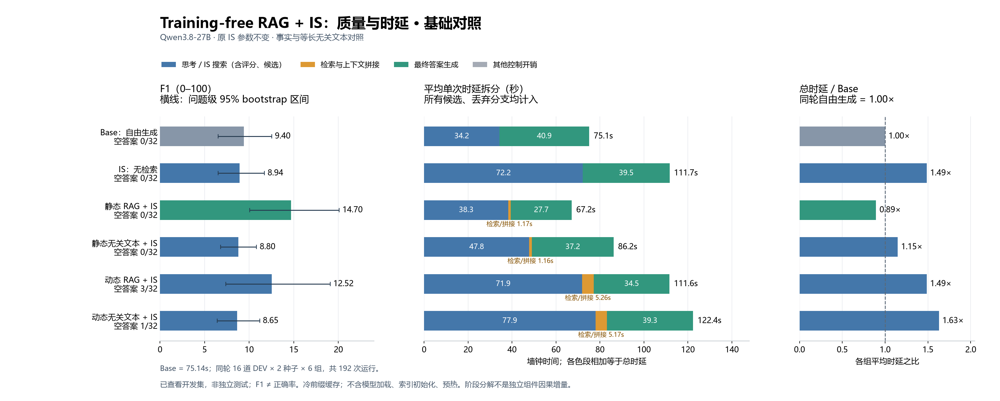
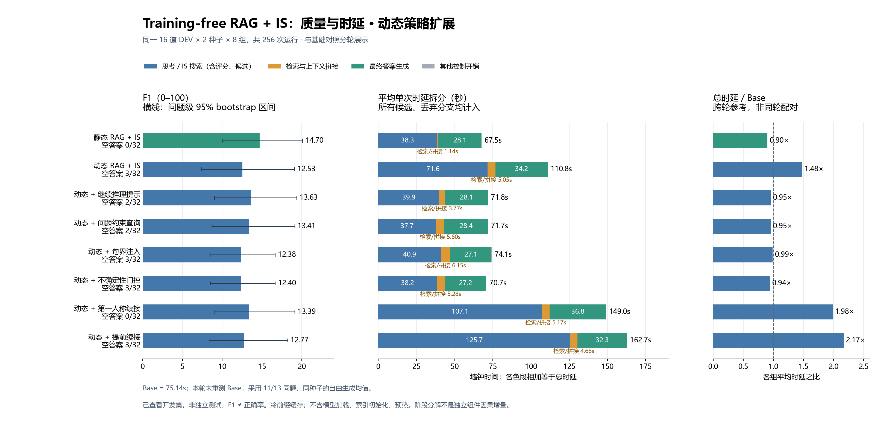

# Training-free RAG + IS：效果、时延与研究状态

更新于 2026-11-16。**实验已按用户要求停止；本次仅整理已有结果，没有新增模型运行。**
用户要求整个新增方法完全 training-free。监督检索投影、学习型知识需求/收益/风险 gate 不符合要求，已排除出合规候选；历史代码、失败和成本保留。

**当前较完整的同题对照中，静态 RAG + IS 的平均 F1 最高；尚无证据证明动态策略稳定优于它。**
以下是已用于开发的 16 道 TechQA DEV 题，各用两个种子。F1 是 0–100 词重叠分数，不是事实正确率；独立配置选择与最终评估尚未开启。

## 基础对照：F1、阶段耗时与 Base 倍率

同轮共 192 次运行。Base 是无检索、无 IS 的自由生成，平均 **75.14 秒**。
所有 IS 组固定 M=3、K=2、block=512、SC 温度 0.25，IS 从第一个思考 token 接管。

| 方法 | F1 | 搜索/思考（秒） | 检索与拼接（秒） | 答案生成（秒） | 总时延（秒） | 总时延 / Base |
| --- | ---: | ---: | ---: | ---: | ---: | ---: |
| Base 自由生成 | 9.40 | 34.21 | 0.00 | 40.93 | 75.14 | 1.00× |
| 无检索 IS | 8.94 | 72.21 | <0.01 | 39.47 | 111.68 | 1.49× |
| 静态 RAG + IS | **14.70** | 38.28 | 1.17 | 27.75 | **67.19** | **0.89×** |
| 动态 RAG + IS | 12.52 | 71.90 | 5.26 | 34.49 | 111.65 | 1.49× |

表内另有每次约 0.001–0.002 秒控制开销，已计入总时延；独立四舍五入可能导致分项加和有微小差别。
静态方案相对无检索 IS 提升 5.76 个 F1 点；动态相对静态的差值为 −2.18，问题级 95% 配对区间为 [−4.58, +0.06]。
静态的实测优势不能外推为普遍结论。本组没有“静态 RAG + 普通生成”对照，不能据此判断 IS 在普通 RAG 之上的独立收益。

[基础图 PDF](assets/training-free-rag-is/core-f1-stage-latency.pdf) · [SVG](assets/training-free-rag-is/core-f1-stage-latency.svg) · [原始结果及配对分析](../../experiments/online-injection-full-is-metrics-20261113/reports/RESULTS_ZH.md)

## 动态策略扩展

这一轮在相同 16 题、两个种子上完成 256 次运行，重新测量静态及原动态基线。
**本轮没有重测自由生成；右栏使用上一轮 75.14 秒作为跨轮参考，不能视为同轮配对时延比。**
同名基线在两张图中的时延来自不同轮次，不混合平均。

继续推理提示的动态方案得到最高在线点估计 **13.63 F1、71.75 秒**；相对本轮静态差值 −1.07，95% 配对区间 [−2.41, +0.23]。
第一人称续接在本轮没有空答案，但平均耗时升至 **149.04 秒**，F1 为 13.39。
这表明减少空答案、延长推理或增加计算量，都不自动带来质量提升。

[动态图 PDF](assets/training-free-rag-is/dynamic-f1-stage-latency.pdf) · [SVG](assets/training-free-rag-is/dynamic-f1-stage-latency.svg) · [本轮结果](../../experiments/online-injection-smart-is-20261114/reports/RESULTS_ZH.md)

## 如何解释阶段耗时

- 图中所有柱形使用组内 32 次运行的算术均值；倍率是“组平均总时延 / Base 平均总时延”，不是逐题比值的几何平均。F1 横线沿用原报告的问题级 bootstrap 区间，未校正多重比较。
- 总时延包含检索、全部 IS 候选与丢弃分支、最终答案生成；每组清空前缀缓存。模型加载、索引初始化、预热不计入单次时延。
- 原 `search_seconds` 包含 `materialization_seconds`。作图先从搜索扣除后者，再与静态预检索合并为“检索与上下文拼接”，避免重复计时。
- “搜索/思考”仍包含模型 prefill/decode、SC 统计、候选选择及编排；现有记录不支持把这些拆成互斥的独立计时。这是实际管线阶段分解，不是组件消融的因果增量。
- 图只纳入上述两个完整对照批次，不混入 TRAIN 小批调参最高分，也不纳入需要训练的新模块。

[全部数值 CSV](assets/training-free-rag-is/chart-data.csv) · [数据与来源哈希 JSON](assets/training-free-rag-is/chart-data.json) · [重绘脚本](assets/training-free-rag-is/render_charts.py) · [计量与重绘说明](assets/training-free-rag-is/README.txt)

## 动态方案的主要失分位置

已有轨迹同时发现：早期错误猜测污染查询；正确文档窗口漏掉关键命令或条件；思考中拼接证据后立即结束；SC 保留退化分支；正确证据出现在丢弃候选而未进入最终答案。
原动态平均只在选中路径注入 384 token，静态固定 512 token；它们还改变了消息位置与采样分段，不能把差异单独归因于注入时机。
上一轮三个空答案贡献约 45.4% 的净 F1 差距，其余非空配对仍落后；该分解不等于修复空答案后的反事实效果。

[逐题故障诊断](../../experiments/online-injection-smart-is-20261114/baseline-analysis/BASELINE_DIAGNOSIS_ZH.md) · [策略与轨迹解读](../../experiments/online-injection-smart-is-20261114/DISCUSSION_ZH.md)

## 当前研究边界

主模型与 17 个原 IS 文件保持不变。累计 182 个作业已结束并释放，投入约 **67.3 卡小时**，包含失败和用户取消；没有运行中的 NPU 作业。
两批大型记录未完整下载，部分结果待事实审阅。后续 TRAIN 调参出现过 27.39 F1，但仅来自四题、一个种子，包含复制证据及不完整答案，不能当作总体最佳成绩。
研究与回收保持停止；独立选择和最终测试保持封存。此前学习型方法仅作历史偏离记录，不能作为 training-free 成果。

[实现指南](../is_retrieve.md) · [纠正后的实验约束](RETRIEVAL_TUNING_PROTOCOL.md) · [历史实验记录](RETRIEVAL_TUNING_HISTORY_20261116.md) · [停止前审计与成本快照](RETRIEVAL_TUNING_SNAPSHOT.json)
