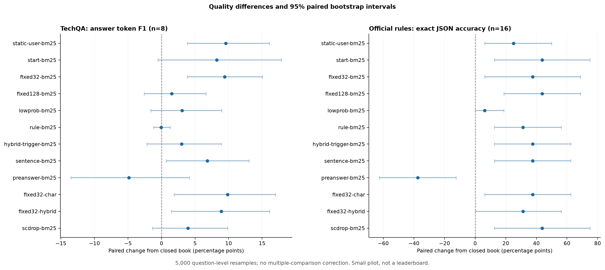
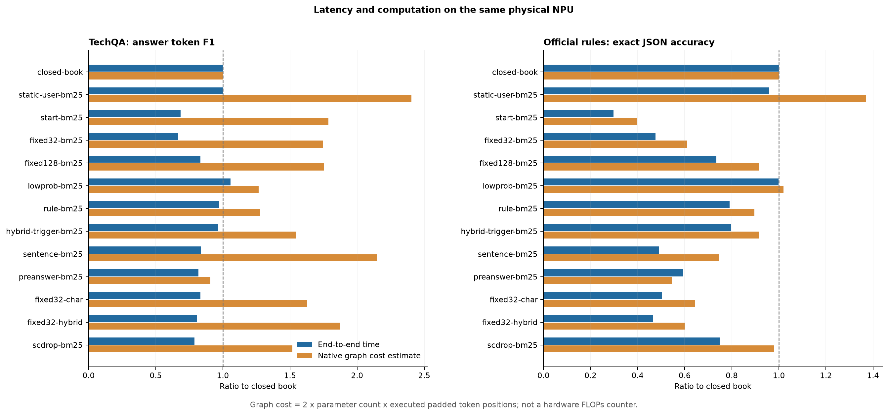
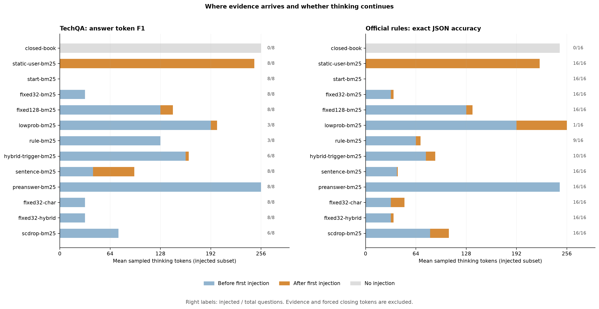

# 技术文档在线注入：十三方法 pilot

快照：2026-11-09T15:41:26+08:00；正式生成状态：complete；状态复用验证：failed。

本实验由外部控制器自动检索和追加资料，模型没有工具定义或检索调用。对照保持同题、同一组生成/推理预算和预定阈值。源码冻结提交：`cbf7998dfcf997436137a0e7385de2da63f5f031`。

数据与方法的完整设计见仓库 docs/online_injection.md。规则题为八份官方文档衍生的 16 题人工诊断，TechQA 为 NVIDIA 发布版的生成式小样本评测；二者分别统计，不作为官方榜单成绩。原虚构合同题只保留作机制自测。

运行资源：所有正式测量按用户选定使用 27.106.124.198 的物理 3 号单卡，TP=1 / vLLM 0.23。两个数据集在同一引擎中顺序执行。同一数据集的所有方法保持相同运行时；质量与成本在各自组内配对比较。其他卡上的旧输出已归档为预运行，不计入本报告。

质量与成本比较使用十三种方法均已完成的全部共同题；正式队列已结束。

## Official Document Rules Diagnostic

已生成 208/208 份；共同完成 16/16 题。

| 方法 | 已生成 | 共同题数 | 严格正确率 / 回答 F1 | 平均秒 | 平均生成 token | 实际注入率 | PFLOPs | 缓存命中 |
|---|---:|---:|---:|---:|---:|---:|---:|---:|
| closed-book | 16 | 16 | 43.8% | 28.990 | 450.938 | 0.0% | 5.096 | 0.0% |
| static-user-bm25 | 16 | 16 | 68.8% | 27.808 | 425.625 | 100.0% | 6.985 | 0.0% |
| start-bm25 | 16 | 16 | 87.5% | 8.639 | 123.000 | 100.0% | 2.027 | 0.0% |
| fixed32-bm25 | 16 | 16 | 81.2% | 13.811 | 205.750 | 100.0% | 3.110 | 0.0% |
| fixed128-bm25 | 16 | 16 | 87.5% | 21.281 | 323.375 | 100.0% | 4.658 | 0.0% |
| lowprob-bm25 | 16 | 16 | 50.0% | 28.964 | 450.750 | 6.2% | 5.196 | 0.0% |
| rule-bm25 | 16 | 16 | 75.0% | 22.909 | 349.875 | 56.2% | 4.567 | 0.0% |
| hybrid-trigger-bm25 | 16 | 16 | 81.2% | 23.140 | 349.688 | 62.5% | 4.666 | 0.0% |
| sentence-bm25 | 16 | 16 | 81.2% | 14.186 | 170.438 | 100.0% | 3.809 | 0.0% |
| preanswer-bm25 | 16 | 16 | 6.2% | 17.197 | 263.000 | 100.0% | 2.786 | 0.0% |
| fixed32-char | 16 | 16 | 81.2% | 14.555 | 216.625 | 100.0% | 3.282 | 0.0% |
| fixed32-hybrid | 16 | 16 | 75.0% | 13.503 | 200.188 | 100.0% | 3.061 | 0.0% |
| scdrop-bm25 | 16 | 16 | 87.5% | 21.709 | 330.562 | 100.0% | 4.986 | 0.0% |

| 方法 | 决策 JSON 可提取率 | EM | 空回答 | 长度耗尽 | 注入后推理 token | 注入文档命中率 |
|---|---:|---:|---:|---:|---:|---:|
| closed-book | 50.0% | 43.8% | 0 | 8 | — | 0.0% |
| static-user-bm25 | 75.0% | 68.8% | 0 | 5 | 221.562 | 100.0% |
| start-bm25 | 93.8% | 87.5% | 1 | 0 | 0.000 | 100.0% |
| fixed32-bm25 | 87.5% | 81.2% | 2 | 0 | 3.562 | 100.0% |
| fixed128-bm25 | 93.8% | 87.5% | 0 | 1 | 8.000 | 100.0% |
| lowprob-bm25 | 56.2% | 50.0% | 0 | 7 | 64.000 | 6.2% |
| rule-bm25 | 81.2% | 75.0% | 0 | 3 | 6.000 | 56.2% |
| hybrid-trigger-bm25 | 87.5% | 81.2% | 0 | 2 | 11.800 | 62.5% |
| sentence-bm25 | 87.5% | 81.2% | 1 | 0 | 1.188 | 100.0% |
| preanswer-bm25 | 6.2% | 6.2% | 14 | 0 | 0.000 | 100.0% |
| fixed32-char | 87.5% | 81.2% | 1 | 0 | 17.500 | 100.0% |
| fixed32-hybrid | 81.2% | 75.0% | 2 | 0 | 3.562 | 100.0% |
| scdrop-bm25 | 93.8% | 87.5% | 1 | 2 | 24.062 | 100.0% |

| 相对闭卷 | 分数差（百分点） | 95% 配对区间 | 耗时比 |
|---|---:|---:|---:|
| static-user-bm25 | +25.0 | [+6.2, +50.0] | 0.959 |
| start-bm25 | +43.8 | [+12.5, +75.0] | 0.298 |
| fixed32-bm25 | +37.5 | [+6.2, +68.8] | 0.476 |
| fixed128-bm25 | +43.8 | [+18.8, +68.8] | 0.734 |
| lowprob-bm25 | +6.2 | [+0.0, +18.8] | 0.999 |
| rule-bm25 | +31.2 | [+12.5, +56.2] | 0.790 |
| hybrid-trigger-bm25 | +37.5 | [+12.5, +62.5] | 0.798 |
| sentence-bm25 | +37.5 | [+12.5, +62.5] | 0.489 |
| preanswer-bm25 | -37.5 | [-62.5, -12.5] | 0.593 |
| fixed32-char | +37.5 | [+6.2, +62.5] | 0.502 |
| fixed32-hybrid | +31.2 | [+0.0, +56.2] | 0.466 |
| scdrop-bm25 | +43.8 | [+12.5, +75.0] | 0.749 |

问题文本检索（不使用生成轨迹）的文档命中率：

| 检索器 | Hit@1 | Hit@2 | Hit@3 | Hit@5 |
|---|---:|---:|---:|---:|
| bm25 | 100.0% | 100.0% | 100.0% | 100.0% |
| char | 100.0% | 100.0% | 100.0% | 100.0% |
| hybrid | 100.0% | 100.0% | 100.0% | 100.0% |

生成失败记录：0。索引构建记录：[{"kind": "index", "documents": 8, "retrievers": ["bm25", "char", "hybrid"], "corpus_sha256": "123d07c20af13960a5d36ba030fd6205cb21e2e5c7ff6a85f135f4a7e004ac3c", "build_seconds": 0.012293206062167883}]。

原生执行图相对逻辑估算多出的前向位置：合计 145，单条范围 [0, 1]；逐条对应关系见 cost_reconciliation。PFLOPs 表格采用原生执行图计数。

## TechQA-RAG-Eval DEV

已生成 104/104 份；共同完成 8/8 题。

| 方法 | 已生成 | 共同题数 | 严格正确率 / 回答 F1 | 平均秒 | 平均生成 token | 实际注入率 | PFLOPs | 缓存命中 |
|---|---:|---:|---:|---:|---:|---:|---:|---:|
| closed-book | 8 | 8 | 13.0% | 27.008 | 430.750 | 0.0% | 2.601 | 0.0% |
| static-user-bm25 | 8 | 8 | 22.6% | 27.062 | 413.375 | 100.0% | 6.250 | 22.2% |
| start-bm25 | 8 | 8 | 21.2% | 18.481 | 273.750 | 100.0% | 4.646 | 19.2% |
| fixed32-bm25 | 8 | 8 | 22.4% | 17.981 | 267.125 | 100.0% | 4.536 | 11.6% |
| fixed128-bm25 | 8 | 8 | 14.5% | 22.507 | 338.750 | 100.0% | 4.556 | 14.4% |
| lowprob-bm25 | 8 | 8 | 16.0% | 28.536 | 421.125 | 37.5% | 3.294 | 15.6% |
| rule-bm25 | 8 | 8 | 12.9% | 26.278 | 408.250 | 37.5% | 3.322 | 17.3% |
| hybrid-trigger-bm25 | 8 | 8 | 16.0% | 26.009 | 398.625 | 75.0% | 4.015 | 24.4% |
| sentence-bm25 | 8 | 8 | 19.8% | 22.549 | 289.375 | 100.0% | 5.584 | 14.3% |
| preanswer-bm25 | 8 | 8 | 8.1% | 22.117 | 339.125 | 100.0% | 2.356 | 30.9% |
| fixed32-char | 8 | 8 | 22.8% | 22.513 | 274.375 | 100.0% | 4.235 | 18.1% |
| fixed32-hybrid | 8 | 8 | 21.9% | 21.782 | 286.750 | 100.0% | 4.878 | 9.4% |
| scdrop-bm25 | 8 | 8 | 16.9% | 21.293 | 322.625 | 75.0% | 3.948 | 11.5% |

| 方法 | 决策 JSON 可提取率 | EM | 空回答 | 长度耗尽 | 注入后推理 token | 注入文档命中率 |
|---|---:|---:|---:|---:|---:|---:|
| closed-book | 不适用 | 0.0% | 0 | 2 | — | 0.0% |
| static-user-bm25 | 不适用 | 0.0% | 0 | 1 | 247.375 | 37.5% |
| start-bm25 | 不适用 | 0.0% | 0 | 0 | 0.000 | 37.5% |
| fixed32-bm25 | 不适用 | 0.0% | 0 | 0 | 0.000 | 50.0% |
| fixed128-bm25 | 不适用 | 0.0% | 0 | 1 | 16.000 | 50.0% |
| lowprob-bm25 | 不适用 | 0.0% | 0 | 2 | 8.000 | 12.5% |
| rule-bm25 | 不适用 | 0.0% | 1 | 2 | 0.000 | 12.5% |
| hybrid-trigger-bm25 | 不适用 | 0.0% | 1 | 2 | 4.000 | 25.0% |
| sentence-bm25 | 不适用 | 0.0% | 0 | 0 | 52.375 | 50.0% |
| preanswer-bm25 | 不适用 | 0.0% | 3 | 2 | 0.000 | 50.0% |
| fixed32-char | 不适用 | 0.0% | 0 | 1 | 0.000 | 62.5% |
| fixed32-hybrid | 不适用 | 0.0% | 0 | 0 | 0.000 | 62.5% |
| scdrop-bm25 | 不适用 | 0.0% | 0 | 0 | 0.000 | 37.5% |

| 相对闭卷 | 分数差（百分点） | 95% 配对区间 | 耗时比 |
|---|---:|---:|---:|
| static-user-bm25 | +9.6 | [+3.9, +16.1] | 1.002 |
| start-bm25 | +8.2 | [-0.5, +17.9] | 0.684 |
| fixed32-bm25 | +9.4 | [+3.8, +15.0] | 0.666 |
| fixed128-bm25 | +1.5 | [-2.6, +6.6] | 0.833 |
| lowprob-bm25 | +3.1 | [-1.6, +9.0] | 1.057 |
| rule-bm25 | -0.1 | [-1.2, +1.3] | 0.973 |
| hybrid-trigger-bm25 | +3.0 | [-2.2, +8.9] | 0.963 |
| sentence-bm25 | +6.8 | [+0.7, +13.0] | 0.835 |
| preanswer-bm25 | -4.9 | [-13.5, +4.1] | 0.819 |
| fixed32-char | +9.9 | [+1.9, +17.0] | 0.834 |
| fixed32-hybrid | +8.9 | [+1.5, +16.1] | 0.807 |
| scdrop-bm25 | +3.9 | [-1.3, +9.8] | 0.788 |

问题文本检索（不使用生成轨迹）的文档命中率：

| 检索器 | Hit@1 | Hit@2 | Hit@3 | Hit@5 |
|---|---:|---:|---:|---:|
| bm25 | 25.0% | 37.5% | 50.0% | 62.5% |
| char | 37.5% | 50.0% | 62.5% | 62.5% |
| hybrid | 25.0% | 37.5% | 62.5% | 75.0% |

生成失败记录：0。索引构建记录：[{"kind": "index", "documents": 28481, "retrievers": ["bm25", "char", "hybrid"], "corpus_sha256": "edd40acfcf393191de23fd7ccdf4cbfb15610eaed74690d8f69b259c6b581665", "build_seconds": 140.58977920003235}]。

原生执行图相对逻辑估算多出的前向位置：合计 62，单条范围 [0, 1]；逐条对应关系见 cost_reconciliation。PFLOPs 表格采用原生执行图计数。

## 解释范围与成本口径

规则题评分提取输出中最后一个不含嵌套的 JSON 对象，要求字段恰为 action 和 wait_seconds，类型分别为字符串与整数；两项取值都与 gold 相同才得分。它允许对象前后的其他文字，不等同于整段输出仅为 JSON。可提取率同时要求字段与类型满足约束。action 是题目给定的决策标签，wait_seconds 是剩余强制等待秒数，无计时要求时取 0。八条短文档的检索难度低，且没有隐藏新事实，闭卷可能已掌握规则。TechQA 使用规范化回答 token F1；EM 与逐样本判分在 summary.json / grades.jsonl。这里只抽取可回答 DEV 样本，未覆盖不可回答题；原数据集可能出现在模型训练资料中，不能声称无污染。

配对 bootstrap 以题目为单位重采样 5,000 次，未作多重比较校正。小样本区间退化不代表方法稳定等价；阈值没有在本 pilot 上优化。

端到端耗时含检索、格式化、追加与续写，排除模型加载、图编译、索引构建及离线判题。PFLOPs 为原生执行图含填充的 2×参数量×token 位置估算，不是硬件 FLOPs 实测。逻辑前向、检索时间、证据长度、空回答、截断和缓存命中均保留在 summary.json。注入文档命中率按 gold 文档 ID 计算；证据截断后未必包含答案原文，因此它不是答案片段召回率。

每组方法起始缓存重置，方法内部允许前缀复用。模型为混合 attention/recurrent 架构，短前缀可能无法形成可复用块。没有缓存命中时，中途续写会重算前缀，不能宣称已获得 KV 加速。

外部证据和强制控制标记不计入模型生成置信度；可追溯片段与原始 token IDs 保留在测量中。不同 chunk 切分的随机流不保证逐 token 一致，句界位置对照包含请求切分差异。

当前已保存测量的前缀、概率来源、原生图成本、无额外评分、无抢占与无取消核对：True。

## 状态复用的独立核对

该诊断在全部正式生成结束后单独运行，未计入上表的质量、延迟与计算成本。两份固定资料追加到同一记录前缀，比较缓存兄弟分支与逐次清空缓存后的重算；每支最多 8 token，BF16 log probability 绝对容差 0.05 nats。另有无下载的小型因果模型 CPU 状态隔离测试。

验证状态：failed；退出码：{'target-cache-validation': '1', 'cpu-cache-reference': '0', 'post-validation': '1'}。

缓存核对的逐分支结果：

| 分支 | token 一致 | 最大 log probability 差 | 缓存分支复用 token | 重算分支复用 token |
|---|---|---:|---:|---:|
| 0 | True | 0.0 | 1536 | 0 |
| 1 | False | 路径不同，未比较 | 1536 | 0 |

目标模型的同种子续写复现要求没有通过，不能将本次结果作为缓存分支一致性的证明。采样路径不同本身不能区分随机流变化与 KV/循环状态差异。原失败记录保留，未更换题目、资料或种子。

事后固定历史的条件状态核对：passed，16/16 个位置通过；相同贪心 token 的最大 log probability 差为 0.0。
该诊断沿用原始共同前缀、两份资料和首条完整八 token 记录历史，每个固定位置单独预测一个贪心 token；缓存与重算使用相同条件历史。它不替代原来的多 token 随机续写测试，也不把原失败改记为通过。

## 来源与复核

[NVIDIA 数据卡](https://huggingface.co/datasets/nvidia/TechQA-RAG-Eval)、[TechQA 原论文](https://aclanthology.org/2020.acl-main.117/)、[vLLM Prefix Caching](https://docs.vllm.ai/en/latest/features/automatic_prefix_caching/)。规则题八份官方来源、原始网页 SHA256 见 summary.json 的 api.manifest.sources。原始结果、冻结配置与源码哈希保存在服务器 results/online-injection-20261109-a3 和 deployment/ascend/online-injection-20261109-a3。

退出状态：{'generation': '0', 'techqa': '0', 'api': '0'}。

## 图示

## 结果解释与来源证据

### TechQA：质量、延迟和计算量需要同时看

固定 32-token BM25 在同一 8 题上，回答 F1 从 13.0% 变为 22.4%，配对差为 +9.41 个百分点，95% bootstrap 区间为 [+3.84, +15.05]。平均耗时从 27.01 秒变为 17.98 秒（0.666 倍）；原生图估算计算量为 1.744 倍。这个方法在本 pilot 上更快，同时做了更多前向位置计算，不能把耗时下降解释成计算量下降。

它的平均生成 token 从 430.8 变为 267.1，推理 token 从 256.0 变为 32.0。静态 user RAG 的 F1 为 22.6%，耗时约为闭卷 1.002 倍、图估算计算量 2.403 倍。更长资料 prefill 与更短串行生成同时改变成本，需要固定资料与输出长度、单独开关 APC 才能量化缓存本身的加速。

固定 32-token 的 BM25、字符检索、RRF 的 F1 分别为 22.4%、22.8%、21.9%；平均检索时间分别为 0.56、2.70、3.12 秒。小幅质量差不能据此确立检索器排名；字符匹配也不是语义向量检索。

### 注入位置也改变了输出行为

起点注入和三个固定 32-token 注入方法，在这 8 题中追加资料后都立即由模型生成推理结束标记，资料后新增推理 token 为 0。控制器并未在这些偏移处强制结束推理。因此本轮能说明资料影响了随后回答，不能声称这些方法已经改善了资料后的推理过程。

句界方法平均在资料后继续生成 52.4 个推理 token。它在等待标点时使用单 token 请求，种子/请求切分也随之变化：DEV_Q209 与闭卷的生成前缀在第 39 token 已不同，实际到第 56 token 才注入。它不是只改变文本插入位置的反事实对照。全部 80 个同 prompt 方法/题目组合在各自第一次注入或请求切分改变之前均通过前缀一致性核对。

回答前注入的 F1 为 8.1%，8 题中 3 题为空白回答；另外还出现省略号、引用标记或未完成推理。其较低成本需要与未完成任务一起解释。所有这些结果保留，未重试择优。

### 置信度触发尚需独立校准

低概率、文本规则和 SC 下降在本轮分别触发 37.5%、37.5%、75.0% 的题。部分低概率触发已到 256-token 推理预算边界。DEV_Q209 中 SC 下降在第 64 token 找到有用的替代 ACCE 文档，但总体 SC 方法相对闭卷的 F1 差区间仍跨 0。该个例支持继续研究触发信号，不足以选定阈值或宣称 SC 等于知识缺口。

### 文档命中与知识暴露是两件事

DEV_Q209 的 gold 是 swg21696083，但 SC 方法找到的 swg21680952 同样包含正确 ACCE 界面路径。按唯一 gold 文档 ID 计命中会漏记这种替代证据。

反过来，DEV_Q011 的 jextract 标注文档虽被多种方法检索到，但 tokenizer 解码表明，本题全部注入片段都没有出现核心参数 `-J-Xmx`。答案位于正文后部，前部截断没有暴露这个信息。不能把“命中文档”当成“已把答案事实送入上下文”。解码文本、输入文件与 tokenizer SHA256 见 evidence-exposure 文件。

104 份回答的探索性来源复核见 [CASE_REVIEW.md](CASE_REVIEW.md)。复核不是独立盲审，也没有替代预定 F1/EM；它解释了 F1 会给包含相同词项的错误规则得分，也会给简短而正确的操作路径较低分。未使用复核标签调整首轮设置。

### 补充 CPU 切块诊断

在看到首轮题目后，额外固定一次 256 词、64 词重叠的 BM25 检索诊断，共形成 71,450 个片段。它没有生成回答，也未更改正式 13 方法。按原标注文档 ID 统计，Hit@1/2/3/5 从整文档的 25.0%/37.5%/50.0%/62.5% 变为 12.5%/25.0%/37.5%/62.5%。原始结果和固定协议在 chunking-diagnostic 文件中，未重新选块长以追求更高分。

这提示切块需与文档召回、产品/版本过滤和段落重排分别测试。此诊断按空白分词，中文长段落仍可能包含很多模型 token；片段字符串包含答案不等于在 1,024-token 注入预算中可见。下一轮应优先比较 tokenizer 计数的切块与“先召回文档、再定位段落”，并在独立开发文档上固定方案。

### 官方规则诊断：严格任务得分提升，同时有显著格式因素

16 题的冻结严格得分为：闭卷 7/16（43.75%），静态 user RAG 11/16（68.75%），起点注入、固定 128-token 注入与 SC 下降均为 14/16（87.5%），固定 32-token BM25 为 13/16（81.25%）。起点注入相对闭卷的配对差为 +43.75 个百分点，95% bootstrap 区间为 [+12.5, +75.0]；样本只有 16 题，且每份文档派生两题，题级区间没有处理文档内相关性，也未做多重比较校正。

闭卷只有 8/16 份回答可提取出评分 JSON，其中 7 份满足冻结答案；起点注入为 15/16 可提取、14 份匹配。闭卷有 8 份耗尽生成长度，起点注入没有长度耗尽，但有 1 份空白回答。原始问题要求谨慎推理并以 JSON 结束，而模型在已关闭的推理段之后仍可能输出很长的解释，最终没有写到 JSON。按已可提取对象条件计算的正确比例属于事后筛选，不能当作公平的知识能力对照。这些现象表明严格得分同时反映规则应用、最终答案格式与预算内完成任务，不能把全部分差解释为获得了此前未知的技术知识。

起点注入平均耗时 8.64 秒，闭卷为 28.99 秒；原生图计算量比为 0.398。平均生成长度从 450.9 变为 123.0 token，起点注入的 16 题均立即结束推理。该诊断的短上下文没有 APC 命中，耗时下降主要伴随更短输出，不能解释为缓存加速。固定 32-token BM25 为 13.81 秒、图计算量 0.610 倍；静态 RAG 为 27.81 秒、图计算量 1.371 倍。

回答前注入只得到 1/16 的严格得分，其中 14 份空白回答；其平均 17.20 秒包含大量没有完成回答的结果。低概率触发只在 1/16 题发生，不能据此用该阈值可靠识别规则知识需求。规则与组合触发覆盖分别为 9/16 和 10/16，SC 下降为 16/16；这组短规则材料与真实长文档任务的信号分布明显不同。

### 冻结题目中的字段歧义

所有方法中“已提取 JSON 但严格答错”的记录均来自 `official-redis-1`：模型正确指出 `EXPIRE key 60 GT` 应将当前 20 秒 TTL 更新为 60 秒，并给出 action=set_expiry、wait_seconds=60；冻结 gold 是 action=set_expiry、wait_seconds=0。原设计把秒数槽解释为客户端必须等待的时间，但问题中“required remaining delay”也容易被理解为更新后的剩余 TTL。

因此这部分失分不能归为 Redis GT 事实理解错误。主表仍保留全部 16 题、原始 gold 和严格评分，没有根据输出改标签或重跑。额外的逐方法 JSON 可提取数、失分记录与排除该歧义题的 15 题敏感性统计见 [api-diagnostic-review.json](api-diagnostic-review.json)；后者是事后探索，不替代主结果。下一轮需明确 client_wait_seconds 与 ttl_seconds 的区别，并在生成前独立审查题目与答案约定。

八份短改述的原始问题检索 Hit@1 均为 100%，语料只有八条。这一部分是人工诊断，不是已发布 benchmark，也没有测试外部服务 API 调用；后续应改为原始长文档、明确的字段定义和按文档留出的新题。

### 目标模型的缓存核对：保留原续写复现失败

预定检查选中 DEV_Q011 / fixed32-char 的前 1,600 个上下文 token。两份固定资料各续写最多 8 token，缓存父前缀后运行兄弟分支，再逐支清空缓存重算。两支缓存均复用 1,536 token，重算均命中 0。分支 A 在两个路径中都只采样到 EOS，token 与 log probability 完全一致；分支 B 第一个 token 与概率一致，从第二个 token 开始采样路径不同。因此原检查失败，没有更换例子、资料或种子重试，也没有把不同路径的 log probability 差写成 0。

随后进行一次事后诊断：保留同一父前缀、两份资料与种子，取原记录中首条完整 8-token 缓存路径作为共同条件历史；在每个位置单独预测一个贪心 token。两份资料共 16 个位置全部得到相同 token 及 log probability，最大差为 0；缓存一侧每次复用 1,536 token，重算一侧每次为 0。这对所测固定条件下的状态复用提供支持，但只比较贪心 token 的概率，没有比较全部词表分布；也没有定位原多 token 随机续写分歧的根因。应继续核对随机流推进、调度和循环状态，不能把原失败改记为通过。

该补充诊断首次在任何位置测量之前被 SamplingConfig 的 temperature=0 参数检查拒绝；随后改用后端已有的原生贪心 SamplingParams 接口，输入、历史、种子、长度和容差均不变。初始化失败、原脚本及修订协议保留，属于接口修复，不作为额外成功样本。正常完成的第二次实现只运行一次。

真实小型因果模型的 CPU 追加与兄弟分支测试通过（1 passed，13.62 秒）。以上验证均在 312 份正式回答结束后运行，成本和耗时不混入主表；完成后本次容器已停止，释放 3 号卡。原随机续写测试、补充固定历史诊断和 CPU 参考各自有独立结果文件与退出码。
