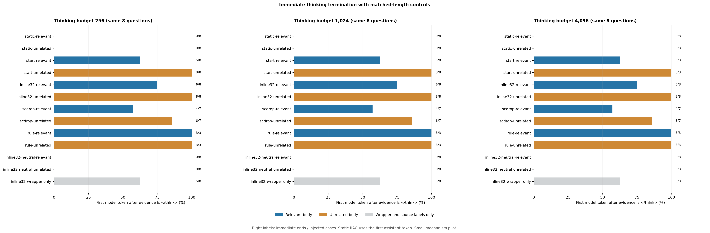
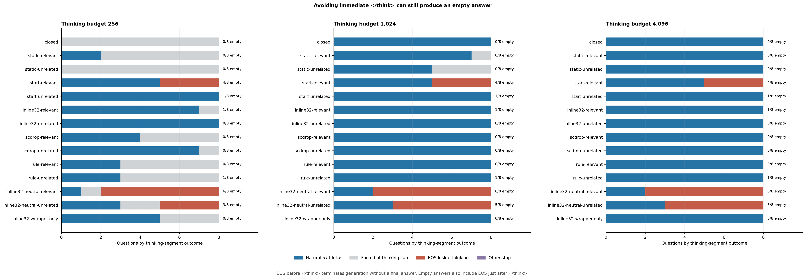
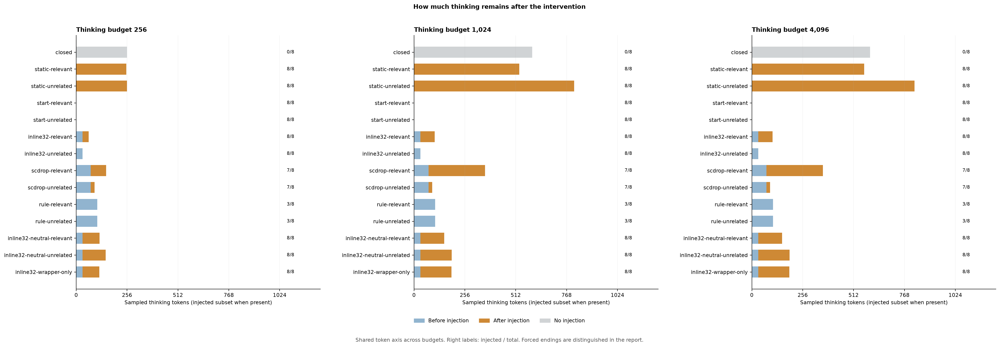
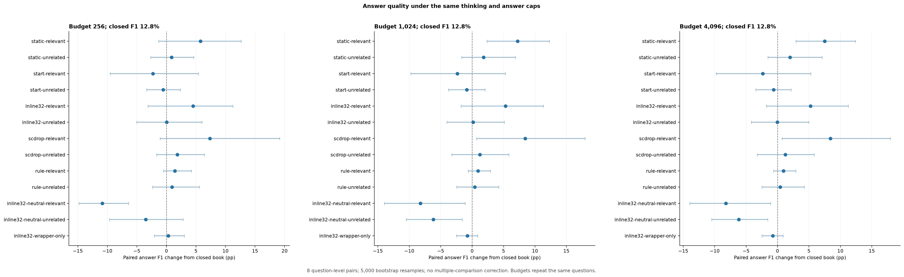

# 去除 effort 提示后的思考预算与注入格式对照

快照 2026-11-09T19:59:15+08:00；状态 complete；已生成 336/336。

实际模型输入完全不含 low、xhigh 或其他 effort 指令；thinking 已打开，预算由控制器独立限制。所有条件另有 512-token 最终回答上限。模型、完整文档集及八道 TechQA 问题与首轮相同。

所有正式计算统一使用 198 物理 3 号单卡。relevant 标签指 BM25 检索资料，并不保证包含 gold 答案。相关资料固定为同一组问题检索结果；无关对照只替换正文，来源标题和标签保留。去包装条件将外层 header/footer 换为等 token 数的换行；仅包装条件将正文换为等长度换行。五种变体的 token 数逐题完全一致，静态 RAG 插入同一原始资料 token IDs。

各位置条件独立生成完整轨迹，开始前清空 APC，内部允许 continuation 复用。动态 SC/规则每 32 token 检查一次，最早 64 token；未触发的结果保留。生成源码、输入、阈值和三档预算在正式测量前冻结，未按结果调整。

## 思考预算 256

已生成 112/112；十四方法共同完成 8/8 题。

| 方法 | F1 | 思考 token | 回答 token | 注入数 | 注入偏移 | 资料后思考 | 立即结束数 | 强制结束数 | thinking 内 EOS | 空回答 | 平均秒 | 总原生 PFLOPs |
|---|---:|---:|---:|---:|---:|---:|---:|---:|---:|---:|---:|---:|
| closed | 12.8% | 256.0 | 240.0 | 0/8 | — | — | 0/0 | 8 | 0 | 0 | 30.86 | 3.070 |
| static-relevant | 18.5% | 252.1 | 229.8 | 8/8 | 0.0 | 252.1 | 0/8 | 6 | 0 | 0 | 30.68 | 6.753 |
| static-unrelated | 13.7% | 256.0 | 248.1 | 8/8 | 0.0 | 256.0 | 0/8 | 8 | 0 | 0 | 32.03 | 7.225 |
| start-relevant | 10.5% | 0.9 | 99.5 | 8/8 | 0.0 | 0.9 | 5/8 | 0 | 3 | 4 | 6.90 | 2.322 |
| start-unrelated | 12.2% | 0.0 | 259.4 | 8/8 | 0.0 | 0.0 | 8/8 | 0 | 0 | 1 | 17.05 | 4.777 |
| inline32-relevant | 17.3% | 63.1 | 279.1 | 8/8 | 32.0 | 31.1 | 6/8 | 1 | 0 | 1 | 22.12 | 5.282 |
| inline32-unrelated | 12.8% | 32.0 | 300.1 | 8/8 | 32.0 | 0.0 | 8/8 | 0 | 0 | 0 | 21.45 | 4.927 |
| scdrop-relevant | 20.1% | 164.0 | 318.0 | 7/8 | 73.1 | 77.7 | 4/7 | 4 | 0 | 0 | 30.92 | 6.262 |
| scdrop-unrelated | 14.6% | 112.5 | 280.4 | 7/8 | 73.1 | 18.9 | 6/7 | 1 | 0 | 0 | 25.39 | 4.831 |
| rule-relevant | 14.2% | 200.0 | 268.5 | 3/8 | 106.7 | 0.0 | 3/3 | 5 | 0 | 0 | 29.51 | 3.501 |
| rule-unrelated | 13.7% | 200.0 | 199.4 | 3/8 | 106.7 | 0.0 | 3/3 | 5 | 0 | 1 | 25.37 | 3.289 |
| inline32-neutral-relevant | 1.9% | 117.1 | 53.0 | 8/8 | 32.0 | 85.1 | 0/8 | 1 | 6 | 6 | 10.81 | 1.888 |
| inline32-neutral-unrelated | 9.3% | 148.5 | 221.8 | 8/8 | 32.0 | 116.5 | 0/8 | 2 | 3 | 3 | 23.33 | 4.575 |
| inline32-wrapper-only | 13.1% | 116.0 | 329.1 | 8/8 | 32.0 | 84.0 | 5/8 | 3 | 0 | 0 | 28.45 | 6.431 |

立即结束指资料之后的第一个模型生成 token 为 thinking 结束标记；静态条件取第一个 assistant 生成 token。资料后思考按实际注入子集计算。动态信号在预算边界才触发时，随后强制结束不是自然提前停止，须结合强制结束和边界注入计数解释。

| 对照 → 替代 | 配对题数 | F1 差（百分点） | 95% 区间 | 两侧均注入 | 同 checkpoint 前缀配对 | 立即结束率差（百分点） |
|---|---:|---:|---:|---:|---:|---:|
| static-relevant → inline32-relevant | 8 | -1.3 | [-5.5, 2.8] | 8 | 0 | 75.0 |
| static-relevant → scdrop-relevant | 8 | 1.6 | [-6.7, 9.9] | 7 | 0 | 57.1 |
| static-relevant → rule-relevant | 8 | -4.3 | [-11.6, 2.6] | 3 | 0 | 100.0 |
| static-relevant → static-unrelated | 8 | -4.9 | [-11.0, 0.3] | 8 | 0 | 0.0 |
| start-relevant → start-unrelated | 8 | 1.7 | [-4.5, 8.0] | 8 | 8 | 37.5 |
| inline32-relevant → inline32-unrelated | 8 | -4.5 | [-10.8, 2.3] | 8 | 8 | 25.0 |
| inline32-relevant → inline32-neutral-relevant | 8 | -15.3 | [-22.0, -8.3] | 8 | 8 | -75.0 |
| inline32-unrelated → inline32-neutral-unrelated | 8 | -3.5 | [-7.1, -0.0] | 8 | 8 | -100.0 |
| inline32-relevant → inline32-wrapper-only | 8 | -4.2 | [-9.3, 2.1] | 8 | 8 | -12.5 |
| scdrop-relevant → scdrop-unrelated | 8 | -5.5 | [-18.4, 2.7] | 7 | 7 | 28.6 |
| rule-relevant → rule-unrelated | 8 | -0.5 | [-3.6, 2.0] | 3 | 3 | 0.0 |

## 思考预算 1024

已生成 112/112；十四方法共同完成 8/8 题。

| 方法 | F1 | 思考 token | 回答 token | 注入数 | 注入偏移 | 资料后思考 | 立即结束数 | 强制结束数 | thinking 内 EOS | 空回答 | 平均秒 | 总原生 PFLOPs |
|---|---:|---:|---:|---:|---:|---:|---:|---:|---:|---:|---:|---:|
| closed | 12.8% | 594.8 | 275.6 | 0/8 | — | — | 0/0 | 0 | 0 | 0 | 56.33 | 8.488 |
| static-relevant | 20.1% | 529.5 | 276.0 | 8/8 | 0.0 | 529.5 | 0/8 | 1 | 0 | 0 | 51.69 | 9.619 |
| static-unrelated | 14.7% | 805.8 | 282.5 | 8/8 | 0.0 | 805.8 | 0/8 | 3 | 0 | 0 | 69.74 | 11.876 |
| start-relevant | 10.5% | 0.9 | 99.5 | 8/8 | 0.0 | 0.9 | 5/8 | 0 | 3 | 4 | 6.89 | 2.322 |
| start-unrelated | 12.0% | 0.0 | 262.8 | 8/8 | 0.0 | 0.0 | 8/8 | 0 | 0 | 1 | 17.22 | 4.793 |
| inline32-relevant | 18.1% | 103.8 | 273.4 | 8/8 | 32.0 | 71.8 | 6/8 | 0 | 0 | 1 | 24.33 | 5.475 |
| inline32-unrelated | 13.0% | 32.0 | 305.6 | 8/8 | 32.0 | 0.0 | 8/8 | 0 | 0 | 0 | 21.78 | 4.963 |
| scdrop-relevant | 21.3% | 434.2 | 332.8 | 7/8 | 73.1 | 284.6 | 4/7 | 0 | 0 | 0 | 49.63 | 9.016 |
| scdrop-unrelated | 14.1% | 201.8 | 269.9 | 7/8 | 73.1 | 18.9 | 6/7 | 0 | 0 | 0 | 30.64 | 6.254 |
| rule-relevant | 13.8% | 360.6 | 279.2 | 3/8 | 106.7 | 0.0 | 3/3 | 0 | 0 | 0 | 41.21 | 5.840 |
| rule-unrelated | 13.3% | 360.6 | 210.1 | 3/8 | 106.7 | 0.0 | 3/3 | 0 | 0 | 1 | 37.05 | 5.627 |
| inline32-neutral-relevant | 4.6% | 152.5 | 96.2 | 8/8 | 32.0 | 120.5 | 0/8 | 0 | 6 | 6 | 15.93 | 2.761 |
| inline32-neutral-unrelated | 6.7% | 189.5 | 103.0 | 8/8 | 32.0 | 157.5 | 0/8 | 0 | 5 | 5 | 18.79 | 4.233 |
| inline32-wrapper-only | 12.1% | 189.0 | 333.2 | 8/8 | 32.0 | 157.0 | 5/8 | 0 | 0 | 0 | 33.71 | 7.144 |

立即结束指资料之后的第一个模型生成 token 为 thinking 结束标记；静态条件取第一个 assistant 生成 token。资料后思考按实际注入子集计算。动态信号在预算边界才触发时，随后强制结束不是自然提前停止，须结合强制结束和边界注入计数解释。

| 对照 → 替代 | 配对题数 | F1 差（百分点） | 95% 区间 | 两侧均注入 | 同 checkpoint 前缀配对 | 立即结束率差（百分点） |
|---|---:|---:|---:|---:|---:|---:|
| static-relevant → inline32-relevant | 8 | -1.9 | [-6.1, 2.0] | 8 | 0 | 75.0 |
| static-relevant → scdrop-relevant | 8 | 1.2 | [-4.8, 8.7] | 7 | 0 | 57.1 |
| static-relevant → rule-relevant | 8 | -6.3 | [-11.9, -0.8] | 3 | 0 | 100.0 |
| static-relevant → static-unrelated | 8 | -5.4 | [-12.9, 2.7] | 8 | 0 | 0.0 |
| start-relevant → start-unrelated | 8 | 1.5 | [-4.7, 7.8] | 8 | 8 | 37.5 |
| inline32-relevant → inline32-unrelated | 8 | -5.1 | [-11.4, 1.8] | 8 | 8 | 25.0 |
| inline32-relevant → inline32-neutral-relevant | 8 | -13.5 | [-20.5, -6.6] | 8 | 8 | -75.0 |
| inline32-unrelated → inline32-neutral-unrelated | 8 | -6.3 | [-12.7, -1.0] | 8 | 8 | -100.0 |
| inline32-relevant → inline32-wrapper-only | 8 | -6.1 | [-12.8, 1.4] | 8 | 8 | -12.5 |
| scdrop-relevant → scdrop-unrelated | 8 | -7.2 | [-20.2, 2.3] | 7 | 7 | 28.6 |
| rule-relevant → rule-unrelated | 8 | -0.5 | [-3.6, 2.0] | 3 | 3 | 0.0 |

## 思考预算 4096

已生成 112/112；十四方法共同完成 8/8 题。

| 方法 | F1 | 思考 token | 回答 token | 注入数 | 注入偏移 | 资料后思考 | 立即结束数 | 强制结束数 | thinking 内 EOS | 空回答 | 平均秒 | 总原生 PFLOPs |
|---|---:|---:|---:|---:|---:|---:|---:|---:|---:|---:|---:|---:|
| closed | 12.8% | 594.8 | 275.6 | 0/8 | — | — | 0/0 | 0 | 0 | 0 | 56.11 | 8.488 |
| static-relevant | 20.3% | 565.8 | 271.8 | 8/8 | 0.0 | 565.8 | 0/8 | 0 | 0 | 0 | 53.71 | 10.246 |
| static-unrelated | 14.8% | 818.5 | 276.8 | 8/8 | 0.0 | 818.5 | 0/8 | 0 | 0 | 0 | 70.17 | 12.025 |
| start-relevant | 10.5% | 0.9 | 99.5 | 8/8 | 0.0 | 0.9 | 5/8 | 0 | 3 | 4 | 6.89 | 2.322 |
| start-unrelated | 12.2% | 0.0 | 259.4 | 8/8 | 0.0 | 0.0 | 8/8 | 0 | 0 | 1 | 16.99 | 4.777 |
| inline32-relevant | 18.1% | 103.8 | 273.4 | 8/8 | 32.0 | 71.8 | 6/8 | 0 | 0 | 1 | 24.30 | 5.475 |
| inline32-unrelated | 12.8% | 32.0 | 300.1 | 8/8 | 32.0 | 0.0 | 8/8 | 0 | 0 | 0 | 21.37 | 4.927 |
| scdrop-relevant | 21.3% | 434.2 | 332.8 | 7/8 | 73.1 | 284.6 | 4/7 | 0 | 0 | 0 | 49.40 | 9.016 |
| scdrop-unrelated | 14.1% | 201.8 | 269.9 | 7/8 | 73.1 | 18.9 | 6/7 | 0 | 0 | 0 | 30.50 | 6.254 |
| rule-relevant | 13.8% | 360.6 | 279.2 | 3/8 | 106.7 | 0.0 | 3/3 | 0 | 0 | 0 | 41.03 | 5.840 |
| rule-unrelated | 13.3% | 360.6 | 210.1 | 3/8 | 106.7 | 0.0 | 3/3 | 0 | 0 | 1 | 36.84 | 5.627 |
| inline32-neutral-relevant | 4.6% | 152.5 | 96.2 | 8/8 | 32.0 | 120.5 | 0/8 | 0 | 6 | 6 | 15.94 | 2.761 |
| inline32-neutral-unrelated | 6.7% | 189.5 | 103.0 | 8/8 | 32.0 | 157.5 | 0/8 | 0 | 5 | 5 | 18.73 | 4.233 |
| inline32-wrapper-only | 12.1% | 189.0 | 333.2 | 8/8 | 32.0 | 157.0 | 5/8 | 0 | 0 | 0 | 33.62 | 7.144 |

立即结束指资料之后的第一个模型生成 token 为 thinking 结束标记；静态条件取第一个 assistant 生成 token。资料后思考按实际注入子集计算。动态信号在预算边界才触发时，随后强制结束不是自然提前停止，须结合强制结束和边界注入计数解释。

| 对照 → 替代 | 配对题数 | F1 差（百分点） | 95% 区间 | 两侧均注入 | 同 checkpoint 前缀配对 | 立即结束率差（百分点） |
|---|---:|---:|---:|---:|---:|---:|
| static-relevant → inline32-relevant | 8 | -2.2 | [-6.8, 1.9] | 8 | 0 | 75.0 |
| static-relevant → scdrop-relevant | 8 | 0.9 | [-5.0, 8.5] | 7 | 0 | 57.1 |
| static-relevant → rule-relevant | 8 | -6.6 | [-12.0, -1.2] | 3 | 0 | 100.0 |
| static-relevant → static-unrelated | 8 | -5.5 | [-12.6, 2.2] | 8 | 0 | 0.0 |
| start-relevant → start-unrelated | 8 | 1.7 | [-4.5, 8.0] | 8 | 8 | 37.5 |
| inline32-relevant → inline32-unrelated | 8 | -5.3 | [-11.6, 1.7] | 8 | 8 | 25.0 |
| inline32-relevant → inline32-neutral-relevant | 8 | -13.5 | [-20.4, -6.6] | 8 | 8 | -75.0 |
| inline32-unrelated → inline32-neutral-unrelated | 8 | -6.1 | [-12.5, -0.9] | 8 | 8 | -100.0 |
| inline32-relevant → inline32-wrapper-only | 8 | -6.0 | [-12.7, 1.4] | 8 | 8 | -12.5 |
| scdrop-relevant → scdrop-unrelated | 8 | -7.2 | [-20.2, 2.3] | 7 | 7 | 28.6 |
| rule-relevant → rule-unrelated | 8 | -0.5 | [-3.6, 2.0] | 3 | 3 | 0.0 |

## 核对与解释边界

当前已保存测量的原始前缀、实际无 effort prompt、资料 token 对齐、独立回答预算、概率来源与计算计量核对：True。生成退出码：0。

相关/无关对照保留了来源标题，所以比较的是正文贡献。去包装对照引入等长换行，不能据此排除所有其他格式效应。SC/规则未触发与预算边界触发单独保留；原始生成前缀不匹配的样本不能作为严格同前缀因果证据。

立即结束指结构性的 thinking 段结束，不等于模型此后没有进行任何推理。回答段重新生成 thinking 起始标记的次数单独保存在统计中。每题每条件仅一条随机轨迹，题级区间不覆盖跨种子方差。

模型也可能在生成 </think> 之前直接输出 EOS，整条轨迹结束且无最终回答。thinking 内 EOS 单独统计；立即 </think> 比例降低不能单独解释成恢复了有效推理。

预算是上限，不强制模型生成相应长度。三档预算使用相同 prompt 和问题种子，因此在较小上限生效前，轨迹本应相同；跨预算前缀与完整上下文一致性另保存在 cross_budget_checks，不把重复的立即结束现象当作独立重复证据。

F1 是词项重叠，不是语义正确率；首轮看过的这八题用于机制复核，不是新的独立泛化测试。配对区间使用题级 5,000 次 bootstrap，未校正多重比较，三档预算的重复不能作为独立新题合并。

与首轮还存在独立回答上限和统一 SC 统计采集的差别，因此跨轮的质量或耗时变化不作为仅由 low 提示造成的单因素效应；主要证据来自本轮冻结矩阵内的配对。

耗时包含本方法完整前缀生成、追加和续写；检索/资料预处理、模型加载及编译不计入单题耗时。PFLOPs 是原生图含 padding 的 2×参数量×执行位置估算，不是硬件计数器。外部资料不占 thinking budget，但占上下文和 prefill 成本。

当前已保存测量的注入前闭卷前缀不一致数：0；跨预算已核对 336 对，较小上限生效前的 prompt/生成前缀不一致 10 对，其中 thinking 前缀不一致 3 对。两侧均未触发思考上限强制结束的 244 对中，完整上下文不同 9 对。首次分叉的位置与阶段逐对保存在 summary.json，不把轨迹重复作为独立实验。

## 本轮结果说明

本轮支持“当前注入格式和位置会改变生成的结束行为”，尚未证明“中途注入增强了资料之后的推理能力”。去掉 low 等全部 effort 文本、提高 thinking 上限后，无关正文仍能触发立即关闭 thinking。正文是否有帮助、是否继续 thinking、是否产生有效答案，需要分别判断。

### 直接检验格式与位置

下表每格均为同一组 8 题，三档使用相同问题种子，不能当作 24 道独立问题。立即结束指资料后第一个模型 token 是 `</think>`；静态条件看第一个 assistant token。

| 条件 | 256：立即结束 | 1024：立即结束 | 4096：立即结束 | 4096：thinking 内 EOS | 4096：空答案 |
|---|---:|---:|---:|---:|---:|
| 静态 RAG，相关正文 | 0/8 | 0/8 | 0/8 | 0/8 | 0/8 |
| 静态 RAG，无关正文 | 0/8 | 0/8 | 0/8 | 0/8 | 0/8 |
| 第 32 token，原包装、相关正文 | 6/8 | 6/8 | 6/8 | 0/8 | 1/8 |
| 第 32 token，原包装、无关正文 | 8/8 | 8/8 | 8/8 | 0/8 | 0/8 |
| 第 32 token，去外层包装、相关正文 | 0/8 | 0/8 | 0/8 | 6/8 | 6/8 |
| 第 32 token，去外层包装、无关正文 | 0/8 | 0/8 | 0/8 | 5/8 | 5/8 |
| 第 32 token，仅包装与来源标签 | 5/8 | 5/8 | 5/8 | 0/8 | 0/8 |

第 32-token 的相关/无关、原包装/去包装配对在每档均有 8/8 条相同注入前缀。最高 4096 档的全部条件没有发生预算强制关闭；全体轨迹最大上下文为 2,955 token，低于 8,192 上限。实际资料 token 均不包含 EOS 或 `</think>`，这些自然终止标记由模型生成。因此，当前观察不能用 low 提示、资料吃掉 thinking 预算、上下文满了或直接塞入结束 token 来解释。

原包装是普通文本的 external-reference 提示、来源标签及末尾继续推理提示。仅保留包装与标签，也能在 5/8 题立即结束，说明有用的正文事实不是出现这种边界行为的必要条件。去包装则用等 token 数换行替换外层文字；它显著改变了结束方式，却在相关正文组造成 6/8 个 thinking 内 EOS 和空答案，不能视为已修复的格式。无关对照仍保留标题，换行本身也可能影响生成；结论只涉及这套具体控制条件。

### 质量、耗时和计算量

| thinking 上限 | 闭卷 F1 | 静态相关 RAG F1 | 第 32 token 相关注入 F1 | SC 动态相关注入 F1 |
|---|---:|---:|---:|---:|
| 256 | 12.8% | 18.5% | 17.3% | 20.1% |
| 1024 | 12.8% | 20.1% | 18.1% | 21.3% |
| 4096 | 12.8% | 20.3% | 18.1% | 21.3% |

4096 档下，第 32-token 相关注入相对静态 RAG 的 F1 差为 −2.25 个百分点，题级配对 95% bootstrap 区间为 [−6.84, +1.91]；SC 动态相关注入的差为 +0.93，区间为 [−4.98, +8.51]。三档中这两种方法相对静态 RAG 的质量差区间都包含 0，没有得到中途注入优于静态 RAG 的稳健证据，也没有证明固定注入质量不劣。相关正文条件的均分在部分配对中高于无关正文，但小样本区间并不足以把这些点估计当作普遍效果。

4096 档平均耗时：闭卷 56.11 秒、静态相关 RAG 53.71 秒、固定 32-token 相关注入 24.30 秒、SC 动态相关注入 49.40 秒。相对闭卷的总原生图计算量估算分别为 1.207、0.645、1.062 倍。固定注入的大幅缩短与 thinking 提前关闭相伴，并含 1/8 空回答，不能直接解释为相同质量下的推理加速。

256 档固定相关注入虽然耗时更短，其原生计算量仍为闭卷的 1.720 倍。外部资料不扣 thinking budget，却会增加上下文和 prefill；计算量比值也取决于闭卷在相应上限下实际生成了多少思考。这里的 PFLOPs 是执行位置估算，耗时包含完整轨迹生成，均不是只计资料后的续写。

### 动态策略实际做了什么

三档中 SC 均在 7/8 题触发，偏移为 64 或 96；文本规则均只在 3/8 题触发，偏移为 64 或 128。已注入的 SC 相关正文有 4/7 立即关闭，无关正文有 6/7；规则的相关与无关条件都是 3/3。未触发的输出保留在八题的整体质量和成本中。

Q184 即使在 1024/4096 上限下自然生成了 970 个思考 token，SC 与规则仍未触发，不能把更大预算等同于更有效的检索调度。此轮为隔离触发与插入机制，资料始终按原问题检索并固定；没有测试根据新子问题改写查询的收益。

### 预算与可复现性

thinking budget 只限制模型生成的思考 token。Q209 的 1024 档固定相关注入包含 826 个外部 token，模型实际生成 581 个思考 token，合计 1,407 仍符合上限规则；最终回答另限 512。预算不是强制最短思考长度。闭卷在 1024 与 4096 两档都平均思考 594.75 token，F1 与完整上下文一致。

全部 336 份测量通过原始前缀、资料对齐、置信度重算、独立回答预算及成本完整性核对；所有已保存的注入前闭卷前缀匹配。跨预算的 336 对中有 10 对生成前缀分歧，其中 3 对涉及 thinking，均来自 Q239 的静态无关条件；其余首次分歧在回答段。两侧都没有预算强制关闭的 244 对中，9 对完整上下文不同。不得把全部跨预算差异归因于上限，也不能声称同种子完全复现。首轮的同种子缓存续写失败仍保留，未由本轮输入前缀核对替代或宣称解决。

所有正式模型计算均在 198 物理 3 号单卡完成，生成退出码为 0，未出现正式生成失败或重试。启动器随后执行 `docker stop`，本次容器已停止，`OOMKilled=false`；容器状态退出码 137 与生成进程的 0 分开保存在原始记录中。初次纯 CPU 配置校验失败、修正后的准备过程、全部冻结源码与输入哈希也保留。

第一道冻结问题 Q209 的 14 方法 × 3 预算，共 42 条完整原始轨迹已导出，选择不依赖结果；模型文字、资料和控制器标记分开显示：

- [256 档全部 14 条](traces/DEV_Q209-budget-256-all-14-methods.txt)
- [1024 档全部 14 条](traces/DEV_Q209-budget-1024-all-14-methods.txt)
- [4096 档全部 14 条](traces/DEV_Q209-budget-4096-all-14-methods.txt)

本轮仅为同八题、每条件单种子的机制复核。F1 是词项重叠，题级区间不包括跨种子方差，且未做多重比较校正。新增的智能检索调研方案没有混入本轮矩阵；后续需要先验证插入边界，再在独立开发集校准触发和查询策略。

## 图示

