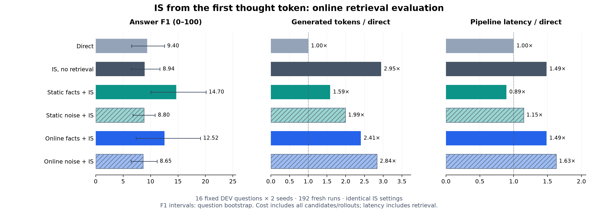

# 从起点 IS 在线注入：指标评测

[中文结果与配对分析](reports/RESULTS_ZH.md) · [结构化汇总](reports/summary.json) · [逐题逐种子分数](reports/scores.csv)



16 道固定 DEV 题、2 个种子、6 组，共 192 次全新原生运行；另有 12 次 TRAIN 完整性验证。
原 IS 算法、参数与在线注入实现未改动；本轮增加静态／等长噪声对照。
原生 EOS、空答案和截断保留。运行数据不包含 gold；参考答案仅在离线分析时读取。

包内保留冻结生成源码、配置、题目、原生轨迹、成本、源文件哈希与图表。
语料复用同仓库之前冻结的副本，位置和校验值见 inputs/corpus-reference.json。
tools 保存原工作区的部署脚本用于追溯，路径依赖原环境；raw 另有实际启动脚本和设备记录。

## 离线重放

安装项目基础依赖的 Python 3.12+ 环境中，在本目录执行（目标目录必须不存在）：

```sh
python replay.py --destination /path/to/new/replay
```

脚本先验证逐文件 SHA-256，再展开原生记录和冻结源码，重新执行完整审计与全部指标计算，要求输出逐字节一致。
可加 `--plot-python /path/to/plot/python` 重放并逐字节校验图表；对应依赖版本见 analysis/plot-requirements.txt。

这批题此前用于开发对照，不是新的独立测试集。F1 是词级重叠指标，不能替代人工语义正确率。
