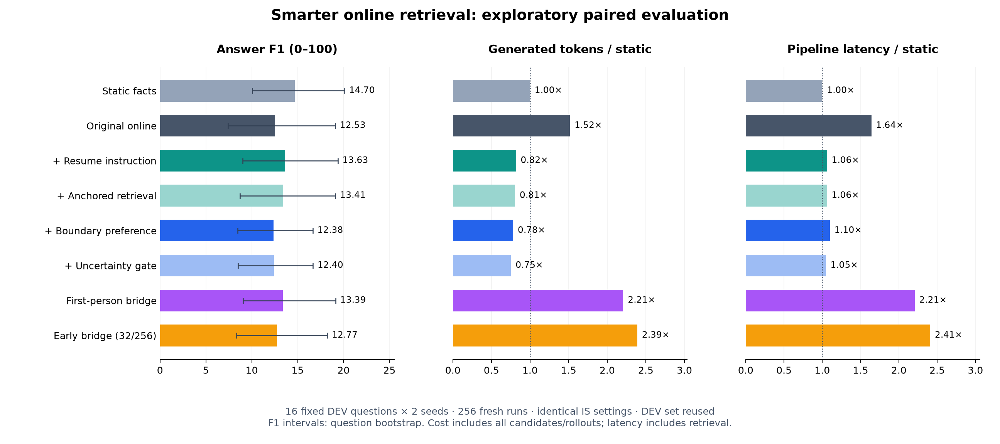

# 更智能的在线检索与注入：探索实验

[结论与实际轨迹解读](DISCUSSION_ZH.md) · [本轮指标与逐题结果](reports/RESULTS_ZH.md) · [上一轮失败轨迹诊断](baseline-analysis/BASELINE_DIAGNOSIS_ZH.md) · [TRAIN格式对照](pilot-analysis/PILOT_FORMAT_ZH.md)



固定16道DEV题、2个种子、8组，共256次全新运行。所有条件按问题在同一张卡上配对；本轮使用A0/A1/A3。
六种在线策略包含：继续推理提示、原问题占优的双查询融合与窗口去重、句末/换行优先注入、不确定性门控、未完成的第一人称续写桥接、提前到32/256的桥接。
静态事实与原在线注入均重新运行作为基线。详见 inputs/PROTOCOL.json。

原IS内核、SC评分、模型设置及预算不变；没有工具调用、额外检索代理生成或固定思考前缀。
保留自然EOS、空答案和截断，不重试或补答。输入证据及继续推理提示不计入思考token或SC评分，但记录输入成本。
正式生成前完成48次TRAIN原生完整性验证；此前另有36次六组TRAIN试验。本地测试与逐文件冻结信息见 local-validation.json。

首次TRAIN启动因runner参数签名不匹配，在第一条测量之前退出；失败日志与当时源码保存在 raw/smoke-failed-v1。
修正入口后，六组TRAIN试验发现命令式提示仍可能直接EOS，因此保留全部六组并增加第一人称桥接、提前桥接两组；此前试验完整保存在 raw/smoke-pilot-v1。最终八组再次完成48次完整性验证；没有丢弃或重跑任何正式测量。

## 复现

安装项目基础依赖后，在本目录运行（目标目录需不存在）：

```sh
python replay.py --destination /path/to/new/replay
```

脚本验证逐文件SHA-256，再用冻结源码重放候选请求、分支注入、概率门控、IS评分选择和答案读出，重新计算指标并要求逐字节一致。
加 `--plot-python /path/to/plot/python` 可重放图表，依赖版本见 analysis/plot-requirements.txt。
加 `--baseline-package ../online-injection-full-is-metrics-20261113` 可重放上一轮诊断的全部轨迹导出和报告。
原生重跑还需要既有模型、Ascend/vLLM环境和 inputs/corpus-reference.json 所指冻结语料。
tools 是原工作区部署脚本的来源记录；实际启动脚本与设备状态包含在原始归档中。

本轮方案基于已查看的DEV结果设计，因此属于开发集探索，不是独立留出测试。
F1为词级重叠，不能替代人工语义正确率。区间未对多重比较校正；边界策略还改变原生分段和派生随机流。
